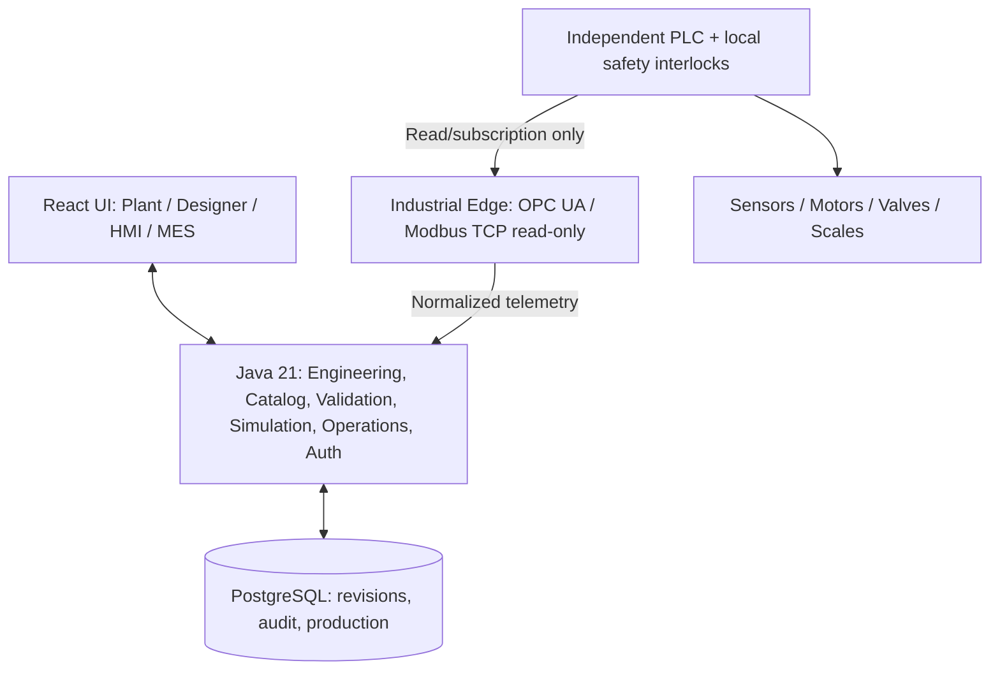
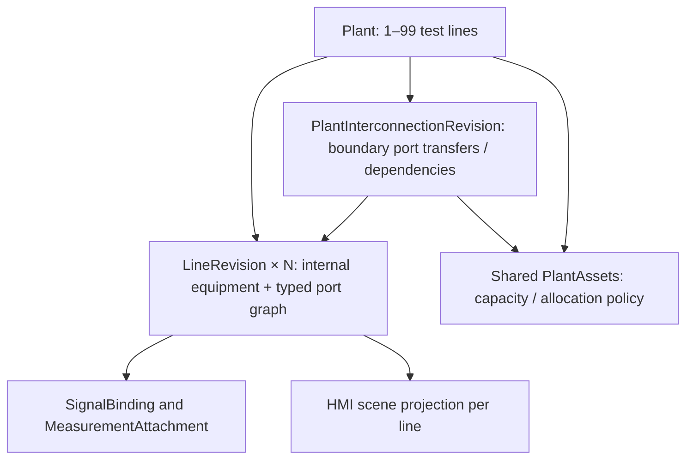

# ZAVOD INDUSTRIALOS — ЕДИНОЕ КАНОНИЧЕСКОЕ МАСТЕР-ТЗ

**Версия документа:** 0.3 (Consolidated Draft; R0.5Q review)  
**Дата baseline:** 13 ноября 2026  
**Статус:** DRAFT / требуется техническое, OT-инженерное и продуктовое ревью; не свидетельствует о реализации функций или промышленной сертификации.  
**Единственный нормативный файл требований:** `docs/ZAVOD-MASTER-SPEC.md`.  
**Репозиторий:** https://github.com/alimbetov/zavod  
**Порядок разработки:** Scenario Design → RED-тесты → Test Review → GREEN → Regression → Independent Review → PR → Merge.

> Этот документ объединяет прежние требования, модель, архитектуру, решения, безопасность, тесты, дорожную карту и исследования оборудования. Старые файлы удалены из рабочей ветки (сохранены в Git history). При конфликте формулировок приоритет имеют **решения раздела 0** и последующие согласованные изменения через PR/DEC. Нельзя заводить параллельные master/spec/roadmap файлы.

## 0. Согласованная продуктовая и техническая политика

| Вопрос | Решение / единая трактовка |
|---|---|
| Название | Zavod IndustrialOS |
| Тип продукта | Универсальный инженерный конструктор производства; в перспективе SCADA + MES + Industrial IoT |
| Первая реальная ценность | Инженер создаёт цифровую модель разных линий, проверяет соединения, тестирует виртуально и получает черновую HMI |
| Иерархия | Organization → Site → Plant → Line → LineRevision; общие PlantAsset и Controller существуют на уровне площадки/сайта |
| Число линий | В первой поставке 1–10 **активных** линий на площадке; DRAFT площадки без линий допустим. Лимит — конфигурируемая бизнес-политика, не физический предел БД. 100 линий — возможная будущая *нагрузочная цель*, не обещание |
| Тип производства | `Line.profileKey`: BATCH / CONTINUOUS / DISCRETE / UTILITY; один Plant может содержать разные процессы. `Plant.plantType` не определяет единственный тип всех линий |
| Общий физический ресурс | Один `PlantAsset`, ссылки от нескольких линий; проверка занятости/влияния при согласованной активации `PlantActivationSet` |
| Пилотные демонстрации | Бетонная BATCH + насосная CONTINUOUS; затем розлив/фасовка DISCRETE как третий профиль |
| Конструктор | **React + TypeScript + React Flow (@xyflow/react)**. Vaadin Flow в MVP **не используется** |
| Backend и домен | Java 21 + Spring Boot (модульный монолит), JPA/PostgreSQL позднее; критическая валидация выполняется на сервере, UI может показывать локальные подсказки |
| Интеграция | Отдельный site-local Industrial Edge, сначала OPC UA и Modbus TCP **строго read-only** |
| Контроль оборудования | PLC, safety PLC и защитные цепи остаются автономны; Java/Web/Cloud не отвечают за safety interlocks, E-stop, deterministic control |
| Рецептура | `RecipeRevision` относится к производственной процедуре/MES; `Mixer` объявляет capability (TIMED/RECIPE_CAPABLE/CONTINUOUS), но не хранит рецепты в шаблоне |
| Лицензии зависимостей | Только бесплатный для предполагаемого коммерческого использования OSS; **Apache-2.0 предпочтительно**, допускаются совместимые разрешительные MIT/BSD/ISC при сохранении уведомлений. Платные Pro-расширения не являются обязательной частью продукта |
| Лицензия собственного кода | Вопрос владельца проекта `DEC-16`; использование Apache-2.0 как собственной лицензии требует отдельного явного оформления `LICENSE`, не предполагается автоматически |
| Node.js | Только frontend toolchain (сборка/тесты), не производственный Backend и не PLC runtime |
| Разработка | Отдельные ветки и Draft PR, без автоматического merge; `main` менять только после review |

**Лицензии подтверждённых компонентов:** React и React Flow лицензированы по **MIT**, а не Apache-2.0; они допускают коммерческое применение при выполнении условий лицензии. Не записывать неверную лицензию в SBOM. Официальные первоисточники: https://github.com/react/react/blob/main/LICENSE и https://github.com/xyflow/xyflow/blob/main/README.md. Условия каждого пакета (включая транзитивные зависимости) проверяются при релизе; сохраняем LICENSE/NOTICE, SBOM и не допускаем неожиданные платные требования.

**Граница обязательств:** «функция в ТЗ» ≠ «функция реализована» ≠ «функция квалифицирована на заводе». Любое утверждение PASS требует логов и commit SHA.

## 1. Конечный сценарий и ценность продукта

**Главный пользовательский путь (North Star):**
1. Инженер создаёт предприятие/площадку и выбирает от 1 до 10 активных линий.
2. Для каждой линии выбирает профиль (например, бетонный Batch и насосный Continuous) либо пустой проект.
3. Из версионированного каталога помещает физические станки, композитные модули и общие ресурсы площадки.
4. Соединяет типизированные порты — материальные потоки, поток отдельных изделий, utilities, сигналы (не смешивать физику с привязкой PLC).
5. Настраивает параметры оборудования и проверяет схему; невалидный черновик сохраняется, но не публикуется и не исполняется.
6. Запускает изолированную сценарную симуляцию с виртуальными сигналами, без real PLC.
7. Получает черновую SCADA/HMI-мнемосхему, автоматически построенную из утверждённой инженерной модели; редактирует представление независимо от физической схемы.
8. Позднее подключает PLC read-only и получает измерения, состояния, alarm/historian с качеством и временем.
9. Позднее MES фиксирует задание, версию рецепта или процедуры, фактический выпуск и производственные отклонения.
10. Проект сохраняется/закрывается/открывается без потери связи оборудования, портов, line revision и shared assets.

**Конкурентное отличие:** простой инженерный No-Code Builder и retrofit существующих китайских и других OEM-линий с независимой автоматикой; не попытка сразу конкурировать количеством драйверов с зрелыми универсальными SCADA. Ценность должна быть доказана пилотом и интервью, а не объявлена автоматически.

### Модули продукта

| Модуль | Потребитель | Результат |
|---|---|---|
| **Zavod Designer** | Инженер | Технологическая топология, проверка, конфигурация и утверждённая ревизия |
| **Zavod SCADA** | Оператор | Мнемосхема, сигналы с provenance/quality, тревоги, тренды и historian |
| **Zavod MES** | Технолог/начальник смены | Заказы, версии рецептов, партии/операции, фактический расход и отчёты |
| **Zavod Edge** | Инженер интеграции | Нормализация read-only PLC данных, quality, локальный буфер |
| **Zavod Analytics (позже)** | Руководитель | Сводная статистика нескольких площадок; без зависимости локальной автоматики от облака |

### Уровни детализации

Физическая машина может быть *Station/Skid/Composite Unit* с вложенными двигателями, датчиками и приводами, но на общей схеме представляться одним узлом. Вложенная структура не должна создавать физические дубликаты.

**Измеримый первый результат:** инженер создаёт две линии (Batch Concrete и Continuous Pump) и один shared asset, проходит Validate → Simulate → Save → Reopen. Затем проверяем десять линий и отказ активации одиннадцатой. Производственная система без реального PLC на первом этапе.

---

## 2. Продуктовые требования и роли

### 1. Цель и позиционирование

Создать расширяемую платформу конфигурирования производственных линий и мониторинга, которая позволяет инженеру описать производственное оборудование, порты, материальные связи, сигналы и технологические ограничения независимо от производителя PLC. Первый полный демонстрационный профиль — бетонный завод; архитектура обязана одновременно поддерживать несколько разнотипных линий на одной площадке. Первая доступная для демонстрации вертикаль — бетонный завод (aggregate/cement/water/admixture → mixer → discharge). В перспективе — комбикорм, элеватор, насосная станция, водоподготовка, асфальт (по отдельным технологическим профилям).

Продукт состоит из логически независимых возможностей:
1. **Engineering Design**: визуальная схема, каталог оборудования, валидация, ревизии.
2. **Simulation**: детерминированная безопасная симуляция линии с виртуальными сигналами, а затем модель замеса.
3. **Edge Integration**: адаптеры к промышленным протоколам и нормализация сигналов, сначала только чтение.
4. **Manufacturing Operations**: рецепты, партии, задания, фактические данные, отчёты (после R1).
5. **Multi-site Visibility**: централизованная аналитика без зависимости локального процесса от облака (после R2).

### 2. Пользователи и полномочия

| Роль | Задачи | Не допускается |
|---|---|---|
| SYSTEM_ADMIN | пользователи, площадки, политики доступа | обход локальной системы безопасности |
| ENGINEER | каталог, линии, порты, инженерные версии, тесты | живые команды без commissioning |
| TECHNOLOGIST | рецепты и допустимые диапазоны после ввода модуля | изменение PLC interlocks |
| OPERATOR | обзор текущей линии, подтверждённые задания в будущем | изменение активной инженерной схемы |
| SUPERVISOR | отчёты, утверждение публикации, расследования | отключение safety interlocks |
| AUDITOR | история, журнал, выгрузки | модификация данных |
| SERVICE_ENGINEER | диагностика только при предоставленном доступе | неограниченный remote write |

В R0 автономный браузерный прототип не имеет реальной аутентификации: роли определяют целевой контракт R1, а не нынешние права доступа.

### 3. Бизнес-сценарии

- **UC-01** Инженер создаёт площадку, линию и черновик схемы.
- **UC-02** Из каталога размещает силос, бункеры, весы, конвейер, водомер/дозатор, бак добавок, смеситель, выгрузку.
- **UC-03** Соединяет явно выбранные входные/выходные порты с направлением и типом материала.
- **UC-04** Получает понятный список ошибок: занятый порт, несовместимая среда, обрыв, цикл, неподключённый обязательный вход, диапазоны параметров.
- **UC-05** Отменяет действие, сохраняет черновик, экспортирует/импортирует версионированную схему без потерь.
- **UC-06** Запускает только симуляцию валидированной схемы, наблюдает лог событий и воспроизводимый результат.
- **UC-07** В R1 отправляет проект схемы на инженерный review, публикует неизменяемую ревизию.
- **UC-08** В R2 подключает OPC UA/Modbus источник в read-only, связывает теги с оборудованием, видит качество и возраст данных.
- **UC-09** В будущем создаёт рецепт, задание и производственную партию с регистрацией фактических показателей.
- **UC-10** При потере связи локальная система и PLC продолжают действовать в безопасном независимом контуре.

---

## 3. Функциональные требования (FR)

### 1A. Универсальный Multi-Line / Multi-Industry Builder (новое P0 для R0.3)

**Новый продуктовый инвариант:** одна площадка Plant может иметь **1–10 активных линий разных типов**; DRAFT-площадка может иметь 0 линий, но не публикуется без хотя бы одной. Лимит 10 — первая продуктовая политика, а не ограничение базы данных, протокола или аппаратуры. Добавление 11-й активной линии должно быть отклонено на backend и в UI без удаления черновиков.

Технологический профиль `profileKey` принадлежит **Line**, а не единственному `Plant.plantType`. Пример одной площадки: бетонная BATCH, насосная CONTINUOUS, упаковочная DISCRETE. Для каждого профиля используются собственные требования, catalogue/validators, HMI и MES extensions; бетонные рецепты не обязательны на насосной линии.

Общие силосы, насосы, компрессоры и источники ресурсов являются `PlantAsset` с единым ID; линии содержат ссылки и интерфейсы, а не копии одного физического оборудования. Межлинейные конфликты и совместимость активных ревизий проверяются в `PlantActivationSet` до активации. Один PLC может обслуживать несколько линий, и одна линия может получать сигналы нескольких PLC.

**Новые требования:**

| ID | Приоритет | Требование | Приёмка |
|---|---|---|---|
| FR-ML-001 | P0 | Создание Plant с 1–10 активными линиями разных профилей | SC-ML-001…005 |
| FR-ML-002 | P0 | Независимый жизненный цикл LineRevision и общая согласованная PlantActivationSet | SC-ML-014, 016, 017 |
| FR-ML-003 | P0 | Общие PlantAsset с уникальной физической идентичностью и ресурсными ссылками | SC-ML-008, 009, 018 |
| FR-ML-004 | P1 | Сайт-уровневая N:M связь Controller ↔ Line через SignalBinding | SC-ML-006, 007 |
| FR-ML-005 | P0 | Версионированный каталог и минимум два полных профиля R0.3: BATCH concrete и CONTINUOUS pump | SC-ML-005, 011 |
| FR-ML-006 | P1 | Автоматическое создание HMI preview из утверждённой модели без PLC writes | SC-ML-010, 012, 013 |
| FR-ML-007 | P1 | Раздельные операторские экраны, сигналы, статусы и производственные метрики на каждую линию | SC-ML-012, 016, 019 |
| FR-ML-008 | P0 | Повторная проверка сохранения/восстановления и целостности связей между линиями | SC-ML-008, 015, 017 |

Полный дизайн, поля, границы подсистем и двадцать новых сценариев: Universal Industrial Builder R0.3 (раздел настоящего мастер-ТЗ). Этот документ дополняет **единое** мастер-ТЗ, не создаёт вторую нормативную версию.

### 4. Обязательные функциональные требования

#### 4.1 Конструктор и инженерная модель (R0.2 / P0)

| ID | Требование | Приёмочное свидетельство |
|---|---|---|
| FR-DES-001 | Создание/переименование/дублирование линий и редакций | UI + unit/e2e |
| FR-DES-002 | Drag & drop оборудования, zoom, pan, snap-to-grid, selection, delete | e2e |
| FR-DES-003 | Детерминированные уникальные стабильные UUID объектов, портов, соединений | unit |
| FR-DES-004 | Порты имеют собственные ID, направление, класс соединения, тип продукта, кратность и обязательность | unit |
| FR-DES-005 | Вода и химическая добавка подключаются к независимым входам смесителя | regression |
| FR-DES-006 | Поддержка ограничений числа связей: min/max для каждого порта и явные многовходовые устройства | property/unit |
| FR-DES-007 | Разделение «material-flow» графа и «signal/control» графа; визуальные координаты отдельно | schema/unit |
| FR-DES-008 | Валидация направлений, типов, единиц, повторяющихся ID, кратностей, обязательных портов, циклов и незавершённых путей | RED suite |
| FR-DES-009 | Запрет симуляции при blocking errors, сообщения об ошибках у конкретного узла/порта | e2e |
| FR-DES-010 | Undo/Redo с корректным восстановлением геометрии, портов и связей | unit/e2e |
| FR-DES-011 | Явные действия «Сохранить», «Экспорт JSON», «Импорт JSON»; резервное восстановление повреждённых черновиков | e2e |
| FR-DES-012 | Поддержка версий документа, миграция совместимых форматов и отказ на неподдерживаемых версиях без порчи данных | contract |
| FR-DES-013 | Подсветка выделенного оборудования, портов и причины несовместимости | e2e |
| FR-DES-014 | Базовая библиотека: silo, aggregate-bin, scale, conveyor, screw, water-tank, water-doser, additive-tank, additive-doser, mixer, discharge, valve | catalog tests |
| FR-DES-015 | Перенос схемы в новое окружение не должен изменять технологическую семантику | round-trip |

#### 4.2 Симулятор (R0.2 / P0)

| ID | Требование |
|---|---|
| FR-SIM-001 | Выполнение только в виртуальном пространстве без драйверов PLC |
| FR-SIM-002 | Воспроизводимое состояние с seed/time-scale и журналом шагов |
| FR-SIM-003 | Нельзя запустить при блокирующей ошибке целостности графа |
| FR-SIM-004 | Модели состояний IDLE, READY, RUNNING, COMPLETED, FAILED, STOPPED |
| FR-SIM-005 | Ошибки: переполнение, пустой источник, сломанный датчик, timeout (эмуляция) |
| FR-SIM-006 | Строгое разделение демонстрационной топологической анимации и физически осмысленного Digital Twin; первая не называется полноценной технологической симуляцией |

#### 4.3 Серверное проектирование (R1 / P1)

| ID | Требование |
|---|---|
| FR-SRV-001 | Tenant/Organization → Site → Plant → Line(profileKey) → LineRevision + PlantAsset/PlantActivationSet; изоляция прав |
| FR-SRV-002 | REST API, OpenAPI, серверная проверка DTO, RBAC |
| FR-SRV-003 | Черновики с optimistic locking / ETag; разрешение конфликтов параллельного редактирования |
| FR-SRV-004 | Неизменяемые опубликованные ревизии; approval, rollback через новую редакцию, а не переписывание истории |
| FR-SRV-005 | История изменений: who/when/what/reason; append-only audit |
| FR-SRV-006 | PostgreSQL и контролируемые миграции (Liquibase или Flyway — открытое решение DEC-06) |
| FR-SRV-007 | Проверка схемы на Backend; frontend не является единственным источником правил |

#### 4.4 Интеграция оборудования (R2 / P1)

| ID | Требование |
|---|---|
| FR-PLC-001 | Конфигурация устройства, endpoint, протокола, тега, типа и единицы измерения |
| FR-PLC-002 | OPC UA client read-only через адаптер; доверие сертификатам, политика шифрования |
| FR-PLC-003 | Modbus TCP reader с документированной register map, endianness, scale, timeout |
| FR-PLC-004 | Качество сигнала GOOD/BAD/UNCERTAIN, timestamp измерения и получения, staleness |
| FR-PLC-005 | Offline-first edge: локальная запись событий, retry/reconnect с backoff, ограниченная очередь |
| FR-PLC-006 | Simulator adapter полностью заменяет физический PLC в CI и тестовых стендах |
| FR-PLC-007 | Любые операции write/command по умолчанию запрещены и НЕ входят в R2 read-only |
| FR-PLC-008 | Потеря Backend/Cloud/Web не является причиной изменения безопасного состояния оборудования |

#### 4.5 Производственный учёт (R3 / P2)

Отдельные сущности RecipeDefinition/RecipeRevision, ProductionOrder, BatchRun, Weighment, MaterialLot, Consumption, Alarm и Shift. Для рецептов требуются версия, допуски, единицы и точная трассировка фактической дозировки. Принятие производственных команд и связь с PLC реализуются только после независимой оценки риска, FAT/SAT и допуска инженерной организации.

---

## 4. Универсальная библиотека и периферия

**Правило конфигурации:** `EquipmentType` с `key + version`, декларациями `Capability`, `Mode`, `PortDefinition`, `ParameterDefinition`, `SignalDefinition`, `hmiTemplateKey`; `EquipmentInstance` — размещённый экземпляр; `PlantAsset` — единый физический ресурс. Никаких классов `MixerWithRecipe` и `MixerWithoutRecipe` как отдельных фундаментальных сущностей.

- Типы смешивания: порционный Batch Mixer, Continuous Mixer, Inline/Static Mixer, Tank Agitator. `RecipeRevision` находится в MES, режим TIMED/RECIPE_CAPABLE/CONTINUOUS_SETPOINT — capability оборудования.
- Порты: `MATERIAL` (порошки/жидкости/гранулы), `ITEM_FLOW` (бутылки/короба/поддоны), `UTILITY` (вода, энергия, воздух), `INSTRUMENTATION/SIGNAL` (измерения), `CONTROL` (только будущие разрешённые действия; не равен физическому приводу).
- Порты имеют id/portKey, direction, medium/item type, min/max links, unit/capacity, optional required; порт `waterIn` и `admixtureIn` независимы.
- Датчик давления моделируется как измерительный компонент, а не по умолчанию трубопровод с входом/выходом воды. Проточный прибор может отдельно объявлять реальные технологические порты.
- Дублированные/занятые/несовместимые соединения, циклы без разрешённого recirculation-профиля, незаполненные обязательные входы блокируют публикацию/симуляцию.
- Переводы RU/KK/EN — через display keys; keys и единицы не зависят от языка.
- Для первых отраслевых профилей используем версионированные декларативные шаблоны, а не динамически загружаемый исполняемый код.

### Повторно используемая периферия

| Класс | Примеры | Телеметрия / параметры |
|---|---|---|
| Хранение | Силос, бункер, бак, накопитель | Объём/уровень/температура |
| Подача | Вакуумный загрузчик, шнек, вибропитатель | Расход, скорость, авария |
| Транспорт | Лента, роликовый/шнековый конвейер, элеватор, насос | Работа, производительность |
| Привод и пневматика | Двигатель, VFD, серво, цилиндр, клапан | Ток, частота, положение |
| Измерение | Весовой терминал, датчик уровня/давления, расходомер, фотоэлектрический датчик | Значение, единица, quality |
| Обработка | Смеситель, дробильная машина, экструдер, пресс, сушилка, фильтр | Операции, состояния, уставки |
| Упаковка | Фасовщик, наполнитель, укупорка, этикетировщик, маркиратор | Количество, цикл, отбраковка |
| Контроль качества | Чеквейер, металлодетектор, машинное зрение | Good/reject, причина |
| Общие utilities | Компрессор, аспирация, чиллер, гидростанция, водоснабжение | Давление, мощность, расход |
| Связь | PLC, local HMI, remote I/O, gateway | Firmware, протокол, связь, stale |

### Отраслевые шаблоны (предложения, а не готовая поддержка)

| Template key | Технологическая линия | Путь | Ввод |
|---|---|---|---|
| `batch.concrete.v1` | Бетон / строительные смеси | Бункер/силос → дозатор → миксер → выгрузка | Первый |
| `continuous.pump.v1` | Насос / водоподготовка | Ёмкость → насос → фильтр/клапан → измерения | Первый |
| `discrete.bottling.v1` | Розлив | Подача тары → наполнитель → укупорка → этикетка → контроль | Затем |
| `discrete.bagging.v1` | Весовая фасовка | Бункер → дозатор → упаковка → контроль веса | Затем |
| `batch.feed-pellet.v1` | Комбикорм | Дробилка → дозирование → миксер → грануляция → охладитель | P1 |
| `discrete.block-press.v1` | Блоки/кирпич/плитка | Смешивание → вибропресс → поддоны → выдержка | P1 |
| `continuous.plastic-recycling.v1` | Переработка пластика | Дробление → мойка → сушка → экструзия → гранулирование | P1 |
| `continuous.grain-processing.v1` | Зерно и крупы | Очистка → сепарация → обработка → сортировка → упаковка | P1 |
| `discrete.conveyor-sort.v1` | Конвейер/сортировка | Подача → обнаружение → сортировка → отвод | P1 |
| `discrete.bakery.v1` | Выпечка | Замес → деление → расстойка → печь → упаковка | P2 |

Профиль может содержать гибридные операции; `ProcessKind` является основной классификацией, а не запретом внутреннего сочетания Batch и Discrete. Предложение 10 шаблонов **не означает** обязанность иметь 10 линий одновременно.

Результаты ознакомления с китайскими поставщиками — **кандидаты рынка**, не подтверждённый рейтинг спроса/интероперабельности. Изучать прежде всего модель+прошивку OEM, доступные теги и протокол, интерфейсы HMI, схемы питания и actual I/O. Китайские PLC/HMI брендов Inovance, Xinje, Haiwell — кандидаты для будущего лабораторного read-only теста, не заявленная совместимость.

Источники примеров: https://www.inovance.com/product?typeId=1 ; https://www.xinje.com/web/solutionInfo/index?id=34 ; https://www.haiwell.com/about/haiwell-cn.html ; https://www.chanferpack.com/zh/equipment/ ; https://zcjxc.com.cn/new/2263.html ; https://www.klongchina.cn/products/ ; https://www.yizumi.com/en/news/product/IMM/guide-how-to-choose-a-pet-preform-injection-molding-machine.

### Интеграционные варианты оборудования

`SIMULATED` (без реального PLC); `READ_ONLY_CONNECTED` (контроллер/шлюз, измерения с quality); `MANUAL_REPORTING` (внесение результата для нецифрового станка с явной маркировкой). Никакой автоматической подмены ручного значения фактической телеметрией.

---

## 5. Единая инженерная и доменная модель

### 1. Bounded Contexts

- **Engineering**: EquipmentTemplate, EquipmentInstance, PortTemplate, EquipmentPort, MaterialConnection, Line, LineRevision, ValidationFinding.
- **Automation Mapping**: Device, DeviceEndpoint, ProtocolDriver, SignalDefinition, SignalBinding, SignalObservation.
- **Simulation**: SimulationScenario, SimulationRun, VirtualPlantState, SimulationEvent.
- **Manufacturing** (будущее): Material, MaterialLot, RecipeRevision, ProductionOrder, BatchRun, Weighment, Consumption, Alarm.
- **Identity/Organization** (R1): Tenant, Site, Plant, User, Role, Approval, AuditEvent.

Не путать EquipmentTemplate (тип из каталога) и EquipmentInstance (физическая установка на конкретной линии). Типизацией физических портов нельзя подменять PLC-адреса.

### 2. Основная модель

| Сущность | Ключевые поля | Инварианты |
|---|---|---|
| Tenant | id, name, status | данные площадок изолированы |
| Site | id, tenantId, timezone | site принадлежит одному tenant |
| Plant | id, siteId, maxActiveLines, status | технологически нейтрален; первая редакция ограничивает до 10 активных линий |
| Line | id, plantId, name, profileKey, activeRevisionId | профиль процесса определяет валидаторы конкретной линии; активная ревизия опубликована |
| LineRevision | id, lineId, revisionNo, status, schemaVersion, contentHash, createdBy, approvedBy | опубликованная версия неизменяема |
| EquipmentTemplate | templateKey, templateVersion, class, capabilities, defaultPorts, parameterSchema | template version фиксируется в ревизии |
| EquipmentInstance | id, templateKey/version, name, parameters, visualPosition, plantAssetRef? | equipmentId уникален в revision; физический общий актив не дублируется |
| EquipmentPort | id, equipmentId, portKey, direction, connectionKind, media, minLinks, maxLinks, required | порт принадлежит одному оборудованию |
| MaterialConnection | id, sourceEquipmentId/PortId, targetEquipmentId/PortId, medium, properties | соблюдены направления, совместимость, лимиты |
| SignalDefinition | id, deviceId, address, protocolDataType, unit, accessMode | адрес не заменяет семантический signalKey |
| SignalBinding | id, revisionId, equipmentId, signalKey, signalDefinitionId, conversion | bind to target property, immutable by revision |
| ValidationFinding | code, severity, entityRef, messageKey, details | blocking flag объективен и проверяем |
| SimulationRun | id, revisionHash, seed, state, startedAt, finishedAt | воспроизводим, без связи с PLC |
| AuditEvent | id, actor, action, entity, beforeHash, afterHash, timestamp | append-only (R1) |

### 3. Виды графов — нельзя смешивать

1. **Process/material flow graph**: физически перемещаемая среда, направление, порты, агрегаты.
2. **Instrumentation/signal graph**: датчики и команды, теги, device endpoints, semantics.
3. **Layout graph**: координаты и размеры блоков, маршруты визуальных рёбер; не определяют реальную длину труб/ленты.
4. **Procedure graph** (R3): последовательность фаз/операций; отдельно от физической связности.

Изменение визуальной позиции не меняет технологическую валидность; изменение типа или кратности порта — меняет.

### 4. Модель портов

Каждый тип оборудования содержит объявленные порты с:
- portKey и displayName; direction: IN/OUT/BIDIRECTIONAL (для material P0 используются только IN/OUT).
- connectionKind: MATERIAL/UTILITY/SIGNAL/CONTROL (на первом этапе материальные связи проверяются отдельно).
- medium: CEMENT, AGGREGATE, WATER, ADMIXTURE, CONCRETE, OTHER; возможность профилей и иерархии сред.
- minConnections/maxConnections: числовые ограничения, 0..N; required определяется minConnections > 0.
- capacity/flowRate и единицу измерения (после R0.2); allowableRange и допустимые агрегатные свойства — отдельные ограничения.
- порты идентифицируются по equipmentInstanceId + portKey, а не только общему слову liquid.

**Принципиальный пример:** Mixer имеет независимые порты cementIn, aggregatesIn, waterIn, admixtureIn (опциональность химической добавки определяется профилем) и concreteOut. Вода и добавка — разные технологические среды; два потока не занимают один порт.

### 5. Инварианты соединений

- source и target существуют в одной LineRevision и не совпадают по ID.
- OUT → IN; разрешённые классы соединения; medium совместим с обоими портами.
- Для P0 не допускаются параллельные дубликаты (sourcePortId,targetPortId), кроме явно моделируемой раздельной физической линии.
- min/maxConnections для каждого порта соблюдаются при статусе READY; допустима временная неполнота DRAFT.
- Самосвязи и циклы материалопотока запрещены по умолчанию; процессы с recirculation включаются только отдельным типом оборудования/правилом профиля.
- Если компонент питается от нескольких источников, нужен явно поддерживаемый multi-in port или соответствующее устройство; никаких скрытых fan-in.
- Unknown equipment type, schemaVersion или единица измерения при импорте — fail-closed, без подмены.
- Проверка готовности к запуску отдельно от проверки, можно ли сохранить черновик.

### 6. Состояния и ревизии

LineRevision: DRAFT → IN_REVIEW → APPROVED → PUBLISHED → SUPERSEDED; при отклонении из IN_REVIEW → DRAFT, запрет редактирования APPROVED/PUBLISHED. Rollback создаёт новую редакцию на основе предыдущей, а не переписывает опубликованную.

SimulationRun: CREATED → VALIDATING → READY → RUNNING → COMPLETED / FAILED / STOPPED. Старт из статуса READY, только при отсутствии блокирующих ошибок. Реальное оборудование ни при каком статусе SimulationRun не затрагивается.

### 7. Рецептурная модель (поздний этап)

RecipeRevision: productCode, targetOutput, ingredientLines(materialId, quantity, unit, tolerance), mixingTime, qualityConstraints. Decimal arithmetic, фиксирование версии на BatchRun. Нельзя «горячо» менять рецепт выполняемого замеса. Фактические масса/время/качество записываются как отдельные измерения с источником и временем.

### 8. Конкретный путь данных для бетонной линии

AggregateBin → AggregateScale → Conveyor → Mixer.  
CementSilo → CementScale → Mixer.  
WaterTank → WaterDoser → Mixer.  
AdmixtureTank → AdmixtureDoser → Mixer.  
Mixer → Discharge.

Наличие отдельного AdmixtureDoser и точный состав обязательных линий для MVP уточнить в DEC-02. Количество физических портов не должно кодироваться как «один общий liquid».

### 9. Контракт сериализации

Будущий серверный документ LineDefinition schemaVersion=3 **не считать совместимым с JSON v2 прототипа R0.1 до реализации мигратора**. Содержит identity, revision metadata, catalogVersion, equipment[], ports[], materialConnections[], layout, optional signalBindings[]; timestamps ISO 8601 UTC. Перед импортом: parse → version check → schema validate → domain validate → preview → transactional save. Сохранение неизвестных полей: только явно разрешённая extension-область. Никакого silent fallback на демосхему при повреждении пользовательского файла.

### 10. Расширение: 1–10 разнотипных линий и общие ресурсы (R0.3)

**Нормативная корректировка прежнего предположения:** `Plant.plantType` удаляется как единственный обязательный тип производства. `Line.profileKey` выбирается независимо для каждой линии: `batch.concrete.v1`, `continuous.pump.v1`, `discrete.packaging.v1` и т.д. Завод может иметь несколько разнотипных линий, в том числе совместно работающих.

**Plant resource context:**
- `PlantAsset(id, plantId, assetCode, equipmentTypeRef, technicalProperties, activeVersion)` — единый физический объект общего пользования.
- `ResourceAllocation(id, plantAssetId, lineId, allocationKind, capacityConstraint)` — ссылка от линии, а не дублирование агрегата; пересечение эксклюзивных ресурсов — блокирующая ошибка активации.
- `PlantActivationSet(id, plantId, lineRevisionRefs, sharedAssetVersionRefs, state)` — атомарно проверяемая комбинация активных конфигураций. Действующая линия не перезаписывается; изменение общего ресурса требует impact analysis на зависимые линии.
- `Controller` привязан к `Site`; независимые `SignalBinding` связывают сигналы одного/нескольких PLC с оборудованием одной/нескольких линий (N:M).
- `HmiScene` — воспроизводимая проекция утверждённой топологии и каталожных HMI шаблонов; presentation override с независимыми IDs.

**Модельные правила:**
1. `Plant` с 0 линий может быть DRAFT, но не PUBLISHED/ACTIVE; требуется 1–10 активных линий в первой продуктовой редакции.
2. Лимит `maxActiveLines=10` — конфигурируемая продуктовая политика, и валидация на backend обязательна; не фиксировать лимит размером массивов/таблиц.
3. `LineRevision` нельзя активировать в обход `PlantActivationSet`, если она зависит от общего ресурса или другой линии.
4. Межлинейная физическая связь описывается через PlantAsset/интерфейс ресурса; ребро `MaterialConnection` внутри линии не должно напрямую ссылаться на чужую LineRevision.
5. Профильная MES-семантика не навязывается другим процессам: `RecipeRevision` требуется только для batch профилей, если это определено validator.
6. Отдельные ошибки `LINE_LIMIT_EXCEEDED`, `RESOURCE_CONFLICT`, `INCOMPATIBLE_ACTIVE_REVISIONS`, `CROSS_PLANT_REFERENCE` возвращают идентификаторы затронутых объектов.

См. [Universal Industrial Builder R0.3](universal-industrial-builder-R0-3.md) — сценарий инженера, подробный контракт и staged rollout.

---

## 6. Технологическая архитектура и политика без оверинжиниринга

**Первый runtime:** React/Vite frontend + чистое Java 21 domain ядро; после квалификации UI — один Spring Boot MVC modular-monolith + PostgreSQL. Отдельный локальный Edge вводится только на этапе read-only PLC.

**Java остаётся единым источником серверной доменной валидации**, TypeScript — интерактивный графический слой. Не плодить отдельные несовместимые определения правил: версия JSON Schema/DTO, fixtures и contract tests должны согласовываться с Java. Для воспроизводимости фиксировать версии JDK/Node/package-lock и покрывать production build.

**Не вводить в MVP:** микросервисы, Kafka, Redis, Kubernetes, multi-tenant billing, динамическую произвольную JVM/PLC plugin-систему, ML и «универсальный Digital Twin». TimescaleDB, MQTT Sparkplug B, централизованная аналитика — после телеметрических замеров и требований пилота.

**Вопрос Vaadin Flow:** для форм/справочников возможен, но не используется в первой версии. React Flow выбран именно для графа узлов/портов/рёбер/zoom/pan; второй UI-стек без измеримой выгоды исключён.

### Границы доменных модулей

- **engineering** — Plant, ProductionLine, LineRevision, PlantActivationSet, physical topology and approval.
- **catalog** — EquipmentType, version, capabilities, port schema, LineProfile.
- **shared-resources** — shared PlantAsset, resource interfaces, impact analysis.
- **simulation** — виртуальный state machine и журнал событий; никаких драйверов PLC.
- **automation** — Controller, SignalDefinition/Binding/Observation, identity/quality.
- **scada** — HMI projections, alarming, historian (R2).
- **operations / batch** — orders, production executions, recipes and traceability (R3).
- **identity / audit** — site scoped RBAC, audit and configuration approval (R1).
- **edge** — отдельно развёртываемый адаптер OPC UA/Modbus read-only (R2).

### Протокольный контракт

`SignalObservation(siteId, deviceId, signalKey, value, unit, sourceTimestamp, receivedAt, quality, sequence, provenance)`; `quality ∈ {GOOD, UNCERTAIN, BAD, STALE}` с явно описанной семантикой STALE как derived display status. Сырые адреса PLC никогда не становятся стабильными инженерными идентификаторами оборудования. Один PLC может обслуживать несколько линий, и линия может читать несколько PLC (N:M через binding).

### Версионирование и хранение

- `LineDefinition schemaVersion=3` — **целевая**, пока несовместимость с прежним автономным JSON v1/v2 должна разрешаться явным мигратором с golden fixtures.
- `DRAFT → IN_REVIEW → APPROVED → PUBLISHED → SUPERSEDED`; публикация immutable; rollback как новая revision.
- `PlantActivationSet` связывает совместимые активные ревизии линий и общих ресурсов, проверяет конфликты перед активацией.
- JSONB snapshot + реляционные ключевые индексы (после R1); optimistic locking/ETag, transaction audit.
- UTC события; TZ как атрибут Site; decimal и явная unit conversion для массы/объёма.
- R0 localStorage — временный черновик с recovery, не промышленный архив.

### 1. Слои системы

~~~text
[Engineering Web UI — React + TypeScript, React Flow]
        | HTTPS / REST (R1) / WebSocket read model (R2)
[Plant Management Backend — Java 21 + Spring Boot]
        | PostgreSQL (versioned configs, audit, recipes, operations)
        | internal auth + policy / outbox if required
[Industrial Edge Gateway — отдельный сервис на plant LAN]
        | OPC UA client READ-ONLY (R2) / Modbus TCP reader (R2)
        | bounded buffering, normalized telemetry, health
[PLC & local HMI / Safety PLC — отдельные trust/safety boundaries]
        | fieldbus / local IO (PROFINET, EtherNet/IP, Modbus, etc.)
[Sensors, scales, valves, motors, mixer, emergency circuits]

[Optional Site → Central analytics] only outbound authenticated,
never necessary for local equipment safety or machine operation.
~~~

Архитектура поддерживает один site on-premise первым; multi-tenant и fleet management — целевая модель, не техническое оправдание для преждевременного усложнения R0.

### 2. Граница ответственности

| Уровень | Выполняет | Не выполняет |
|---|---|---|
| React Editor | чертёж, настройки, ошибки, симуляция | циклическое управление PLC |
| Spring Boot | версии схем, учёт, права, API, audit | interlocks, real-time control |
| Edge Gateway | чтение тегов, нормализация, качество, очередь | safety-critical logic |
| PLC | последовательности и взаимодействие с I/O в локальном контуре | зависимость от облака |
| Safety circuits | аварийный останов / защитные отключения | управление через веб-запрос |

При остановке Backend/Cloud/Browser PLC и защитные контуры должны сохранять безопасную независимую работоспособность согласно проекту OEM и site-specific HAZOP/risk assessment.

### 3. Технологический стек (выбор для реализации)

- Frontend: React, TypeScript, Vite, React Flow; тесты Vitest + React Testing Library + Playwright.
- Backend: Java 21, Spring Boot MVC, Bean Validation, Spring Security, Spring Data JPA, PostgreSQL; Testcontainers.
- Миграции БД: контролируемые, инструмент определяется DEC-06.
- Edge: отдельный Java процесс/контейнер на Industrial PC, plugin-like protocol adapter SPI; Eclipse Milo как кандидат OPC UA.
- Telemetry: в R2 локальный PostgreSQL для начала; TimescaleDB/MQTT Sparkplug B — только при доказанной необходимости и после baseline нагрузки.
- Integration: OPC UA с серверными сертификатами и allowlist; Modbus TCP только в изолированной OT-сети и строго READ-ONLY.
- Observability: structured logs, Micrometer/Prometheus (по необходимости), correlation IDs, health/readiness.
- Deployment: локальная площадка может работать без Интернета; внешняя аналитика факультативна.

### 4. Предлагаемые границы модулей

frontend/line-designer — canvas, palette, inspector, validation panel, history.  
shared/line-schema — versioned JSON schema, types, migration fixtures.  
backend/engineering — lines, revisions, catalog, approvals, audit.  
backend/production — orders, recipes, batches (позже).  
edge/adapter-core — SignalObservation, adapter lifecycle, subscriptions, quality.  
edge/adapter-opcua; edge/adapter-modbus; edge/adapter-simulator — отдельные реализации.  
testing/fixtures — valid/invalid line graphs, simulated devices.

В R0 допускается монолит фронтенда с изолированным domain; дробление на микросервисы до фактической необходимости запрещено архитектурным решением.

### 5. API-контракт (целевые примеры, R1)

| Метод | Endpoint | Семантика |
|---|---|---|
| GET | /api/v1/sites/{siteId}/plants | доступные установки |
| POST | /api/v1/plants/{plantId}/lines | создание Line |
| GET | /api/v1/lines/{lineId}/revisions | список редакций |
| POST | /api/v1/lines/{lineId}/revisions | новый DRAFT |
| PUT | /api/v1/revisions/{revId} | запись при If-Match, optimistic lock |
| POST | /api/v1/revisions/{revId}/validate | общий server-side validator |
| POST | /api/v1/revisions/{revId}/submit | перевод в review |
| POST | /api/v1/revisions/{revId}/approve | утверждение по роли |
| GET | /api/v1/catalog/equipment | библиотека шаблонов |
| GET | /api/v1/revisions/{revId}/audit | записи изменений |

Ошибки — Problem Details, стабильный errorCode, binding к entity/port, никакого leak endpoint credentials.

### 6. Edge contract (R2)

SignalObservation = {siteId, deviceId, signalKey, value, unit, sourceTimestamp, receivedAt, quality, sequence, provenance}. В R2 доступен только outbound read. Gateway соблюдает bounded queue, reconnect с backoff/jitter, refresh certificate lifecycle, distinct connected/disconnected/stale. Отсутствие данных нельзя интерпретировать как ноль. Write endpoints отсутствуют.

### 7. Данные и целостность

- Конфигурация линии хранится как versioned JSONB snapshot + реляционная индексация основных сущностей (детали по профилированию).
- Иммутабельные опубликованные версии, транзакционный audit, optimistic locking.
- Клиентское localStorage R0 — лишь черновик, не архив и не single source of truth после R1.
- Резервное копирование/восстановление должно быть протестировано прежде производственного применения.
- Время UTC, local TZ как атрибут Site, числа для массы/объёма в decimal с явной unit conversion.

### 8. Переходы и архитектурные ограничения

R0.2: никаких реальных PLC драйверов и Backend.  
R1: серверное хранение/права/ревизии, но нет PLC-control.  
R2: реальная телеметрия только read-only, site network isolation.  
R3: технологический учёт, а машинные команды — отдельный safety-gated workstream и без обещания готовности на этапе проектирования.

Стандарты для проектирования границ: ISA-88, ISA-95, ISA/IEC 62443 и NIST SP 800-82 Rev.3; соответствие стандартам требует отдельного аудита.

---

## 7. Интерфейс и пользовательские рабочие области

### 5. UX, языки и единицы

- Desktop-first инженерный редактор; операторский экран должен отличаться от экрана редактирования.
- Левое меню — каталог с поиском; центр — схема; справа — свойства; снизу — ошибки и события.
- Русский интерфейс в пилоте, архитектура переводов ru/kk/en. Все пользовательские сообщения через ключи i18n.
- Единицы хранятся канонически: kg, m3, L, s, °C и др. Дисплейная единица отдельно от расчётной; запрещено складывать несовместимые физические величины.
- Статусы и тревоги кодируются не только цветом; доступность с клавиатуры и понятные подписи.
- При импорте файл валидируется до замены текущего проекта; нужна возможность предварительного просмотра.

### 7. Designer UX / workflow

**Plant overview:** list 1–10 lines, type icon, engineering status, runtime quality, draft/active revision and last event. Add Line button displays templates + empty line. Disable *Activate* above limit; allow preserving an extra inactive draft until scope decision.

**Line Designer:** left equipment palette scoped by profile, center graph, right typed property/port editor, bottom validation findings. Support multi-select, undo/redo, copy/paste, saving invalid drafts, import preview, stable IDs and cross-line assets as reference nodes.

**HMI Preview:** auto-generate readonly visualization from approved engineering revision and equipment HMI templates. Distinguish a synthetic/virtual signal from physical signal by visible provenance and interface banner. Edit visual overrides separately; do not conflate canvas geometry and plant topology.

**Simulation:** virtual sensor model with seed, bounded step count and recorded events, no production PLC adapters in build/dependencies. Simulate each line independently first; later a plant-level simulation can reason about shared resources.

**Operations:** a generic execution records line, revision, operator, time, production quantity and status, with profile-specific payloads. Batch, discrete and continuous extensions may use different performance metrics.

### 10. Product acceptance demonstration (target outcome)

Demo plant «Pilot-Z» has:
- Line A: concrete BATCH, silos/scales/mixer, virtual batch records.
- Line B: pump CONTINUOUS, tank/pump/flow/pressure sensors.
- One shared utility asset referenced by both.
- Both lines visible on Plant Overview, independently editable and simulated.
- HMI scenes generated from approved engineering revision with virtual signal quality badges.
- Save → close → reopen → same schema/links/IDs, no lost references.
- Separate test creates ten valid lines; adding an eleventh active line fails with explainable error.
- No connection to physical PLC, no safety or commissioning claims.

**Definition of Done:** artifacts exist in repo, RED→GREEN tests and browser journey evidence, no undocumented cross-line state, independent engineering/security review for future OT connectivity.

---

## 8. SCADA, MES и производственная прослеживаемость

### Различие трёх продуктовых модулей

| Модуль | Вопрос клиента | Конечный артефакт |
|---|---|---|
| Zavod Designer | Из каких компонентов и соединений состоит линия? | Утверждённая ревизия инженерной модели |
| Zavod SCADA | Что происходит с оборудованием сейчас и какие есть тревоги? | Live HMI, сигналы с качеством/временем, historian, журнал alarms |
| Zavod MES | Что было заказано, сколько произведено и из чего? | Заказ, версия рецепта, batch record, расход/отклонения/отчёт смены |

Технологически это **три модуля на одном инженерном registry**, а не три отдельные несвязанные программы.

### Два принципиальных процесса

#### Engineering Change Control
`DRAFT → REVIEW → APPROVED → ACTIVE → SUPERSEDED/ARCHIVED`

Запрет активации без проверки обязательных соединений, прав, миграций и тестовой валидации. Действующая ревизия и ревизия, использованная при партии, неизменяемы.

#### Batch Traceability
`ProductionOrder → ApprovedRecipeVersion → PLC Batch Events → ActualMeasurements → BatchRecord → MaterialReconciliation`

При обрывах связи учитываем качество данных и неполные партии явно, а не додумываем их статусы в MES. Номинальные и фактические дозы хранятся отдельно.

### Метрики успеха для первого пилота

- Время подключения от списка сигналов до первого HMI.
- Доля партий с полным и непротиворечивым batch record.
- Сходимость отчётов Zavod с проверенными журналами и калиброванными весами.
- Время ручного заполнения отчётности за смену «до/после».
- Время обнаружения потери/устаревания сигнала.
- Ноль неразрешённых записей в PLC и подтверждённая автономность control loop.

Численные SLO/ROI определяются после пилота, не объявляются достигнутыми.

### 7. Что НЕ входит в R0

Прямая выдача команд в PLC, аварийный останов, safety PLC, SIL/PL сертификация, real-time motion/drive control, удалённое управление через облако, полноценные P&ID/электрические CAD, автоматическая генерация PLC ladder/program, бухгалтерия, ERP, прогнозирующий ML и сертифицированный Digital Twin. Эти направления потребуют отдельного ТЗ и инженерной приёмки.

---

## 9. OT-безопасность и кибербезопасность

### 1. Fundamental safety boundary

IndustrialOS R0/R1/R2 проектируется как инженерный редактор, безопасный симулятор, конфигурационный сервис и шлюз **read-only телеметрии**. Нельзя описывать его как промышленный safety controller или replacement PLC/HMI. Безопасное циклическое управление, interlocks, E-stop, пусковые цепи, permissive checks, защита электродвигателей, контроль уровня/давления/температуры и все safety-critical функции выполняются локально независимым, квалифицированным контроллером и физическими защитными устройствами согласно проекту объекта.

Потеря Java Backend, браузера, Ethernet, облака или gateway не должна отключать, обходить либо деградировать локальные защитные блокировки. Источником истины для состояния оборудования является PLC/local system; UI отображает измерения с качеством и возрастом данных.

### 2. Классификация режимов

| Режим | Взаимодействие с реальным PLC | Разрешение |
|---|---|---|
| DESIGN | отсутствует | R0 |
| SIMULATION | отсутствует, только виртуальные устройства | R0 |
| SHADOW_READ_ONLY | OPC UA/Modbus чтение, no writes, no method invocation | R2, после допуска на стенд |
| COMMISSIONED_MONITORING | промышленная сеть, наблюдение в эксплуатации, no writes | после SAT monitoring |
| COMMAND_CAPABLE (будущий) | ограниченные allowlisted команды через независимый PLC-контур | отдельное ТЗ/HAZOP/FAT/SAT и approval |
| SAFETY_LOGIC | недопустима в Java/Web/Cloud | никогда |

Запрет записи должен обеспечиваться не только выключенной UI-кнопкой: права учётной записи PLC, сетевые ACL, read-only adapter SPI, отсутствие write API и интеграционные негативные тесты.

### 3. Threat model и границы доверия

Актуальные угрозы: подмена конфигурации линии, компрометация сервисной учётной записи, проникновение из IT в OT, небезопасный удалённый доступ, replay/duplicate telemetry, timestamp spoofing, loss of communication, неверный register mapping, нарушение полноты журнала, ошибочная интерпретация BAD quality как реального значения, отказ датчика, устаревшие сертификаты.

Минимальные зоны:
- OT Field: датчики, приводы, физические E-stop.
- OT Control: PLC/local HMI/safety controller.
- Industrial DMZ / Edge: шлюз, ограниченный однонаправленный логический поток телеметрии; реальную сетевую односторонность не заявлять без соответствующих средств.
- Plant IT: management backend и engineering browser.
- Optional enterprise/cloud: только через контролируемый шлюз, никакого прямого доступа к PLC.

Классические firewalls/VLAN/ACL, разрешённые направления трафика, отдельные сервисные учётные записи, deny by default, VPN + MFA для авторизованного сервисного доступа. Никаких публичных OPC UA/Modbus endpoint.

### 4. Требования к OPC UA / Modbus

OPC UA:
- Защищённый канал, верификация сертификата и application identity, endpoint allowlist.
- Запрет insecure SecurityPolicy=None для реального deployment за исключением документированного изолированного лабораторного стенда.
- Только Subscription/Read в R2; write/method calls отсутствуют в коде или блокируются аппаратными/ACL ограничениями.
- Качество и sourceTimestamp обязательны; при BAD/UNCERTAIN явное отображение.

Modbus TCP:
- Не рассчитывать на встроенную аутентификацию классического Modbus TCP; изоляция подсети и сетевые ACL обязательны.
- Разрешать только read function codes на уровне адаптера и сети где возможно, отсутствие writes в интерфейсе; read-only binding credentials не всегда реализуемы конкретным PLC, поэтому усиливать сетевые и организационные меры.
- Endianness, подписанность, масштаб, регистр и unit выбираются на основании официальной карты производителя и тестируются с симулятором.

Никаких runtime-перепривязок тегов в production без ревизии, review и commissioning.

### 5. Secure development / operational requirements

- RBAC least privilege, утверждение публикации схемы отдельной ролью, аудит actor/time/oldHash/newHash.
- Сертификаты/секреты вне git, секреты в конфигурации с ограниченными правами, ротация и отзыв.
- TLS для интерфейсов IT; mTLS для соединений между доверенными сервисами по оценке рисков.
- SBOM, dependency/vulnerability scanning, подпись релизных артефактов по мере введения production.
- Параметры telemetry: GOOD/BAD/UNCERTAIN, stale age, device disconnect и lastSeen; старые данные не показывать как live.
- Rate limit, bounded queues, backpressure, retry jitter, circuit breaker по месту; в случае перегрузки деградирует UI/телеметрия, а не локальная безопасность.
- Логи не содержат паролей, секретов PLC, приватных ключей и raw access tokens.
- Отдельные backup/restore, incident response и patch window; любое обновление на объекте с rollback-plan.
- При расхождении часов фиксировать разницу, source/device timestamp и time received, не подделывать «текущее» измерение.

### 6. Условия для будущей возможности команд

До первого write должны быть оформлены и утверждены:
1. Технологическое описание конкретной установки и OEM-документация.
2. HAZOP / risk assessment + hazards and mitigations, согласованные ответственным инженером.
3. Command matrix: кто, когда, что, как подтверждает, допустимое состояние PLC, ограничения диапазона.
4. PLC-side validation/permissives/interlocks и независимый E-stop.
5. Локальная авторизация, запрет команд из публичного облака, временные разрешения и audit command/ack.
6. Safe failure states, потеря связи, duplicate command, replay, stale state, partial failure.
7. FAT на стенде, затем SAT на объекте, испытания восстановления, план обслуживания.
8. Юридическое/регуляторное соответствие применимое к конкретной стране и машине.
9. Письменная приёмка ответственным инженерным владельцем.

До выполнения всех пунктов — **NO-GO** на команды реальному оборудованию.

---

## 10. Нефункциональные требования и performance targets

### 6. Нефункциональные требования (кандидатные, подлежат нагрузочной квалификации)

| ID | Метрика / условие | Цель и проверка |
|---|---|---|
| NFR-01 | Редактор | 100 узлов / 150 связей: p95 действий интерфейса ≤ 300 мс на согласованном эталонном ноутбуке, Playwright tracing |
| NFR-02 | Восстановление | После принудительного закрытия браузера восстановление последнего подтверждённого черновика, тест crash recovery |
| NFR-03 | Целостность | 100% сохранения семантики при JSON round-trip на поддерживаемых версиях |
| NFR-04 | API | p95 ≤ 500 мс на чтение конфигурации при 20 конкурентных инженерах и согласованном тестовом окружении |
| NFR-05 | Edge | При разрыве связи никакой команды в PLC; диагностика DEGRADED и STALE, bounded buffers |
| NFR-06 | Безопасность | Чёткие роли, аудит, секреты вне исходников, TLS/mTLS по границам |
| NFR-07 | Наблюдаемость | Health, structured logs, metrics, trace/correlation IDs без чувствительных секретов |
| NFR-08 | Тестируемость | Повторяемые unit/contract/e2e/integration тесты; критерии Gate в отдельном документе |
| NFR-09 | Данные | UTC хранение событий; локальная TZ только в отображении; decimal для массы и объёма |
| NFR-10 | Развёртывание | Локальный plant edge способен работать при отсутствии подключения к Интернету |

Эти показатели — проектные SLO для стенда, не гарантии производственной безопасности или реального времени.

---

## 11. Приёмочные сценарии, CI и Test Review

### 1. Матрица сценариев R0.2 (обязательные)

| Scenario | Требование | Given / When / Then | Уровень |
|---|---|---|---|
| SC-LD-001 | FR-DES-001/002 | пустая линия → инженер добавляет Silo и Scale → два объекта с устойчивыми ID на canvas | E2E |
| SC-LD-002 | FR-DES-004/008 | Silo.OUT(CEMENT) → Scale.IN(CEMENT) → валидная связь | Unit |
| SC-LD-003 | FR-DES-008 | Water.OUT(WATER) → CementScale.IN(CEMENT) → BLOCKING incompatible-medium | Unit |
| SC-LD-004 | FR-DES-005 | Mixer.waterIn уже занят; подключаем AdditiveDoser к Mixer.admixtureIn → обе линии существуют независимо | Regression |
| SC-LD-005 | FR-DES-006/008 | порт maxLinks=1 занят → вторая попытка подключения отклонена без изменения графа | Unit |
| SC-LD-006 | FR-DES-008 | Два identical source/target port edges → обнаружен duplicate | Unit |
| SC-LD-007 | FR-DES-008 | MaterialFlow A→B→C→A → blocker unless explicitly declared recirculation profile | Unit |
| SC-LD-008 | FR-DES-008/009 | Mixer требует воду и цемент, но вода отсутствует → validation ERROR, симуляция не стартует | E2E |
| SC-LD-009 | FR-DES-008 | Два equipment instances имеют один ID → BLOCKING duplicate-id | Unit |
| SC-LD-010 | FR-DES-010 | удаление узла с 2 рёбрами и Undo → исходная структура и портовые ссылки восстановлены | E2E |
| SC-LD-011 | FR-DES-011 | повреждённый local draft → предложение восстановления, не молчаливое затирание демосхемой | E2E |
| SC-LD-012 | FR-DES-011/012 | импорт неверного JSON → текущий проект не изменился | E2E |
| SC-LD-013 | FR-DES-012/015 | валидная схема → export/import → одинаковая нормализованная семантика, несмотря на порядок JSON полей | Contract |
| SC-LD-014 | FR-DES-012 | unknown schema version → explicit error, без частичной загрузки | Contract |
| SC-LD-015 | FR-DES-012 | old prototype JSON v1/v2 → поддерживаемый мигратор или явный отказ без потерь; никакой silent conversion | Contract |
| SC-LD-016 | FR-DES-007 | только перемещение блока → доменные порты и соединения неизменны | Unit |
| SC-LD-017 | FR-SIM-001 | симуляция R0 активна → OPC UA/Modbus sockets и драйверы не используются | Security |
| SC-LD-018 | FR-SIM-002 | одинаковые версия/seed/параметры → идентичная последовательность simulation events | Unit |
| SC-LD-019 | FR-SIM-003 | blocking graph error → START disabled + domain start rejected | Unit/E2E |
| SC-LD-020 | FR-DES-013 | попытка недопустимой связи → подсветка обоих портов и конкретный код ошибки | E2E |
| SC-LD-021 | FR-DES-014 | все каталожные шаблоны имеют уникальные keys и валидную портовую декларацию | Unit |
| SC-LD-022 | NFR-01 | 100 узлов + 150 связей на эталонном стенде → p95 UI actions ≤ 300ms | Performance |

### 2. R1 — Backend и права

| Scenario | Given / When / Then |
|---|---|
| SC-BE-001 | ENGINEER создаёт DRAFT; опубликованный результат не изменяется |
| SC-BE-002 | параллельные изменения с одинаковым ETag → одна операция успешна, другая 409/412 |
| SC-BE-003 | пользователь Tenant A пытается открыть линию Tenant B → 403/404 без утечки |
| SC-BE-004 | DRAFT → IN_REVIEW → APPROVED → PUBLISHED только правильными ролями |
| SC-BE-005 | попытка модифицировать PUBLISHED → отказ; rollback создаёт новую версию |
| SC-BE-006 | API получает документ с портовым конфликтом → server-side rejection |
| SC-BE-007 | трансакция публикации падает → audit/activeRevision не расходятся |
| SC-BE-008 | повторная загрузка после сбоя → восстановленный snapshot hash совпадает |
| SC-BE-009 | Testcontainers PostgreSQL: constraints, optimistic locking, isolation, audit |

### 3. R2 — Read-only Edge

| Scenario | Given / When / Then |
|---|---|
| SC-EDGE-001 | OPC UA Simulator publishes tag; Gateway emits correct unit, timestamp, quality |
| SC-EDGE-002 | Device offline → no stale value rendered as GOOD/live |
| SC-EDGE-003 | Reconnect with retry/backoff → no uncontrolled reconnection storm |
| SC-EDGE-004 | Modbus words/endian/scale map tested on known fixtures |
| SC-EDGE-005 | Attempt write via Adapter SPI/API → no write implementation reachable |
| SC-EDGE-006 | loss of backend → bounded queue, no unbounded OOM, no PLC command |
| SC-EDGE-007 | invalid certificate/unknown OPC UA endpoint → connection refused |
| SC-EDGE-008 | duplicate/out-of-order observations → explicit sequence handling |
| SC-EDGE-009 | disconnect network, kill Edge, kill Browser → PLC simulation interlocks unaffected |

### 3A. R0.3 — Multi-Line / Multi-Industry Builder (новые RED-контракты)

Группа **SC-ML-001…020** детализирована в Universal Industrial Builder R0.3 (раздел настоящего мастер-ТЗ), §8. Это 20 **запланированных**, ещё не исполненных сценариев сверх базовых 40. Требуется отдельный Test Review.

| Критический тест | Ожидаемый результат |
|---|---|
| SC-ML-001/002 | 1 и 10 активных линий успешно проходят валидацию, в том числе смесь BATCH и CONTINUOUS |
| SC-ML-003/004 | 11-я активная линия заблокирована по первоначальной продуктовой политике; DRAFT не повреждён; пустой DRAFT сохраняется, но не активируется |
| SC-ML-005 | Рецепт обязателен только в профиле, который его требует, например BATCH; для насосной линии он не навязывается |
| SC-ML-006/007 | Один PLC допускает read-only-привязки от нескольких линий; линия — от нескольких PLC |
| SC-ML-008/009/018 | Общий PlantAsset не дублируется; конфликтующая заявка блокирует активацию; показано влияние изменения ресурса |
| SC-ML-010/011/013 | HMI layout и регенерация не изменяют материальные связи; шаблоны и overrides версионируются |
| SC-ML-012 | HMI различает VIRTUAL/REAL и GOOD/BAD/STALE, показывает источник и временную метку |
| SC-ML-014/016/017 | Несогласованные ревизии линий и общего оборудования не активируются |
| SC-ML-015 | Межплощадочный доступ к ресурсам/тегам отклонён сервером |
| SC-ML-019/020 | Производственные результаты ссылаются на нужные ревизии; read-only контур не отправляет физических команд |

**Масштабируемость:** `maxActiveLines=10` — значение политик для первой поставки, **не константа в доменной модели или схеме БД**. Отдельный будущий benchmark может проверять 20/50/100 линий на согласованном сервере и профиле телеметрии; это не обещание поддержки 100 линий в MVP.

### Дополнительные RED-сценарии R0.3 — SC-ML-001…020

| ID | Ожидаемый результат |
|---|---|
| SC-ML-001 | Plant с одной Batch линией → допустимая активация |
| SC-ML-002 | Plant с 10 разнотипными линиями → успешная проверка совместимых ревизий |
| SC-ML-003 | 11-я активная линия → доменная ошибка `LINE_LIMIT_EXCEEDED`, черновик не потерян |
| SC-ML-004 | Plant DRAFT без линий сохраняется, но не активируется |
| SC-ML-005 | Concrete Batch и Pump Continuous соседствуют; насос не требует бетонного рецепта |
| SC-ML-006 | Один Controller связан с сигналами двух линий, без копирования контроллера |
| SC-ML-007 | Одна линия читает два PLC, без неявных write-команд |
| SC-ML-008 | Две линии ссылаются на один физический PlantAsset |
| SC-ML-009 | Конфликт эксклюзивного ресурса → блокирующая ошибка `SHARED_RESOURCE_CONFLICT` |
| SC-ML-010 | Перемещение HMI-виджета не меняет инженерный граф/SignalBinding |
| SC-ML-011 | Новая версия EquipmentTemplate не меняет уже ACTIVE LineRevision |
| SC-ML-012 | HMI показывает VIRTUAL/BAD/STALE и timestamp/источник |
| SC-ML-013 | Повторная генерация HMI сохраняет идентичность согласованных overrides |
| SC-ML-014 | Неполный DRAFT допустим; RUN/PUBLISH с блокирующей ошибкой запрещён |
| SC-ML-015 | Cross-plant asset/tag ссылки отклоняются на сервере |
| SC-ML-016 | Изменение Line B не изменяет APPROVED Line A |
| SC-ML-017 | Несовместимые версии общего ресурса и линий не активируются |
| SC-ML-018 | Изменение shared asset приводит к межлинейному impact report |
| SC-ML-019 | BatchRecord ссылается на exact PlantActivationSet, LineRevision, RecipeRevision и provenance |
| SC-ML-020 | Отказ UI/Backend/Edge не меняет независимые PLC interlocks; никаких write |

### Дополнительные RED-сценарии периферии (кандидаты)

| ID | Ожидаемый результат |
|---|---|
| SC-PER-001 | ITEM_FLOW не соединяется с несовместимым MATERIAL портом |
| SC-PER-002 | Композитная упаковочная станция содержит вложенные sensor/drive, не дублирует PlantAsset |
| SC-PER-003 | Две линии ссылаются на один компрессор, сохраняя единый assetId |
| SC-PER-004 | PLC и ручные источники на одной линии имеют различимую provenance |
| SC-PER-005 | pcs/h и kg/h не смешиваются без явной и проверенной конверсии |
| SC-PER-006 | Timed Mixer может работать без RecipeRevision, если профиль не требует рецепта |
| SC-PER-007 | Датчик давления не подразумевает материальный flow-through |
| SC-PER-008 | Политика 10 активных линий и сохранение дополнительного DRAFT |
| SC-PER-009 | Автогенератор HMI не создаёт PLC write и не обозначает виртуальный сигнал как реальный |
| SC-PER-010 | JSON round-trip сохраняет каталожные версии, порты, ссылки на общий ресурс |

Новые сценарии **не исполнены**. Они дополняют первоначальные 40 (SC-LD-001…022, SC-BE-001…009, SC-EDGE-001…009) и 20 SC-ML — всего **70 запланированных сценарных контрактов**, а не 70 успешных тестов.

### 4. Test pyramid / обязательные CI checks

**R0.2:**
1. npm ci на фиксированном lockfile.
2. npm run typecheck / lint / format check.
3. unit + property-based tests валидаторов/миграции/портов.
4. production build.
5. Playwright smoke: создание схемы, неправильная связь, восстановление, импорт/экспорт, Undo.
6. JSON fixtures golden tests (valid, invalid, legacy).
7. SCA/dependency scanning; no known critical vulnerabilities без документированного исключения.
8. Проверка, что R0 не импортирует production PLC/edge drivers.

**R1:**
JUnit 5 + Spring Boot tests, Testcontainers PostgreSQL, Flyway/Liquibase migration test, REST security/ABAC, optimistic locking, audit integrity, backup/restore, contract tests и API docs check.

**R2:**
Protocol simulators and negative write tests, certificate rejection, malformed payloads, QoS/staleness, disconnect/restart/backpressure tests, penetration review.

### 5. Quality Gates и verdict

| Gate | Условие PASS |
|---|---|
| G0 Specification | все P0 требования имеют измеримый сценарий, владелец определён |
| G1 Test Review | независимый reviewer утверждает RED-контракт и test oracles |
| G2 Implementation | RED → GREEN, все требуемые тесты, линтер, типы и сборка зелёные |
| G3 Integration | импорт/экспорт, deterministic simulation, миграции и recovery проходят |
| G4 OT Safety (R2) | успешные негативные write-тесты, сетевые правила, режим read-only подтверждены |
| G5 Release | review без нерешённых P0/P1 дефектов, зафиксирован SHA и evidence |

Вердикты: PASS, FAIL, BLOCKED, NOT_RUN, NOT_APPLICABLE; слово PASS применять только к фактически выполненной проверке с логами, окружением и commit SHA. На R0.1 ранее упоминались 18 пройденных доменных тестов отдельного архива: **это историческая информация, не CI-результат репозитория Zavod**.

### 6. Evidence template

- Commit SHA / Branch / PR:
- Tool versions, OS, browser, DB/PLC simulator versions:
- Setup and fixtures:
- List of test IDs executed:
- Results PASS/FAIL/BLOCKED and logs:
- Architecture/security review:
- Known defects and severity:
- Recommendation GO / NO-GO:
- Sign-off by reviewer:

Нет автоматического merge при частичных PASS или BLOCKED. Любое изменение бизнес-инварианта требует обновить сценарий и RED-тест до реализации.

---

## 12. Roadmap и квалификация релизов

### Current baseline

- GitHub repo Zavod был пустым до создания документации 2026-11-13.
- В предыдущем обсуждении был подготовлен отдельный архив Line Designer R0.1 (React/TS), с 11 шаблонами и 18 доменными тестами. Он **не импортирован в Zavod**; любые утверждения о его работоспособности внутри данного repo требуют повторной проверки.
- Текущая задача PR: согласовать ТЗ, модель, safety-boundaries и тестовый план.

### R0.1-IMPORT — принять исходный прототип в репозиторий

Содержимое: импорт исходников отдельным feature PR, pin Node/npm versions, package-lock, build scripts, CI, тестовые evidence. Сопоставление JSON v1/v2, выявление и фиксация расхождений после ревью. Нельзя смешивать импорт с изменением доменной семантики, пока не получены baseline CI results.

Exit criteria: чистая сборка и все зафиксированные unit/e2e smoke, воспроизводимый запуск на macOS/Linux, отчёт о дефектах.

### R0.2 — Engineering Line Designer [P0]

Этапы:
1. Scenario Design с 22 SC-LD и инженером-рецензентом.
2. RED-тесты портов, обязательных входов, материала и безопасности симулятора.
3. Версионированный каталог оборудования: типов, параметров, портов и единиц.
4. Инженерная валидация графа; отдельная проверка READY.
5. UI: подключение к конкретным портам, ошибки, Undo/Redo, импорт preview/recovery.
6. Детерминированная симуляция и журнал шагов (не физическое управление).
7. CI + скриншотные E2E, документация миграций.

Exit criteria: Gate G0–G3, нет P0-блокеров; демонстрационная схема бетонного завода может независимо подключить цемент, инертные, воду и химическую добавку при соответствующем профиле.

### R1.0 — Java foundation & versioned engineering storage [P1]

- Spring Boot MVC + Java 21, PostgreSQL, управляемые миграции.
- Tenant/Site/Plant/Line/Revision, API, RBAC, append-only audit.
- Server-side validation, optimistic locking, approvals, immutable publication.
- Contract and Testcontainers integration tests.
- Frontend подключается к Backend вместо единственного localStorage, поддерживает offline draft/конфликты.
- Не содержит доступа к PLC.

Exit criteria: Gate G0–G3 + SC-BE-001…009, квалификация backup/restore.

### R2.0 — Simulator Gateway and OPC UA read-only [P1]

- Adapter SPI, OPC UA simulator, воспроизводимый test harness.
- Gateway read-only, quality/sourceTimestamp/staleness, сертификаты и discovery policy.
- Site-level deployment and network ACL, disconnect tests.
- Read-only подключение к первому реальному контроллеру **только после approval**.

Exit criteria: Gate G4, SC-EDGE-001…003/005…009, протокол испытаний без write.

### R2.1 — Modbus TCP read-only and multi-device inventory [P1]

- Register map, byte/word ordering, scaling, unit tests.
- Ошибки датчиков, диагностика с качеством и журнал событий.
- Нет команд в PLC; MQTT Sparkplug B в P2, только если обоснована необходимость.

Exit criteria: SC-EDGE-004, повторная security/OT проверка.

### R3.0 — Batch operations / concrete plant [P2]

- Catalog материалов, версионированные рецепты, заказы на производство, фактические замесы и сменные отчёты.
- ISA-88-подобное разделение recipe/equipment/procedure; ISA-95 уровни интеграции.
- Read-only reconciliation факта из PLC допустимо раньше, чем write.
- Write-capable контур управления — **другой workstream** с HAZOP/FAT/SAT и отдельным GO/NO-GO.

Exit criteria: трассируемость recipe revision → batch → измерения, неизменяемые записи, инженерная приёмка.

### R4+ — Multi-site analytics [P2 / не в текущем ТЗ MVP]

- Fleet dashboard, SLA и аналитика, атрибуция downtime.
- Опциональный MQTT Sparkplug B/TimeSeries storage.
- ML для прогнозов — только после накопления качественной телеметрии и измерения экономического эффекта.

### Sequencing and dependency rules

R0.1-IMPORT → R0.2 → R1.0 → R2.0 → R2.1 → R3.0 → R4+.  
Запрещены: direct PLC write до приёмки, публикация mutable revision, смешивание UI и технологической/safety логики, автоматический merge без evidence.

### Первая серия задач

- Issue A: аудит и импорт R0.1 + CI baseline.
- Issue B: Scenario Design + RED tests портов и графа.
- Issue C: domain/catalog schemaVersion 3 + import/migration policy.
- Issue D: React Flow порты, undo/redo и ошибки.
- Issue E: deterministic simulator с изолированным VirtualPLC.
- Issue F: независимое R0.2 qualification review.

Все номера Issue и PR назначаются GitHub после создания; документ не притворяется уже созданными задачами.

### Уточнение последовательности вертикальной реализации

1. **R0.1-IMPORT** — импорт автономного React R0.1; lockfile, typecheck, unit, build, Playwright; повторная квалификация baseline.
2. **R0.2** — Java equipment/port/line graph + корректные физические порты/обязательные входы, undo/redo, safe simulation, validator.
3. **R0.3A** — Plant 1–10 active lines, две разнотипные линии, shared PlantAsset без реализации управления общим ресурсом.
4. **R0.3B** — HMI preview из APPROVED revision, equipment declarative templates + layout overrides; третья упаковочная линия с ITEM_FLOW как proof of universality.
5. **R1** — Spring Boot/PostgreSQL, backend validation, auth, immutable revision, PlantActivationSet, audit.
6. **R2** — virtual OPC UA → read-only реальный пилот, quality, alarm, historian; Modbus TCP reader.
7. **R3** — MES recipe/order/batch для бетонного производства, generic execution для других линий, фактические сигналы с provenance.
8. **R4 command mode (отдельный GO)** — только site-qualified limited supervisory intents после hazard analysis, PLC-side permissives и FAT/SAT.
9. **R5 fleet** — multi-site, другие пакеты, телеметрическая аналитика после доказанной пользы.

**Не менять scope R0.2 на сотни каталожных типов.** Подтверждённые 15 Java типов и два профиля в Draft PR #2 — достаточная начальная база.

### Статус реализации на дату baseline

| Артефакт | Статус |
|---|---|
| GitHub PR #1 (документация) | Draft / review не завершён |
| GitHub PR #2 (`feat/r0-smart-equipment-library`) | Draft; Java 21, 15 типов, 2 профиля; `catalog-smoke` GitHub Actions PASS на `0df0bb23243aa5b1511d34b8aa93f2fe66da8c2f` |
| Старый React Line Designer R0.1 | Отдельный архив, **не импортирован** в этот репозиторий |
| Line Graph + multi-line + HMI generator | Только требования, не реализация |
| Backend Spring Boot/PostgreSQL | Не реализован |
| OPC UA/Modbus Edge | Не реализован |
| MES production execution | Не реализован |
| Real PLC commands | Не разрешены и не реализованы |

**Тестовое свидетельство:** 18 smoke checks — не 18 независимых E2E/интеграционных тестов. Любое заявление о production readiness требует дополнительных gate evidence.

---

## 13. Решения, реестр DEC и проектные ограничения

| ID | Приоритет | Вопрос | Предлагаемое прагматичное решение | Блокирует |
|---|---|---|---|---|
| DEC-01 | P0 | Первая версия: бетонный завод или другой процесс? | Бетонный batch plant, одна демонстрационная линия | R0.2 scope |
| DEC-02 | P0 | Минимальный набор узлов и обязательность добавки? | Cement, aggregate, water, mixer, discharge обязательны; admixture опциональна по рецептуре, отдельный физический порт всегда существует | Catalog/validator |
| DEC-03 | P0 | Рециркуляция и циклы? | Запрет по умолчанию, разрешение только профилем типа оборудования и отдельным тестом | Graph validator |
| DEC-04 | P0 | Каноническая версия LineDefinition и v1/v2 миграция? | Определить schemaVersion=3; миграции через fixtures, reject unsupported | R0.2 import |
| DEC-05 | P0 | Кто утверждает инженерную схему? | ENGINEER составляет; SUPERVISOR/назначенный engineering reviewer утверждает, запрет self-approval для production | R1 RBAC |
| DEC-06 | P1 | Инструмент миграций Spring Boot БД? | Flyway или Liquibase; один выбранный инструмент, без ddl-auto=update в прод | R1 |
| DEC-07 | P1 | Первый PLC и протокол тестового стенда? | OPC UA simulator сначала; затем один реальный model/vendor под read-only, device mapping после инвентаризации | R2 |
| DEC-08 | P1 | Регион и безопасность при внедрении? | Пилот в Казахстане, оценка требований владельца объекта и местных норм до SAT | Live site |
| DEC-09 | P1 | Offline режим и частота синхронизации? | локальный edge автономный; cloud необязателен; данные передавать по политике site | R2 |
| DEC-10 | P1 | Параметры давления, температур, плотности, дозировки? | type-specific Quantity с unit + range, catalog profile per industry | R0.2/R3 |
| DEC-11 | P2 | MQTT Sparkplug B и time series storage? | не вводить до необходимости multi-site потоков и нагрузочных измерений | R4 |
| DEC-12 | P1 | Лицензирование и multi-tenant SaaS? | архитектурная изоляция Site/Tenant предусмотрена, SaaS billing не в R0/R1 | коммерческий релиз |
| DEC-13 | P1 | Требования к SCADA/P&ID и символам ISO? | R0 только functional process layout, не сертифицированный P&ID | UX |
| DEC-14 | P1 | Требуется ли browser/desktop app? | Browser-first на локальном industrial PC, desktop packaging только после UAT | Deployment |
| DEC-15 | P0 | Критерии допуска команд в оборудование? | Команды запрещены до отдельного ТЗ, независимой оценки риска, FAT/SAT и одобрения инженера | любой PLC write |

### Процесс принятия решений

1. Для каждого DEC сохранить решение, 2 альтернативы, последствия и тестовый оракул.
2. Проверить согласованность с R0-master-spec, domain-model, OT-safety.
3. Утвердить на PR с owner и датой; закрытие DEC обновляет документы и тесты в одном PR.
4. Если DEC меняет опасность или границу PLC — отдельное safety review, обычного code review недостаточно.

### Главная неопределённость пилота

Пока не определены конкретный производитель PLC, модель контроллера, схемы подключения, I/O карта, протокол, допустимость удалённого подключения и инженер, отвечающий за реальный завод. Поэтому обещать управление настоящей установкой или совместимость с любым PLC нельзя.

### Дополнительные проектные решения

| ID | Статус | Правило |
|---|---|---|
| DEC-ML-01 | Proposed | `maxActiveLines=10` — политический лимит выпуска, не техническая константа модели |
| DEC-ML-02 | Proposed | Общая машина — один PlantAsset с несколькими ссылками |
| DEC-ML-03 | Proposed | Site Controller и Line связаны через SignalBinding N:M |
| DEC-ML-04 | Proposed | Line PUBLISHED отдельно от согласованного PlantActivationSet ACTIVE |
| DEC-ML-05 | Proposed | В R0.3 только виртуальные сигналы; будущие реальные — read-only |
| DEC-ML-06 | Proposed | Вначале два инженерно качественных отраслевых профиля, остальные поэтапно |
| DEC-16 | Open | Лицензирование **собственного** исходного кода Zavod: Apache-2.0 либо другой вариант, решение владельца и отдельный LICENSE |
| DEC-17 | Proposed | Frontend React + React Flow, **не Vaadin Flow**; допустимы бесплатные Apache-2.0/MIT/BSD/ISC зависимости после license audit |
| DEC-18 | Proposed | Второй контрольный отраслевой профиль — Continuous Pump; третий — фасовка/розлив для ITEM_FLOW |

### Рассмотренные альтернативы

| Альтернатива | Почему не выбрана как первая |
|---|---|
| Сразу заменить PLC + HMI | риск безопасности, отсутствует проверенная инженерная компетенция и доступ к стенду |
| Только дашборд телеметрии | не формирует универсальную доменную модель линии |
| Сразу микросервисы / Kafka | избыточная стоимость и эксплуатационная нагрузка на старте |
| Привязка к одному Siemens/ОВЕН | лишает обещанной мультивендорности |
| Только frontend без серверных ревизий | недостаточна прослеживаемость для multi-user engineering |

### Последствия

Плюсы: переносимость каталога, независимое тестирование без оборудования, контролируемая стоимость и безопасность. Минусы: потребуется реальная работа с картами регистров/сертификатами и инженерная экспертиза, будущий commissioning может потребовать OEM-specific адаптеров.

### Признаки пересмотра

Первые реальные объекты используют недоступные по сети протоколы; промышленный инженер отклоняет портовую модель; не достигаются SLO интерфейса; другой стандарт безопасности обязателен по конкретной юрисдикции. Тогда новое ADR с trade-off и migration plan.

---

## 14. Трассировка требований

### 8. Трассировка и согласование

Для каждого FR обязательна связь Scenario ID → Requirement ID → Test ID → PR → CI run → Review verdict. Любое изменение производственной семантики требует изменения версии схемы и тестовых оракулов. Документ считается утверждённым только после закрытия P0-решений в реестре DEC (раздел настоящего мастер-ТЗ) и независимого ревью.

**Обязательная матрица:** `FR-xxx → SC-xxx → TEST-xxx → PR → CI evidence (SHA) → verdict → reviewer`. Идентификаторы из исторических документов сохраняются. Не переименовывать SC-LD, SC-BE, SC-EDGE, SC-ML без миграционной таблицы.

---

## 15. Принятые ограничения, альтернативы и контроль изменений

**Отклонённые решения для текущего этапа:** Cloud-only SCADA; прямой web-to-PLC; замена safety PLC; микросервисы/Kafka в R0; несколько взаимоисключающих доменных моделей в React и Java; исключительно бетонный тип Plant; один общий liquid-порт смесителя; Vaadin Flow как обязательный конструктор.

**Причины:** повышенные эксплуатационные риски OT, дублирование предметной логики, усложнение UX и сопровождения, стоимость инфраструктуры без подтверждённой ценности. Риск безопасности для будущих PLC-команд рассматривается отдельно.

**Открытые блокеры:** конкретный OEM/PLC + firmware и разрешённая read-only интеграция, реальные материалы и технологические допуски, ответственный PLC инженер/владелец производства, формат и утверждение рецептов, security review, отраслевые особенности страны/площадки, результаты пилотных интервью и E2E.

**Принятие изменения ТЗ:** issue/DEC → сценарии → PR diff в **этом файле** → review → согласованное изменение тестов → merge. При пересмотре OT границ обязательно отдельное safety review. Документ нормативный внутри проекта после утверждения, но **не заменяет применимые местные нормы, технологический проект, FAT/SAT, HAZOP, SIL/PL assessment и OEM документацию**.

## 16. Нормативные ориентиры и исследования

- ISA-95 / IEC 62264: https://www.isa.org/standards-and-publications/isa-standards/isa-95-standard
- ISA-88 / IEC 61512: https://www.isa.org/standards-and-publications/isa-standards/isa-88-standards
- ISA/IEC 62443: https://www.isa.org/standards-and-publications/isa-standards/isa-iec-62443-series-of-standards
- NIST SP 800-82 Rev.3 FINAL: https://csrc.nist.gov/pubs/sp/800/82/r3/final
- OPC UA reference: https://reference.opcfoundation.org/
- Modbus: https://www.modbus.org/modbus-specifications
- Eclipse Sparkplug B: https://sparkplug.eclipse.org/specification/
- License React (MIT): https://github.com/react/react/blob/main/LICENSE
- License React Flow (MIT): https://github.com/xyflow/xyflow/blob/main/README.md
- Региональные промышленные нормы/допуски/инструкции конкретного объекта должны быть получены и проверены до пилота.

**Исторический provenance:** консолидация 11 прежних файлов из ветки `docs/r0-industrialos-master-spec` коммит `3ecba55aa1e10fce79f58b16ed8e7c44b62ce957`. Прежние `docs/requirements`, `docs/architecture`, `docs/security`, `docs/testing`, `docs/roadmap`, `docs/decisions`, `docs/strategy` сохранены в Git history, но текущий нормативный файл один.

---

## 17. R0.4 — эксперимент Plant Scenario Lab: 1–99 взаимосвязанных линий

**Статус:** проектная архитектура + синтетический лабораторный эксперимент; **не** утверждение о промышленной готовности, пропускной способности или совместимости PLC. Исходники: `src/main/java/kz/zavod/lab/`, тесты `src/test/java/kz/zavod/lab/`. Веточный CI должен быть подтверждён до ревью.

### 17.1 Цель эксперимента и политика масштабирования

Проверить технологическую универсальность при **1, 10, 50, 99 одновременно описанных линиях**, уникальном структурном наборе оборудования, межлинейных передачах, зависимостях и общих ресурсах. Проверка 99 — только **нагрузочный профиль модели**, а не жёсткий предел в API, БД или самой доменной модели.

**MVP** остаётся `maxActiveLines=10` на площадку; политика `maxActiveLines` является конфигурационным и проверяемым бизнес-правилом. Режим тестового стенда выставляет 99 и не требует новой архитектуры. Наличие 99 модельных линий не гарантирует выдерживание 99 PLC/потоков телеметрии/операторов — это другие виды нагрузочного тестирования.

**Структурная уникальность линии в эксперименте** определена как fingerprint, построенный из типа процесса, списка типов оборудования, технологического графа связей и измерительных привязок **без lineId/nodeId**. Уникальные человеческие названия не считаются доказательством уникальных паттернов. В рабочем продукте одинаковые паттерны разрешены: требование уникальности относится только к генератору тестовых случаев.

### 17.2 Правильная иерархия графов

1. **LineGraph:** собственные EquipmentInstance, версионированные EquipmentType, физические ports, internal directed connections, port cardinality/medium validator. Линия публикует контракты `LineBoundaryPort` и имеет независимую `LineRevision`.
2. **InterLineGraph:** связи только через явно названные граничные порты. `MaterialTransfer` проверяет направление, класс среды, совместимость и лимиты fan-in/fan-out; **позже** должен иметь binding к физическому входу/выходу и количественный баланс. `ProcessDependency` задаёт предусловия выполнения и отдельно от физического перемещения продукции.
3. **SharedResourceGraph:** `PlantAsset` с единой физической идентичностью, заявки `ResourceDemand`, ограничения доступной мощности; локальный симулятор — справедливое моделирование ожидания, **не PLC-переключатель**.
4. **InstrumentationGraph:** сенсор/измерение прикрепляется к объекту `MeasurementAttachment`; нельзя моделировать датчик давления как обязательный материальный проточный узел. `SignalBinding` и физические PLC-адреса — следующая ступень.
5. **Presentation/HMI Graph:** независимая проекция с layout, zoom, группировкой и отображением состояний; **не** определяет реальные технологические связи.

**Не делать один гигантский React Flow canvas на 99 линий.** Разделить `Plant Overview` (сводка 99 линий, зависимости, общие ресурсы) и `Line Designer` (открытая одна линия и её локальный граф), загружать и валидировать изменившиеся части инкрементально; показывать Impact Analysis по связанным линиям.

### 17.3 Состояния, ревизии и активация

- `PlantRevision` фиксирует набор line revisions, shared asset revisions и `InterLineRevision` — совместимость проверяется атомарно до `PlantActivationSet`.
- Изменение одной линии или общего ресурса порождает `ImpactReport(affectedLineIds, interfaces, reasons)`, без неявной модификации других `APPROVED/ACTIVE` версий.
- Временная симуляция/эмуляция привязана к immutable revision set + seed + clock model; никогда не изменяет опубликованную производственную конфигурацию.
- Ошибки `DUPLICATE_LINE`, `UNKNOWN_NODE`, `UNKNOWN_PORT`, `INCOMPATIBLE_STREAM`, `REQUIRED_PORT_MISSING`, `PORT_CAPACITY_EXCEEDED`, `MATERIAL_CYCLE`, `INCOMPATIBLE_TRANSFER`, `TRANSFER_FANOUT_UNSUPPORTED`, `INTERLINE_DEPENDENCY_CYCLE`, `RESOURCE_DEMAND_EXCEEDS_CAPACITY`, `LINE_LIMIT_EXCEEDED` должны возвращаться со стабильными code + entity reference.

### 17.4 Три слоя виртуального исполнения

- **Structural emulation (R0.4):** генератор валидных инженерных схем (Batch бетон, Continuous насосная, Discrete упаковка) с вариативными цепочками оборудования, межлинейными transfer/dependency и shared assets.
- **Logical scheduling simulation (R0.4):** дискретные условные такты, release-after-upstream, буфер виртуальных единиц доступности, fairness при распределении resource slots, счётчики WAITING_UPSTREAM/WAITING_RESOURCE/PRODUCED. Вывод не выражается в тоннах или м³.
- **Process-aware simulation (позже):** материальный баланс и единицы, фактические циклы, накопительные буферы, времена обработки, расход сырья, аварии, состояние PLC-симулятора. Не объявлять реализованным по результату первых двух слоёв.

В первой версии feedback-петли и технологическая рециркуляция **запрещены до отдельного профиля/анализатора**; ограничения текущей модели fan-in/fan-out = 1, нет контролируемого распределения материального потока. Для новых режимов потребуется модель разветвителей/смесителей/буферов и проверки сохранения массы.

### 17.5 Новые требования R0.4

| ID | Приоритет | Требование | Приёмка |
|---|---|---|---|
| FR-LAB-001 | P0 | Генерация 1/10/50/99 строк LineGraph с различными корректными equipment patterns | SC-LAB-001, 002 |
| FR-LAB-002 | P0 | typed internal ports, stable graph validation, line lifecycle independence | SC-LAB-003, 006 |
| FR-LAB-003 | P0 | Typed boundary transfer и отдельная precedence dependency | SC-LAB-004, 007 |
| FR-LAB-004 | P0 | Shared asset capacity и детерминированное ожидание ресурса | SC-LAB-005, 010 |
| FR-LAB-005 | P0 | Sensors через instrumentation attachment, не material flow | SC-LAB-008 |
| FR-LAB-006 | P0 | Разделение `maxActiveLines` policy и графической/доменной масштабируемости | SC-LAB-009 |
| FR-LAB-007 | P1 | Согласованная PlantActivationSet ревизия и impact analysis межлинейных изменений | SC-LAB-011 (пока PLANNED) |
| FR-LAB-008 | P1 | JSON schema/import/export всех ссылок и golden fixture 99 lines | SC-LAB-012 (пока PLANNED) |
| FR-LAB-009 | P1 | Инкрементальная серверная проверка и UX lazy rendering отдельной линии | SC-LAB-013 (пока PLANNED) |
| FR-LAB-010 | P1 | Количественная модель throughput, buffers, resource allocation, time and units | SC-LAB-014 (пока PLANNED) |

### 17.6 SC-LAB — критерии испытаний

| ID | Проверяемое ожидаемое поведение | Статус |
|---|---|---|
| SC-LAB-001 | 1/10/50/99 линий создаются и проходят проверку структуры | Локально PASS |
| SC-LAB-002 | Все 99 структурных сигнатур уникальны | Локально PASS |
| SC-LAB-003 | Нарушения портов/обязательных связей/циклов отклоняются | Локально PASS |
| SC-LAB-004 | 64 transfer и 14 dependency в профиле 99; ошибочная среда отклоняется | Локально PASS |
| SC-LAB-005 | Общие ресурсы вызывают ожидание при насыщении | Локально PASS |
| SC-LAB-006 | Межлинейная ссылка на чужой локальный node запрещена | Локально PASS |
| SC-LAB-007 | Недопустимые межлинейные циклы / fanout отклоняются | Локально PASS |
| SC-LAB-008 | Датчик давления — instrumentation attachment | Локально PASS |
| SC-LAB-009 | Политика на 10 блокирует 99, но тестовая политика 99 допускает | Локально PASS |
| SC-LAB-010 | Два запуска одного виртуального сценария дают одинаковые итоги | Локально PASS |
| SC-LAB-011 | Атомарная публикация связанной PlantActivationSet + impact analysis | PLANNED |
| SC-LAB-012 | JSON export/import/restore 99 линий с сохранением связей | PLANNED |
| SC-LAB-013 | React UI открывает отдельно выбранную линию из 99 без подвисания | PLANNED |
| SC-LAB-014 | Material balance / equipment cycle times / constrained intermediate buffers | PLANNED |
| SC-LAB-015 | Разрыв связи / перезапуск Edge не влияет на независимую PLC safety | PLANNED (только после R2 стенда) |

**Локальная реализация:** Java 21, 52 assertion checks на ветке; 0 реальных PLC вызовов. До CI на head и независимого review не переносить статусы в production-quality PASS.

### 17.7 Воспроизводимые синтетические результаты

Выполнение `bash scripts/test-plant-scenario-lab.sh`, на отдельной Java 21 лаборатории (**240 условных тиков**).

| Линии | Nodes | Internal edges | Transfers | Dependencies | Virtual units per 240 ticks |
|---:|---:|---:|---:|---:|---:|
| 1 | 8 | 7 | 0 | 0 | 240 |
| 10 | 70 | 57 | 5 | 1 | 1 440 |
| 50 | 407 | 340 | 31 | 7 | 1 680 |
| 99 | 853 | 721 | 64 | 14 | 1 680 |

Стабилизация throughput при >=50 линиях вызвана **искусственно заданной ёмкостью** двух общих ресурсов (`compressed-air=3`, `electrical-supply=4` slots/tick). Это тест ограничения, а не прогноз реального выпуска. Времена исполнения зависят от JVM, прогрева, железа и нагрузки; они **не служат production SLA**.

**Технические долги перед настоящим фундаментом:** line boundary привязать к физическим ports и media balance; version-aware EquipmentType registry вместо строк; ввести реальные временные/количественные единицы и ограниченные буферы; хранить ревизии + migrations; испытать incremental impact, concurrency и Playwright 99-line overview. Нельзя использовать лабораторный код для управления заводом.

---

## 18. R0.5 — Physical Process OS / Zavod Blueprint

**Design decision (Draft):** Zavod develops as a Physical Process OS. The authoritative, versioned engineering artifact is the **Zavod Blueprint**; SCADA/HMI, simulation and MES are derived views and runtimes. The general process unit can be a LINE, CIRCUIT, ZONE or STATION. Equipment, typed physical ports, instrumentation, material/item transfers, explicit dependencies and shared resources are distinct concepts. This expands the earlier Line model without invalidating existing FR/SC identifiers.

### 18.1 Scale and boundaries

- The 10-active-LINE MVP limit remains a configurable product policy; circuits, zones and stations do not consume line slots, not a database array limit. Scenarios 1/10/50/99 exercise synthetic structure and do not imply 99 PLCs or qualified live throughput.
- Plant/Blueprint snapshots include independently described ProcessUnits and typed inter-unit boundary contracts. A physical asset has one identity even if shared by many units.
- ProcessUnit CIRCUIT is the foundation for hydroponics/recirculation. Real recirculation is not yet fully qualified: explicit flow-loop rules, buffers, measurements and failure modes remain mandatory future work. Process dependency cycles remain blocked.
- Revisions are append-only: changes create a new snapshot. Impact analysis finds downstream connections and peers sharing constrained assets; it does not execute or authorize physical operations.
- An incomplete DRAFT may be saved and reopened. Unknown catalogue templates, mismatched ports and unbound boundaries block PUBLISH until reviewed and repaired.

### 18.2 Java/JPA engineering slice

- Java 21 pure domain: ProcessBlueprint, EquipmentRef (key/version), ProcessUnit, Boundary, Transfer, Dependency, SharedAsset, BlueprintValidator, BlueprintCatalogAudit and BlueprintImpactAnalyzer.
- LabBlueprintAdapter migrates existing synthetic R0.4 fixtures. R0.4 boundary interfaces are unbound, so the migrated data is DRAFT only.
- One Spring Boot MVC modular-monolith with PostgreSQL/JPA append-only BlueprintRevisionEntity snapshots; schema marker blueprint.v1 and SHA-256 corruption check.
- Revision writes require expectedPreviousRevision and a unique DB constraint on (blueprint_id, revision_no); old snapshots remain readable. No REST write API or physical control API in this stage.
- Database connection parameters are environment supplied. No Liquibase/Flyway in R0.5.

### 18.3 Requested development configuration

~~~properties
spring.jpa.hibernate.ddl-auto=update
spring.jpa.open-in-view=false
spring.jpa.properties.hibernate.jdbc.lob.non_contextual_creation=true
spring.jpa.show-sql=false
spring.jpa.properties.hibernate.format_sql=false
spring.datasource.hikari.maximum-pool-size=5
spring.datasource.hikari.minimum-idle=1
spring.datasource.hikari.idle-timeout=30000
spring.datasource.hikari.connection-timeout=30000
~~~

**Production gate:** schema auto-update is **development only**. The production profile uses validate and requires a separately reviewed schema deployment/backup plan. Pool size 5 is a local starting point, not a validated 99-line telemetry configuration.

### 18.4 New acceptance scenarios

| ID | Required result | Qualification |
|---|---|---|
| SC-BP-001 | Generate 1/10/50/99 units with distinct structural equipment patterns | JDK21 core smoke |
| SC-BP-002 | Save and reload 99 units, all equipment, 64 transfers, 14 dependencies and shared assets | PostgreSQL Testcontainers |
| SC-BP-003 | Change one unit, save revision 2, reload revision 1 unchanged | PostgreSQL Testcontainers |
| SC-BP-004 | Impact report finds dependent and shared-resource peers | Core and integration |
| SC-BP-005 | maxActiveLines=10 policy warns/blocks 99, while test policy 99 accepts | Core smoke |
| SC-BP-006 | Unknown template/unbound boundary reported; DRAFT preserved but not published | Core and integration |
| SC-BP-007 | Shared capacity contention detected, not mistaken for real production throughput | Core and integration |
| SC-BP-008 | Interunit dependency cycles blocked; hydroponic recirculation requires separate engineering safety review | Core smoke / future |
| SC-BP-009 | Stale revision write fails and PostgreSQL unique constraint preserves history | Integration |
| SC-BP-010 | Actual HMI, MES and PLC read-only projection tests | PLANNED; excluded from this PR |

**CI gate:** Java 21 javac smoke, then Maven/JUnit/Testcontainers PostgreSQL on the exact PR HEAD. No success claim until CI completes. Real OEM/PLC connectivity, process physics, quantified buffers, nested units, production approval, security/RBAC and performance benchmarking are later workstreams. Never represent this laboratory as a certified SCADA or industrial safety controller.

---

## 19. R0.5Q — независимое техническое ревью и ТЗ усиления Zavod Blueprint

**Дата ревью:** 13.11.2026. **Кодовая база:** PR #3 (52f36957), PR #4 (92bf6422); оба Draft. **Статус:** РЕЗУЛЬТАТ АУДИТА / ТЗ ДЛЯ РАЗРАБОТКИ, не реализованные функции нельзя отмечать PASS. Приоритет: подготовить полноценное инженерное ядро Physical Process OS, не создавать второе ТЗ. Технологии: Java 21 / Spring Boot MVC modular monolith / JPA / PostgreSQL / React + React Flow; Liquibase и Flyway до отдельного решения не использовать.

### 19.1 Проверенные факты, ограничения доказательств

- **R0.4:** 52 проверки, CI PASS (GitHub Actions 43365232455), графы на 1/10/50/99 синтетических линий, 99 уникальных топологических паттернов из трёх семейств.
- **R0.5:** 47 проверок Java-кода и 1 JUnit/Testcontainers PostgreSQL integration test, CI PASS (GitHub Actions 43368291026). Save→Load→Edit→Impact→Save revision 2→Load old revision работает на одном процессе.
- 99 ProcessUnits, 853 equipment, 64 Transfer, 14 Dependency и два SharedAsset сохраняются как один JSON snapshot. Эти результаты **не** доказывают реальную производительность, 99 PLC, физику гидропоники, multi-user concurrency, HMI/MES, корректность публикации, перезапуск JVM, отказоустойчивость или точность Impact относительно независимого oracle.
- `BlueprintCoreSmoke` — один Java runner с 47 assertions, а не 47 независимых JUnit-тестов; `BlueprintPersistencePostgresTest` — один интеграционный метод. Тесты с условием `impact.size() <= n` и `catalogFindings.size() >= 0` заменить содержательными oracle.

### 19.2 Audit Findings — проблемы сверх исходного перечня тестов

| ID | Приоритет | Дефект / упущение | Требуемое исправление |
|---|---|---|---|
| AUD-001 | P0 | `BlueprintImpactAnalyzer` для одного SharedAsset создаёт peer-clique: k потребителей получают O(k²) соседств | Двудольный граф Unit→Asset→Units, каждый asset посещать однократно, индекс adjacency; проверить 1000 потребителей |
| AUD-002 | P0 | Impact строится только от вручную переданных changed unit IDs; нет сравнения ревизий, причин и точного множества ID | `BlueprintDiff(before,after)`, типы изменений, `ImpactReport(affected,reasonPaths,conflicts)` и независимые golden oracles; UI/layout changes не распространять на физику |
| AUD-003 | P0 | `findTop...` + `saveAndFlush` в JPA допускает race; `@Version` на append-only строке не охраняет head | Атомарный `BlueprintHead` CAS / row lock + уникальность ревизии + типизированный `RevisionConflict` и idempotency key |
| AUD-004 | P0 | Валидатор проверяет только индивидуальный `ResourceUse.demand <= capacity` и exclusivity, но не разрешённую суммарную перегрузку SHARED_CAPACITY | `ResourcePolicyValidator` с capacity/units/time-window/allocations и списком всех потребителей, единый publication gate |
| AUD-005 | P0 | `Boundary` может не быть связан с физическим EquipmentPort; внешние Transfer и внутренние connections не учитывают общую занятость порта | Явный контракт Boundary→PhysicalPort, проверка ownership, единого cardinality/capacity, удалённых и устаревших ссылок |
| AUD-006 | P0 | `EquipmentCatalog` содержит одну current version на key; old blueprint при upgrade шаблона перестаёт соответствовать каталогу | Версионированный Registry по (typeKey,version), immutable templates, explicit migration, pin версии в ревизии |
| AUD-007 | P0 | `maxActiveLines` находится в клиентском snapshot, валидатор считает все LINE, в том числе неактивные | Серверный `PlantPolicy`, отдельный `PlantActivationSet` и status; 99 DRAFT допустимы при лимите 10 ACTIVE |
| AUD-008 | P0 | Нет реальной операции Publish/Approve/Activate, `BlueprintReadiness` лишь возвращает blockers | Server-enforced жизненный цикл DRAFT→IN_REVIEW→APPROVED→PUBLISHED, атомарная активация совместимых revisions |
| AUD-009 | P0 | `BlueprintCatalogAudit` проверяет port key/direction/medium/cardinality, но не FlowKind (его нет в исходном шаблоне) | Версионированный `PortType`: direction, FlowKind, medium, unit, cardinality; запрет путать материал/изделия/utility/instrument |
| AUD-010 | P0 | Тесты 99 линий частично содержат вымышленные типы оборудования и unbound Boundary | Доказать full catalog coverage на утверждаемых проектах, отсутствующие типы оставлять только в DRAFT |
| AUD-011 | P1 | Изменение одной линии переписывает полный JSON 99 линий, нет независимого unit revision manifest | Определить manifest и stable unit revision refs; физическое дробление хранения вводить только по результатам benchmark |
| AUD-012 | P1 | Нет Site/Tenant scope, RBAC и audit actor/reason | Серверные ownership/RBAC/deny-by-default до публичного write REST; site isolation |
| AUD-013 | P1 | SHA-256 есть, но тестов corruption/schema migration/restore нет; hash не защищает от администратора БД | Typed failures, explicit schema-version migration, quarantine/recovery, SHA для accidental corruption, не security signature |
| AUD-014 | P1 | Повторные ResourceUse(assetId) внутри одной линии не запрещаются, возможны ложные суммарные заявки | Unique structural references; duplicate detection и проверка физических идентификаторов |
| AUD-015 | P1 | Virtual simulator имеет бесконечные buffers, токен может пройти несколько этапов за такт, нет времени/массы | Phased deterministic simulation, bounded buffers, units, process times, backpressure; не называть физическим Digital Twin |
| AUD-016 | P1 | Не проверен рестарт JVM/БД и атомарность rollback; размеры входного Blueprint не ограничены | Restart/fault injection, limits на JSON/graph/threads, тайм-ауты, проверка recovery |
| AUD-017 | P1 | Большинство тестов handcrafted и проверяют лишь наличие ошибки, а не полноту результата | JUnit parameterized, jqwik 10k seeds, mutation tests, точный golden oracle, code SHA и воспроизводимый seed |
| AUD-018 | P1 | Нет профилирования JPA/SQL/CPU/heap и Hikari 5 при 99/500/1000 modules | Performance qualification на фиксированном стенде, p50/p95/p99, SQL, heap, GC, errors |
| AUD-019 | P1 | Нет полного contract профиля/операций для LINE/CIRCUIT/STATION; class kind не доказывает поддержку гидропоники | Versioned ProcessProfile и обязательная разная golden fixture гидропоники, упаковки, бетонной линии |
| AUD-020 | P2 | Нет React Blueprint Studio, HMI projection, MES, реальных read-only PLC | Отдельные R0.6+ с Playwright, virtual signal provenance и OT review |

**Кодовые указатели:** `BlueprintImpactAnalyzer.java` строки 27–39, `BlueprintValidator.java` 15, 52–79, `BlueprintCatalogAudit.java` 17–36, `BlueprintDraftService.java` 30–36, `BlueprintPersistencePostgresTest.java` 37–69, `VirtualPlantSimulator.java` 20–46. Если код изменится — использовать новые ссылки на точный commit SHA.

### 19.3 Минимальная целевая модель данных

- `Site` и `Plant`: ownership, server-controlled `maxActiveLines` и полномочия.
- `Blueprint`: стабильный UUID, siteId, versioned engineering scope, catalog lock.
- `BlueprintRevision`: immutable snapshot + schemaVersion + hash + createdAt + actor + parentRevision; snapshot JSONB/TEXT допустим на MVP, решение о декомпозиции после benchmark.
- `ProcessUnitRevision`: stable unitId, kind (LINE/CIRCUIT/ZONE/STATION), processProfile version, EquipmentInstances, typed Ports, internal graph, BoundaryPorts. Физическое хранение как отдельные unit revisions — целевая эволюция, не обязательные 99 отдельных JPA таблиц.
- `InterUnitRevision`: Transfer по двум физически привязанным Boundary и отдельная ProcessDependency; нельзя использовать Transfer как бизнес-зависимость.
- `PlantAssetRevision`: один physical assetId, capacity+unit, ownership; ResourceClaims с понятной временной семантикой, exclusive/shared policy.
- `PlantActivationSet`: совместимые approved/published unit revisions и asset revisions, ровно до серверного лимита активных LINE; не путать с числом DRAFT.
- `BlueprintChangeSet`: element-level diff; `ImpactReport`: impacted IDs + independently traceable paths/reasons, linked to specific before/after revisions.
- `BlueprintHead`: currentRevision and rowVersion для атомарного CAS, `BlueprintRevisionEntity` append-only; unique (blueprintId,revisionNo).
- Без преждевременного event sourcing, отдельной графовой БД, Kafka/Redis/Kubernetes и динамических PLC plugin system.

### 19.4 Алгоритмы разработки

**A. Diff → Impact:** сопоставить before/after по stable IDs (Equipment, Port, Boundary, ResourceClaim, Transfer, Dependency); сформировать типизированные изменения `EQUIPMENT_ADDED/REMOVED, PORT_CHANGED, CAPACITY_CHANGED, TRANSFER_CHANGED, PRESENTATION_ONLY`; учитывать только релевантные направления; индекс Unit→downstream и Asset→consumers; BFS с visited-assets (без O(k²) all-peer materialization); отсортировать affected IDs; возвращать reason path, не просто count; UNKNOWN и cross-site nodes отвергать.

**B. Revision persistence:** клиент отправляет expectedRevision + idempotencyKey; в одной транзакции CAS обновить `BlueprintHead.currentRevision` и вставить immutable snapshot; ровно одна параллельная запись выигрывает, вторая получает `RevisionConflict` (HTTP 409 после введения API), а не raw SQL 500; unique index как last line of defense. Старый snapshot неизменен и читаем. Рестарт после commit не меняет ни content_hash, ни ссылки.

**C. Publication gate:** SaveDraft допускает incomplete schema; Publish/Approve/Activate серверно проверяет Site/Auth → ownership → valid revision → catalog/profile versions → physical Boundary binding → transfer medium/flow/unit compatibility → resource policy → impact acknowledgement → approval → atomic activation. Один немодифицируемый approved snapshot; никаких PLC command API.

**D. Эмуляция:** единственный Java deterministic simulator; сначала logical availability, затем quantity/time/bounded buffers с измеримыми единицами; гидропонная рециркуляция допускается только после process-specific qualification (аварии насоса, отсутствие потока, перелив, качество воды).

### 19.5 Test-first и качество

Новые acceptance contracts `SC-HARD-*` описаны ниже. До их исполнения статус **RED/PLANNED**, не PASS. Первоначальные 8 испытаний пользователя сохраняются. Следующие тесты покрывают найденные дополнительно дефекты и причинно-следственную точность.

**No-overengineering rule:** каждая доработка должна улучшать конкретный проверяемый инвариант; запрещено вводить новые абстракции ради предполагаемой поддержки любой промышленности. Java/Spring modular monolith и PostgreSQL сохраняются. Dev `spring.jpa.hibernate.ddl-auto=update`, PROD `validate` с review schema/backup/rollback; Liquibase/Flyway не подключать без отдельного DEC.

### 19.6 Матрица RED acceptance tests — восемь обязательных сценариев

| ID | Priority | Сценарий / метод | Проверяемый oracle |
|---|---|---|---|
| SC-HARD-001 | P0 | 99 LINE. На L037 меняем физический port / connection. Использовать отдельный golden fixture: L037→L040→L043 и общий ресурс только с L012,L055, без других downstream путей. | Точный набор affected IDs = {L037,L040,L043,L012,L055} для ресурсно значимого изменения, для presentation-only изменения = {L037}. Ни одного чужого ID; каждый affected имеет причину и путь. Oracle не вычислять production-алгоритмом. |
| SC-HARD-002 | P0 | Два независимых клиента/транзакции с barrier одновременно сохраняют Revision 2 на expectedRevision=1. | Ровно 1 успешная Revision 2, второй `RevisionConflict` / HTTP 409, без 500; Revision 1 неизменна, уникальный индекс сохранён. Повторить со случайным порядком запуска. |
| SC-HARD-003 | P0 | 99 LINE → записать Revision 1, завершить **JVM-процесс**, создать новый процесс с прежней PostgreSQL, загрузить Revision 1/2. | Deep equality по IDs, типам, версиям каталога, ports, Boundary, Transfer, Dependency, SharedAsset, hash; нет обращения к памяти старого JVM. |
| SC-HARD-004 | P0 | Удалить реальный EquipmentPort, на который указывает Boundary линии L037 и внешний Transfer другой линии. | Публикация/активация запрещена с exact sourceUnit/equipment/port/targetUnit/targetBoundary; старый Active snapshot не затронут, DRAFT сохранён. |
| SC-HARD-005 | P0 | Компрессор: capacity=3 units в определённом окне, 10 одновременных claims по 1 unit. | Полные 10 consumer IDs, sum=10, exceeded=7, unit/time-window; `RESOURCE_OVERCOMMIT` при строгой policy; если разрешена очередность — предупреждение вместо ложного физического отказа. |
| SC-HARD-006 | P1 | 100, 500, 1000 Unit с типовым составом оборудования и hub resources. | Замер p50/p95/p99 validate, impact, serialize, JPA save/load, SQL count/latency, heap peak, GC, CPU, pool wait, JSON bytes; 3+ warmup и 30+ измерений на фиксированном окружении, результаты и пороги согласовать до Gate. |
| SC-HARD-007 | P1 | Изменить snapshot_json без обновления hash, подменить hash, schema_version на неизвестное значение. | `CORRUPTED_BLUEPRINT_SNAPSHOT` / `UNSUPPORTED_BLUEPRINT_SCHEMA`, никакой silent substitution, статус recovery и exact bad revision сохранены для расследования. |
| SC-HARD-008 | P1 | 10 000 seeded property-based генераций корректных и повреждённых схем. | Корректные варианты сохраняют инварианты; некорректные дают предсказуемый код без NPE/переполнения/зависания. Seed и минимизированный пример фиксируются в CI. |

**Важно:** значения 99 / 100 / 500 / 1000 в этом ТЗ — параметры испытаний, не квота на промышленную эксплуатацию и не ограничение числа физических PLC.

### 19.7 Дополнительные RED-тесты, выявленные ревью

| ID | Priority | Контракт | Expected PASS |
|---|---|---|---|
| SC-HARD-009 | P0 | Catalog v1 Approved, затем создание type v2 с изменёнными портами | Old Revision сохраняет v1 и проходит проверку по pinned v1; migration только явная |
| SC-HARD-010 | P0 | Попытка подключить чужой Site Asset, Blueprint с подменённым maxActiveLines | 403/404 или domain deny; server-owned policy неизменна; отсутствует утечка foreign IDs |
| SC-HARD-011 | P0 | Площадка: 99 LINE DRAFT, 10 APPROVED+ACTIVE, 89 неактивных | Все 99 сохраняются; 10 успешно ACTIVE; 11-я активация запрещена без удаления DRAFT |
| SC-HARD-012 | P0 | Shared capacity overbooking и EXCLUSIVE конфликт по времени | Проверка видит precise consumerIds, policy и capacity units, блокирует только реально запрещённую активацию |
| SC-HARD-013 | P0 | Имена портов совпадают, но отличается FlowKind/direction/medium/unit/cardinality | Publish gate выдаёт точную ошибку catalog/type/version/port; нет silent coercion |
| SC-HARD-014 | P0 | Shared asset revision v1→v2 ломает L012 и L037 | Impact включает оба модуля с причинами; ActivationSet v2 не вступает в силу, old version остаётся Active |
| SC-HARD-015 | P0 | 10 одновременных писателей одной revision; rollback на середине транзакции | Нет дублирования ревизий/partial writes; одна winner, остальные typed conflicts, atomic head+snapshot |
| SC-HARD-016 | P1 | Идентичный idempotencyKey с тем же и другим payload | Для того же payload — один и тот же сохранённый ответ; для другого — controlled conflict |
| SC-HARD-017 | P1 | Duplicate Equipment ID/ResourceUse, missing Unit/Port refs, два входа на порт max=1 | Exact deterministic Finding.code/entity; ни один некорректный link не принимается молча |
| SC-HARD-018 | P1 | 240 тактов с ограниченными material/item buffers, process duration, shared resource conflicts | Нет отрицательного баланса или бесконечных buffers, одинаковая seed→одинаковый результат, очередность событий детерминирована |
| SC-HARD-019 | P1 | PostgreSQL unavailable/timeout between version check and insert | Atomic rollback, retry безопасен по idempotencyKey, controlled exception вместо потерянной ревизии |
| SC-HARD-020 | P1 | Three golden fixtures: hydroponic CIRCUIT, batch mixer plant, discrete packaging | Один Blueprint schema, три профиля; физическая рециркуляция DRAFT-only до process qualification |
| SC-HARD-021 | P1 | 1000 consumers одного PlantAsset; hub resource graph | Нет материализации clique, memory/operation count пропорциональны числу реальных links, benchmark artifact сохранён |
| SC-HARD-022 | P1 | Одновременно редактировать две независимые линии в одном Plant | Обе DRAFT версии сохраняются; publish требует согласованного manifest, нет тихой перезаписи другой линии |
| SC-HARD-023 | P1 | Несанкционированное чтение чужих ревизий/общих ресурсов по guessed UUID | Backend deny-by-default + audit; нельзя получить чужой snapshot |
| SC-HARD-024 | P2 | React Blueprint Studio: Create→Connect→Validate→Save→Reopen, затем HMI virtual preview | Playwright реальные браузерные captures, schema/ID сохранены, виртуальный источник маркирован, PLC write отсутствует |
| SC-HARD-025 | P2 | Backup/restore PostgreSQL с несколькими ревизиями и interunit graph | Deep equality + hash, политика backup retention и восстановления документирована |

### 19.8 Нормативные требования FR-HARD

| ID | Требование | Тесты |
|---|---|---|
| FR-HARD-001 | BlueprintDiff/Impact с точными reason paths и без peer-clique | SC-HARD-001,021 |
| FR-HARD-002 | Атомарные concurrent/idempotent immutable revisions через JPA/PostgreSQL | SC-HARD-002,015,016,019 |
| FR-HARD-003 | Версионированный EquipmentCatalog и typed physical Port schema | SC-HARD-004,009,013,017 |
| FR-HARD-004 | PlantActivationSet и серверный лимит только на ACTIVE LINE | SC-HARD-011,014,022 |
| FR-HARD-005 | ResourcePolicyValidator: capacity, allocation, unit, time assumptions, consumers | SC-HARD-005,012,018 |
| FR-HARD-006 | Долговременная сохранность, обнаружение corruption, восстановление после рестарта | SC-HARD-003,007,025 |
| FR-HARD-007 | Site ownership, RBAC и аудит до сетевых write API | SC-HARD-010,023 |
| FR-HARD-008 | Property-based и performance qualification | SC-HARD-006,008,021 |
| FR-HARD-009 | Единая ProcessUnit модель для CIRCUIT/BATCH/DISCRETE | SC-HARD-020,024 |
| FR-HARD-010 | Publish/Activate через квалифицированные ревизии, без PLC control | SC-HARD-004,014,024 |

### 19.9 Порядок работ / Quality Gates

**G0 — архитектурный контракт (Draft, без merge в main до review):** подписать модели BlueprintRevision, ActivationSet, PortBinding, Diff, ResourcePolicy; утвердить независимые oracle для тестов 001–005, 009–015. Создать RED-тесты, зафиксировать реальный красный результат. Не усложнять домен до согласования контрактов.

**G1 — domain GREEN (P0):** исправить Impact, каталог versions/ports, Boundary binding, Active policy, publication lifecycle и resource rules. JUnit unit/parameterized tests и negative cases; проверять, что ранее Approved/Active revisions не затрагиваются.

**G2 — persistence GREEN (P0):** транзакционный BlueprintHead CAS, uniqueness, controlled conflicts, idempotency, PostgreSQL concurrency, рестарт реального JVM процесса, атомарный ActivationSet. На этом этапе `spring.jpa.hibernate.ddl-auto=update` допускается в DEV, а PROD — только `validate` после проверенного schema deployment/backup/rollback. Не вводить Liquibase/Flyway без согласования.

**G3 — reliability и performance (P1):** 10 000 seeded schemas, corrupted JSON/schema, fault injection, 100/500/1000 modules с повторяемым performance harness, heap/CPU/DB metrics. Явно определить baseline аппаратуры и accept/reject thresholds; средняя задержка одного CI-прогона не заменяет p95/p99.

**G4 — продуктовая проверка (отдельный R0.6):** React/React Flow Blueprint Studio, два контрастных профиля (гидропоника + упаковка/бетон), save/reopen E2E, virtual HMI. Real PLC/OT — отдельный read-only qualification; никаких управляющих команд.

**Evidence contract:** FR-ID → SC-ID → JUnit/Playwright test method → fixture seed → exact commit SHA → CI link → PASS/FAIL → independent reviewer. На каждом PR фиксировать непройденные сценарии. `CI SUCCESS` означает только зелёные запущенные тесты; не доказывает отсутствия непокрытых рисков.

**Definition of Done для R0.5Q:** все P0 AUD-001…010 закрыты инженерными тестами и ревью; нет публикации без server-side validation, все concurrent writes дают предсказуемый результат, старые snapshots immutable, точно известен круг затронутых модулей и корректный активный revision set. P1 benchmark/robustness обязательны прежде, чем утверждать готовность управлять/мониторить 99 производственных линий. SCADA/MES и производство реального PLC из этого не следуют.

**Ограничения:** никаких Kafka, Redis, отдельной графовой БД, микросервисного рефакторинга, arbitrary user scripts и команд на реальные safety-контроллеры на текущем этапе. Архитектурные решения проектировать по проверяемым сценариям, не по предполагаемому масштабу.

### 19.10 Implementation checkpoint — исправления в ветке R0.5 до объединения в main

**Реализовано и проверяется CI:** BlueprintDiff, линейно индексированный SharedAsset Impact без peer-clique, ресурсная диагностика и запрет перегрузки при preflight, версионированные EquipmentType с StreamKind, проверка физических BoundaryPort и duplicate ResourceUse, право сохранять 99 Draft при server-owned quota для выбранных ACTIVE LINE, атомарный PostgreSQL BlueprintHead CAS и typed revision conflicts, тесты конкурентных Revision 2 и проверки corrupted JSON/schema. Для нужного сценария 99 связанных линий реализован точный golden Impact oracle; повторный порядок графических элементов не считается изменением.

**Незакрытые пункты, запрещающие маркировать продукт production-ready:** persisted PlantActivationSet и Approved/Published lifecycle с авторизованным actor/Site, HTTP RBAC и идемпотентность по ключу, реальный рестарт JVM и backup/restore, версия ProcessProfile/полная catalog qualification, property-based 10 000 seeds, production performance 99/500/1000, количественный симулятор, R0.6 React Studio, HMI, OT qualification. Не заменять эти факты общим «CI PASS».

**Важная семантика:** `BlueprintPublicationGate.preflight()` проверяет только выбранные активные модули, а не все черновики. Это read-only preflight и **не** persisted activation API. `ProcessBlueprint.maxActiveLines` сохраняется в старом контракте JSON ради совместимости, но ограничение активации берётся из серверной политики, не из пользовательского снимка. Старые снимки остаются читаемыми. Для будущего persisted ActivationSet добавить site ownership и approvals перед доступом через сеть.

**Режим работы после интеграции:** единственный `main`, без создания дополнительных веток по умолчанию. GitHub Actions автоматически запускаются на `main`. Новые требования вносятся только в этот файл.

### 19.11 Фактический итог слияния PR #3/#4 и дополнительной проверки main

**Факт интеграции:** PR #3, #4 merged в `main`; последующий коммит `9a2cc21e1f03f48c6e6901f66daf06284dbddded` добавил 10 000 воспроизводимых seeded randomized graph scenarios. GitHub Actions в `main`: `catalog-smoke`, `plant-scenario-lab`, `blueprint-r05` = SUCCESS; в `blueprint-r05`: 47 core checks, 30 hardening checks, 10 000 seeded scenarios, 3 JUnit/PostgreSQL Testcontainers tests без failures/errors.

**Разделение фактической готовности:**

| Audit ID | Статус по коду | Остаточный блокер |
|---|---|---|
| AUD-001 | FIXED/CI PASS | 1 000 hub consumers; промышленный performance SLA ещё не утверждён |
| AUD-002 | PARTIAL | Semantic diff и exact golden Impact PASS; не реализованы typed cause graph, comprehensive reason paths и разные policy последствия всех change kinds |
| AUD-003 | PARTIAL | PostgreSQL CAS и concurrent writers PASS; отсутствует persisted idempotency key и HTTP 409 API |
| AUD-004 | PARTIAL | Static shared-capacity preflight/consumer IDs PASS; нет квалифицированной модели time-window и расписаний |
| AUD-005 | PARTIAL | Physical Boundary binding/cardinality PASS; полная трассировка межлинейного physical path и publish workflow ещё не реализованы |
| AUD-006 | FIXED/CI PASS | Несколько immutable template versions сохраняются; явные миграции каталогов — отдельный этап |
| AUD-007 | PARTIAL | Server-provided active-line quota и 99 DRAFT/10 selected PASS; persisted ActivationSet пока отсутствует |
| AUD-008 | OPEN | Нет авторизованной транзакции APPROVE/PUBLISH/ACTIVATE; read-only preflight не равен публикации |
| AUD-009 | FIXED/CI PASS | StreamKind в каталожных портах и сравнение с Blueprint |
| AUD-010 | OPEN | Большинство синтетических R0.4 OEM шаблонов не квалифицировано для публикации |
| AUD-011 | OPEN | Full JSON snapshots; нет performance evidence для materialized per-unit revisions |
| AUD-012 | OPEN | Нет Site-scoped RBAC, actor audit и HTTP write API |
| AUD-013 | PARTIAL | Corrupted JSON / unknown schema_version тестируются; нет восстановления после реального рестарта/backup |
| AUD-014 | FIXED/CI PASS | Duplicate ResourceUse обнаруживается, остальные structural duplicate cases расширять |
| AUD-015 | OPEN | Нет материального баланса, bounded buffers и физических времен операций |
| AUD-016 | OPEN | Нет process-restart и mid-transaction DB outage испытаний |
| AUD-017 | PARTIAL | 10 000 deterministic seeded graph scenarios PASS; jqwik shrinking/mutation/negative property oracle ещё не реализованы |
| AUD-018 | OPEN | Нет замеров p95/p99/CPU/heap/SQL для 99/500/1 000 модулей |
| AUD-019 | OPEN | Гидропоника пока modelable CIRCUIT, но реальный circulation/process profile не квалифицирован |
| AUD-020 | OPEN | Нет интегрированного React Studio, HMI/MES и Industrial Edge |

**Решение:** разработка ведётся только в `main`, без новых рабочих веток. Эти статусы относятся к инженерному прототипу, а не к production-licensed control system. Не маркировать AUD-008, AUD-010, AUD-012, AUD-015, AUD-018, AUD-019, AUD-020 как закрытые. Зелёный CI подтверждает исполненные контрактные тесты, но не промышленную квалификацию.

---

## 20. Zavod Intelligence — ML / Optimization Architecture (future, NOT P0)

**Статус:** стратегический контракт, DESIGN ONLY. **Ничего из INT-001…INT-008 не реализовано и не считается обязательством текущего R0.5/P0.** Zavod — Physical Process OS; инженерный **Blueprint** является единственным источником идентичности оборудования, процессов, портов, сигналов и ревизий. Intelligence — дополнительные вычислительные функции на основе квалифицированного Blueprint, а не новая независимая модель завода.

### 20.1 Последовательность внедрения (строгие prerequisites)

\`Engineering Builder → Smart Line Designer → SCADA/Telemetry → Production Intelligence → Predictive Maintenance → Production Optimizer\`.

1. **Engineering Builder (R0.5 / R0.6)**: физическая модель и ревизии, typed port/flow, safe validation, resource dependencies, server-owned site permissions, draft/review/publish/activate.
2. **Smart Line Designer (R0.6)**: React + TypeScript + React Flow, golden hydroponics/packaging/pump fixtures, Save→Reopen→Validate и virtual HMI.
3. **SCADA / Telemetry (после OT gate)**: site-local Edge, OPC UA / Modbus TCP **read-only**, signal quality + timestamps, alarms/historian, stale/unknown as first-class; механизмы PLC/safety не замещаем.
4. **Production Intelligence**: корректные нормализованные фактические показатели, статистические правила и explainable anomaly/production-loss inference; сначала deterministic baselines, **без обязательного ML**.
5. **Predictive Maintenance**: failure/maintenance event taxonomy, model validation with time-series data and holdout plants, confidence and uncertainty; никаких невалидированных «вероятность аварии 99%».
6. **Production Optimizer**: offline what-if и предложения по scheduling, ресурсам, буферам/ограничениям; ограниченный supervisory intent в реальном процессе только после отдельного site-specific safety governance / FAT/SAT и PLC-side permissives.

**Никакого переключения управляющих реле, насосов, клапанов или уставок из ML/LLM.** Вывод может быть только объяснением, оценкой риска или рекомендацией для уполномоченного человека. Даже после появления optimizer прямые writes в PLC не входят в базовый продукт.

### 20.2 Унифицированные data contracts

- \`BlueprintContext(siteId, blueprintId, blueprintRevision, activationSetId, processUnitId, equipmentId, equipmentTemplateKey/version, signalKey, unit, processProfileKey/version)\` — typed, immutable references; чужие siteId запрещены.
- \`Observation(signalKey, value, unit, sourceTimestamp, receivedTimestamp, quality, provenance, sequence)\`; quality \`GOOD/UNCERTAIN/BAD/STALE\`, timestamps в UTC; derived values явно помечаются.
- \`ProcessExecution(executionId, activationSetId, unitId, start/finish, material/product quantities, qualityOutcome)\` — только после появления MES и проверенной политики единиц измерения.
- \`MaintenanceEvent(eventId, assetId, failureModeCode, occurrenceAt, repairAt, labelSource)\` — события с доказанным происхождением и классификацией для supervised learning.
- \`FeatureSnapshot(featureVersion, observationWindow, extractionTime, sourceReferences, missingQualityFlags)\` — lineage каждого признака и окна данных.
- \`InferenceResult(modelId, modelVersion, featureVersion, blueprintRevision, confidence, explanation, limitations, createdAt, validityWindow, recommendationStatus)\`; \`recommendationStatus\` никогда не означает «команда выполнена».
- \`OptimizationProposal(scenarioId, activationSetId, objective, constraintSet, proposedSchedule, estimatedBenefit, feasibilityStatus, reviewedBy)\` — не исполняется автоматически.

**Разделение моделей:** инженерная топология Blueprint ≠ реальная телеметрия ≠ утверждённые производственные результаты ≠ ML prediction. Витрины признаков можно строить из historian/MES только с явными версиями, качеством наблюдений и provenance.

### 20.3 Реестр требований и независимых тестов

| ID | Стадия | Требование (будущее) | Acceptance contract |
|---|---|---|---|
| **INT-001** | SCADA→Intelligence | Единая нормализация сигналов с quality, timestamp, unit, site/Blueprint lineage; bad/stale не используются как хорошие обучающие значения | SC-INT-001: stale/unknown and cross-site telemetry rejection |
| **INT-002** | Intelligence | Feature Registry: версионированные статистики и временные окна (mean, trend, variance, downtime), без скрытого leakage из будущего | SC-INT-002: time-bound features, deterministic replay, no label leakage |
| **INT-003** | Intelligence | Обнаружение аномалий сначала rules/statistics; optional baseline ML с uncertainty и объяснением | SC-INT-003: supervised false-positive rate and drift monitoring |
| **INT-004** | Maintenance | Taxonomy failure modes + журнал ремонтов, dataset lineage; оценка риска только на валидационных данных | SC-INT-004: holdout by time and plant, recall/precision and calibration gates |
| **INT-005** | Intelligence | Объяснение влияния отказа/дефекта на связанные ProcessUnits по BlueprintDiff/Impact + actual events | SC-INT-005: evidence trace from signal→asset→dependent units and data-quality flags |
| **INT-006** | Optimizer | Offline schedule / energy / resource what-if с математическими ограничениями, материалами, емкостями и единицами | SC-INT-006: constraint-feasible plan or explicit infeasibility, no invented throughput |
| **INT-007** | Cross-cutting | Model governance: approve/model registry, explicit model versions, rollback, reproducible training; bias/leakage/drift audit | SC-INT-007: version lock, canary, reproducibility and rollback |
| **INT-008** | OT safety | Strict recommendation-only default; role approval, audit and OT safety boundary; prohibited direct PLC command path | SC-INT-008: invariant no PLC write under model error, corrupt data, drift or offline Edge |

**Качество/метрики:** определить false positive budget, data completeness, telemetry lag, precision/recall, per-site domain drift и ROI **до** пилота. Нельзя объявлять «предсказание поломок» при отсутствии размеченных отказов и исторических данных. Примеры гидропоники, насосов, фасовки и бетонного производства — независимые пилотные наборы, не общая универсальная обучающая выборка по умолчанию.

### 20.4 Технологии, лицензии и deployment boundary

Начало: Spring Boot / Java 21 с deterministic rules, rolling aggregates, обычным SQL/PostgreSQL и отдельными feature contracts; **отдельный ML microservice и Python-кластер не нужны** до подтверждённой ценности. Кандидаты к будущему исследованию: Tribuo (Java ML), ONNX Runtime (model inference), Timefold Solver (constraint optimization), Apache Commons Math. Версии, лицензии и применимость каждой зависимости должны проходить release license/SBOM audit. Предпочтение — бесплатные permissive OSS (Apache-2.0, MIT/BSD/ISC по условиям); платные планировщики и обязательные коммерческие SDK не вводить.

Deployment при offline площадке: Blueprint и local Edge продолжают работу без cloud; Intelligence может быть отключён полностью, не влияя на основную инженерную модель, SCADA display или PLC safety logic. ML не получает credentials для контроллеров и не вызывает никакие физические управляющие endpoints.

### 20.5 Definition of Done — будущий Intelligence release

Сначала утверждённые наблюдения и жизненный цикл Blueprint; затем 1–2 статистических сценария с измеримой точностью и человеческой проверкой; потом ML (baseline vs heuristic comparisons, holdouts и drift); затем offline optimizer только с реальными constraints. Во всех результатах сохранять input provenance, model version, uncertainty, reviewer и сценарий. **До закрытия R0.5Q/P0 и R0.6 visual E2E все INT-001…INT-008 — PLANNED, а не DONE.**

---

## 21. R0.5L — Blueprint Approval, Publication & PlantActivationSet (implemented engineering slice)

**Статус:** IMPLEMENTED + CI VERIFIED (engineering-only, **not** industrial commissioning). Не пересматривать INT-001…INT-008: Zavod Intelligence остаётся отложенным. Этот раздел фиксирует фактический переход от чистого `BlueprintPublicationGate.preflight` к сохраняемому серверному жизненному циклу.

### 21.1 Границы реализации

- В PostgreSQL: `SiteEntity(siteId, maxActiveLines, activeSetId, @Version)`, `SiteMember(siteId, actorId, Role)`, `BlueprintSite(blueprintId, siteId)`, `BlueprintApproval(blueprintId, revisionNo, selection, status, actor, timestamps)`, immutable `PlantActivationSet(previousActiveSetId, revisionNo, selectedProcessUnits, activatedBy, activatedAt)`.
- Актор определяется **внутри сервера из Spring SecurityContext**, а не передаётся HTTP-параметром `actorId`; membership и role читаются из БД площадки. Роли: VIEWER, REVIEWER, PUBLISHER, ACTIVATOR, ADMIN (одна роль на пользователя в площадке в первом slice).
- `Approve(site, blueprintRevision, selectedUnits)`: reviewer site role + exact site ownership + immutable revision from DB + server-owned maxActiveLines + `BlueprintPublicationGate.preflight`; при ошибке запись не создаётся.
- `Publish`: только после Approval и только PUBLISHER/ADMIN, pessimistic row lock на approval, versioned state APPROVED→PUBLISHED, факт и актор сохраняются.
- `Activate`: ACTIVATOR/ADMIN + blueprint ownership + PUBLISHED status + read-only повторная проверка избранной конфигурации + expectedPreviousSetId. PostgreSQL `SELECT FOR UPDATE` над Site и одна transaction: append-only ActivationSet + замена site.activeSetId. При stale pointer rollback сохраняет прежнюю активную конфигурацию.
- `active(site)`: доступ разрешён только имеющему membership actor; исторический set остаётся неизменным и несёт ссылку на точную ревизию Blueprint.
- **Физическое действие не выполняется.** ACTIVE означает лишь выбранную инженерную конфигурацию в Zavod. Никаких OPC UA write, PLC command, E-stop или движения насосов.
- До появления полноценной аутентификации HTTP сервисы **не опубликованы в сети**: servlet filter `denyAll`, no default network users. Политика безопасности работает для server-internal methods и проверена тестами с authenticated principals.

### 21.2 Исполненные тесты и доказательства

| ID | Метод | Критерий | Статус |
|---|---|---|---|
| SC-LIFE-001 | `approvePublishActivateTenOfNinetyNineAndKeepImmutableSelection` | 99 DRAFT lines, 10 выбранных; role checks, APPROVE→PUBLISH→ACTIVATE, stale activation отказ, immutable snapshot | CI PASS |
| SC-LIFE-002 | `invalidDraftCannotBeApprovedAndSiteBoundaryIsEnforced` | broken physical port, cross-site and unauthenticated actor rejected; old revision safe | CI PASS |
| SC-LIFE-003 | `elevenActiveLinesAreRejectedWithoutTouchingPreviousActivation` | 11th active line denied; existing activation unaffected | CI PASS |
| SC-LIFE-004 | `twoActivatorsWithSamePreviousPointerCannotBothActivate` | 2 concurrent activators, exactly 1 new ActivationSet; second gets typed `STALE_ACTIVATION_SET` | CI PASS |

CI проверил также три предыдущих JPA/PostgreSQL теста Blueprint Revision CAS/JSON corruption, 47 core assertions, 30 hardening assertions, 10 000 deterministic graph seeds. **7 JUnit tests PASS**, 0 failures/errors; GitHub Actions `blueprint-r05`, `catalog-smoke`, `plant-scenario-lab` success на merge-обновлённом `main`. Технический baseline commit: `ca8aeedc5fcb43da5a1e2452b8821e99e3e7bc05` (после устранения condition-on-servlet bug).

### 21.3 Незакрытые эксплуатационные вопросы

- **Пользователи и bootstrap:** тесты напрямую создают Site/SiteMember/BlueprintSite в БД. Отсутствуют защищённый provisioning workflow и подключённый OIDC/enterprise SSO. Нельзя выдавать текущие внутренние методы за публичный готовый API.
- **Author separation:** approval actor и publisher записываются; ещё требуется формализовать, может ли один человек создавать и утверждать собственные производственные схемы. Для OT high-risk — независимое review.
- **Audit hardening:** immutable append-only snapshot/ActivationSet существуют, но нет защищённого от администрирования БД журнала audit events и обязательной бизнес-причины изменения.
- **Idempotency:** `Activate` поддерживает expected-pointer compare, но нет durable idempotencyKey API для сетевых повторов и recovery после разрыва ответа.
- **Inter-site/shared utilities:** текущий validation ограничен выбранной конфигурацией одного Site/Blueprint; cross-blueprint reservations and external PlantAsset contracts требуют отдельного stress/consistency review.
- **Performance/DR:** не выполнен процессный restart/backup/restore тест, multiuser security penetration test, 500/1000-line benchmark или real physical process qualification. HikariCP=5 остаётся лабораторной настройкой, Hibernate update только DEV.
- **Инженерные профили:** искусственные 99-line тесты могут содержать непроверенные типы; нельзя автоматически публиковать такие схемы. В lifecycle test используются реальные catalog-defined water tanks с корректной port schema.

**Следующий продуктовый этап:** R0.6 React Blueprint Studio + virtual HMI (Save→Reopen, hydroponic CIRCUIT + factory LINE fixtures). Затем read-only SCADA/Telemetry с отдельным OT review. Intelligence INT-001…008 запускать лишь после получения измерений и фактических производственных событий.

---

## 22. R0.6 — Zavod Blueprint Studio: UX-концепция, технический аудит и ТЗ первого рабочего React-конструктора

**Решение:** Zavod Blueprint Studio — рабочая 2D-среда проектирования физических процессов, с инженерной семантикой Unreal Engine Blueprint Editor (Asset Palette, Hierarchy, Graph, Details/Inspector, Compile/Validate, virtual Play), **но не игровой движок и не программируемый PLC**. Пользователь визуально определяет ProcessUnit, экземпляры оборудования, физические порты, связи, измерения и зависимости. Из одного versioned Engineering Blueprint в следующих релизах строятся виртуальная симуляция, HMI/SCADA read-only projection и MES. **Статус этого раздела: техническое ревью и ТЗ, не реализация React-приложения.**

### 22.1 Техническая доказательная база (2026-11-13)

1. `main` до разработки Studio содержит Java 21/Spring Boot/JPA/PostgreSQL, ProcessBlueprint (LINE/CIRCUIT/ZONE/STATION), 15 catalog templates, 2 отраслевых профиля, typed ports, Validator/Readiness, Diff/Impact, append-only revision storage, внутренние Approve/Publish/Activate, SiteMembership и PlantActivationSet. Java/JPA CI PASS; это backend foundation, не GUI.
2. В `main` **нет** `frontend/`, React/Vite/TypeScript, Node lockfile, HTTP Blueprint API, Canvas Layout entity, Playwright browser tests и backend virtual HMI endpoint. Spring Security Servlet filter `denyAll` и `noNetworkUsers` намеренно препятствуют неквалифицированному сетевому доступу.
3. Проверен прежний локальный архив `industrialos-line-designer-r0-1.zip` (не находится в `main`): `npm test` на Node 22.16.0 → 18/18 PASS. Демо: 9 nodes, 8 edges, 11 equipment types; `src/App.tsx` содержит монолитный React Flow UX, `src/domain.ts` — собственный материальный каталог и JSON v2. **Browser build/E2E не подтверждены** (архив без lockfile/node_modules; предыдущий аудит зафиксировал недоступность npm registry). Старый визуальный прототип — **донор UI-паттернов, не источник инженерной истины**.
4. Семантика старого прототипа `powder/aggregate/liquid/concrete` и 11 шаблонов несовместима напрямую с Java catalog `cement/aggregate/water/admixture/...`, версионированными `EquipmentType.Port` и `ProcessBlueprint.Port(FlowKind,medium,min,max)`. Нельзя делать best-effort silent JSON conversion или дублировать независимый TypeScript-каталог.
5. Версия представления на холсте, положения x/y, масштаб, группы, выделение и состояние панелей **отсутствуют** в Java ProcessBlueprint. Их нельзя добавлять в physical topology или запускать Diff/Impact при простом перетаскивании. В раннем прототипе `localStorage` может молча подменять повреждённый черновик демо-объектом: поведение запрещено.
6. R0.4 laboratory simulator и R0.1 topological waves — **не** калиброванная физическая симуляция; рециркуляция CIRCUIT остаётся unqualified для публикации. Превью должно явно маркировать VIRTUAL/SYNTHETIC, time/quantity и signal quality не выдумывать.

### 22.2 Блокирующие результаты аудита

| ID | Приоритет | Дефект/риск | Обязательное решение |
|---|---|---|---|
| AUD-STUDIO-001 | P0 | Нет интегрированного React/Vite фронтенда в `main` | `frontend/` (React, TS, Vite, @xyflow/react), reproducible `package-lock.json`, `npm ci`, фронтенд CI |
| AUD-STUDIO-002 | P0 | Два несовместимых equipment catalog и media mapping | Один authoritative Java Catalog API; UI генерирует palette/typed handles из DTO, в тестах проверяет совпадение key/version/flowKind/medium/cardinality |
| AUD-STUDIO-003 | P0 | Не существует API/публичной аутентификации; deny-all корректен | Site-scoped authenticated BFF/REST, Spring Security session+CSRF или эквивалентный утверждённый auth provider; edit permission; deny-all до включения проверенного auth |
| AUD-STUDIO-004 | P0 | Canvas position смешивается с React Flow graph и будет теряться при JPA round-trip | `BlueprintViewState` отдельно от `ProcessBlueprint`; стабильные IDs, собственная revision/layout version, сохранение/восстановление положения |
| AUD-STUDIO-005 | P0 | Не согласован schema+ownership contract для GUI | Typed DTO mapper/adapters, explicit schema version, validation of max size/depth, no arbitrary user-supplied Java class names, server UUID ownership checks |
| AUD-STUDIO-006 | P0 | Клиентская проверка и серверная проверка могут расходиться | UI instant guidance + server authoritative validation, identical stable diagnostic codes, exact element references; server may reject invalid publish and retain DRAFT |
| AUD-STUDIO-007 | P0 | Draft save может быть перезаписан при гонке/повреждённом local cache | `expectedRevision`/ETag, typed 409 conflict UX, recovery screen + explicit export; never silent demo fallback; no auto-publish |
| AUD-STUDIO-008 | P0 | UI рисует все 99 линии и сотни узлов как один Canvas | `Plant Overview` на уровне ProcessUnits и InterUnit links; `ProcessUnit Editor` загружает/рендерит только выбранный технологический модуль |
| AUD-STUDIO-009 | P0 | У гидропоники несовместимый с физикой цикл и отсутствует process-qualified profile | Позволить редактировать как DRAFT, показать `RECIRCULATION_UNQUALIFIED`; не маркировать publishable без отдельной квалификации |
| AUD-STUDIO-010 | P0 | В раннем UI animation может выглядеть как real process | Только `Virtual Preview` с маркировкой VIRTUAL, запрет PLC write и недоказанных throughput/pressure/pH states |
| AUD-STUDIO-011 | P1 | UI App монолит, нет browser end-to-end тестов | Palette/Canvas/Inspector/Validation/Overview/ViewState/ApiClient как независимые компоненты; Playwright Chromium smoke, import/export/undo |
| AUD-STUDIO-012 | P1 | Нет Undo/Redo, удаления зависимого оборудования с Impact и подтверждения | Undo/Redo локального draft, confirmation + affected connections, не мутировать approved revisions |
| AUD-STUDIO-013 | P1 | Нет фиксированного quality/performance baseline | 10/50/99 overview cases, focused one-line 30–100 nodes, PerformanceObserver/browser metrics, React memo, no whole-graph state subscriptions |
| AUD-STUDIO-014 | P1 | Нет accessibility/i18n/keyboard flows | RU first, externalized UI messages and catalog label keys with planned KZ/EN, keyboard navigation, visual diagnostics not relying on color alone |
| AUD-STUDIO-015 | P1 | Измерения и PLC tags сводятся к строковому `signalTag` в старом UI | Отдельные Instrumentation/SignalBinding presentations; no invented OPC UA/Modbus register config, no direct PLC writes |
| AUD-STUDIO-016 | P2 | Нет 3D/CAD и пространственного размещения | **Явно вне R0.6**: 2D process schematic first. 3D site model отдельное optional extension, не предпосылка для редактора |

### 22.3 UX-контракт «как Unreal Blueprint, но для процесса»

**Основная оболочка:**
- **Project/Site Explorer** (слева): Site → Plant → ProcessUnit (LINE/CIRCUIT/ZONE/STATION); искать, фильтровать, переключать без загрузки 99 внутренних графов.
- **Equipment Palette** (слева): категории Storage/Transfer/Measure/Process/Utility, текстовый поиск, version-aware equipment definition; drag-and-drop порождает immutable equipment instance ID.
- **Engineering Canvas** (центр): React Flow nodes/edges, handles по реальным `PortDefinition`, zoom/pan/minimap/grid, multi-select, group, interunit boundary placeholders. Физические разные порты воды и добавки должны быть отдельными handles.
- **Inspector/Details** (справа): model/typeKey/version, параметры, port list/connection status, unit/medium, measurement attachments. Недопустимые параметры не исчезают при перерисовке.
- **Validation Console** (внизу): `code + severity + unitId/equipmentId/portKey/edgeId + messageKey`, переход к конкретному объекту, разделение DRAFT warnings, blocking publish errors.
- **Toolbar:** Save Draft, Undo, Redo, Validate, Compare Revisions, Virtual Preview (never physical controller), Publish/Activate **не показывать как доступное действие без server-authorized role and passed preflight**.
- **Plant Overview:** сжатый межмодульный граф N=1…99 и общие ресурсы. Режимы связей MaterialTransfer/ItemFlow/Dependency/ResourceUse различаются цветом, легендой, подписью и свойствами; не все отношения рисовать одной стрелкой.
- **Virtual HMI Preview:** read-only projection from selected Blueprint and synthetic signal-provider, `SIMULATED` visible watermark, no PLC credentials/commands; аварийные выводы не имитировать как safety qualification.

Ключевой UX-сценарий: «Новая площадка → создать ProcessUnit → добавить 3–6 устройств → соединить реальные совместимые порты → поправить свойства → Validate → сохранить Draft → закрыть вкладку → открыть → позиция и физическая схема неизменны → Virtual Preview». Для 99 units: «Plant Overview → выбрать L037 → изменить порт → серверный Impact → показать downstream/dependent objects → сохранить Revision N+1».

### 22.4 Четыре независимо версионируемых представления

1. **EngineeringGraph** = серверный `ProcessBlueprint`: Equipment, typed Port, internal Connection, Boundary, Transfer, Dependency, SharedAsset, Measurement; **только Backend authoritative**.
2. **ViewLayout** = отдельный persistence contract: `siteId,blueprintId,unitId,viewId,layoutVersion,positionsByStableEquipmentId,edgeWaypoints?,groups?,viewport`; screen positions и grouping не меняют physical blueprint revision и не создают change-set Impact. Selection/panels могут быть purely client-local.
3. **SimulationSession** = `blueprintRevision,unitId,clock/seed,source=SIMULATED,status/provenance`; не перезаписывает engineering history и не содержит physical command channel.
4. **HmiProjection** = вычисляемый набор widget labels/states/measurements derived from Blueprint + qualified signal source; R0.6 использует только virtual data; позднее SCADA snapshot is read-only.

**Anti-corruption layer:** `ReactFlow.Node/Edge/Handle` никогда не сериализовать как `ProcessBlueprint` напрямую. Adapter `BlueprintDTO ↔ EngineeringEditorModel` отделяет ID оборудования, портов и model data от canvas x/y и состояния UI. Server-side schema validation и version-specific migrations обязательны. Никаких двух авторитетных каталогов.

### 22.5 P0 API contracts — сначала безопасность, затем интеграция

Спецификация маршрутов; **в текущем main они не реализованы**:

| Метод / route prefix `/api/v1/sites/{siteId}` | Значение / ответ |
|---|---|
| `GET /equipment-types` | Versioned catalog DTO, port definitions, capabilities, filtered categories |
| `GET /blueprints/{blueprintId}/revisions/{revision}` | Site-scoped immutable Engineering Blueprint (read access) |
| `POST /blueprints` | Создать пустой безопасный DRAFT и owner/site association |
| `PUT /blueprints/{blueprintId}/draft` | Сохранить full canonical draft с expectedRevision/If-Match, 409 on stale; body size limit |
| `POST /blueprints/{blueprintId}/validate` | Server authoritative structural diagnostics, no side effects |
| `GET /blueprints/{blueprintId}/impact?from={n}&to={m}` | Exact diff + reasons/affected IDs from two revisions |
| `GET /blueprints/{blueprintId}/layouts/{viewId}` | Отдельный canvas layout, graph scope/actor permissions |
| `PUT /blueprints/{blueprintId}/layouts/{viewId}` | Position & viewport CAS independent of Blueprint engineering revision |
| `GET /plant/overview` | Compact process unit metadata, dependencies and shared-asset summary; no 99-unit full graph payload |
| `POST /blueprints/{blueprintId}/preflight` | Role-aware server preflight для requested active unit selection, без Publish side effects |

Сетевые Approve/Publish/Activate API — **после** завершения аутентификации, RBAC и CSRF/security acceptance. Не раскрывать прямо наружу JPA entities. Использовать Java immutable DTOs + mapper с exact schema and stable ID. Ошибки `400/401/403/404/409/422` содержат predictable error code; внутренние SQL/stack traces никогда не показывать пользователю.

**Требуемое изменение ролей:** нынешние `VIEWER/REVIEWER/PUBLISHER/ACTIVATOR/ADMIN` не содержат отдельного `EDITOR`; право редактировать и создавать Draft должно быть server-owned, отдельно от права APPROVE/PUBLISH. В продакшене нельзя предоставлять случайному автору роль ADMIN лишь ради сохранения своего черновика.

### 22.6 Реестр требований R0.6 (P0/P1)

| Requirement | Priority | Реализуемое поведение | Приёмка |
|---|---|---|---|
| STUDIO-001 | P0 | Создать `frontend/` с lockfile, typed React Flow Editor, no paid UI dependencies | SC-STUDIO-001 |
| STUDIO-002 | P0 | Полный каталог с Backend через versioned Equipment API | SC-STUDIO-002, 007 |
| STUDIO-003 | P0 | Site-scoped auth + dedicated DRAFT EDIT permission + strict API security | SC-STUDIO-003, 014 |
| STUDIO-004 | P0 | Добавить/удалить/изменить EquipmentInstance со стабильным ID и typed physical ports | SC-STUDIO-004, 005 |
| STUDIO-005 | P0 | Проверка port flow direction/medium/cardinality клиентом и подтверждение сервером | SC-STUDIO-006, 007 |
| STUDIO-006 | P0 | Draft Save/Reopen на PostgreSQL + версионный conflict UI | SC-STUDIO-008, 009 |
| STUDIO-007 | P0 | Отдельное сохранение x/y/zoom без изменения engineering revision | SC-STUDIO-010 |
| STUDIO-008 | P0 | Server diagnostics with navigation/highlight to precise equipment, port and boundary | SC-STUDIO-011 |
| STUDIO-009 | P0 | Plant Overview N=99, lazy one ProcessUnit Canvas and interunit navigation | SC-STUDIO-012, 015 |
| STUDIO-010 | P0 | Virtual Preview labelled SIMULATED, no physical PLC control | SC-STUDIO-013 |
| STUDIO-011 | P0 | Hydroponics CIRCUIT draft and packaging/concrete LINE share one schema; no false publish | SC-STUDIO-016 |
| STUDIO-012 | P1 | Recovery for damaged local cache, explicit discard/export, undo/redo | SC-STUDIO-017 |
| STUDIO-013 | P1 | Impact-aware delete of linked equipment and revision compare | SC-STUDIO-018 |
| STUDIO-014 | P1 | Playwright browser tests + frontend npm ci / TypeScript build in `main` CI | SC-STUDIO-019 |
| STUDIO-015 | P1 | Performance/a11y/i18n baseline for 99 overview and 30–100 node local Canvas | SC-STUDIO-020 |

### 22.7 Исполняемые acceptance сценарии (пока RED/PLANNED)

| ID | Независимый проверяемый сценарий | PASS |
|---|---|---|
| SC-STUDIO-001 | `npm ci && npm run build && npm test` on clean Linux runner, pinned Node/toolchain | Success, no missing packages, documented licensing |
| SC-STUDIO-002 | API catalog 15 Java templates, version pinned; render palette and handles | UI matches server keys, versions and Port schemas exactly |
| SC-STUDIO-003 | Anonymous/foreign site user attempts Create/Save/Delete | Request denied; no cross-site disclosure/write |
| SC-STUDIO-004 | Drag water-tank + water-pump + valve onto Canvas | Three stable IDs with correct port maps, after reload unchanged |
| SC-STUDIO-005 | Drag two physical ports of same Equipment and change allowed connections | Only correct model port binding, no silently reassigned handles |
| SC-STUDIO-006 | Connect water→water, water→cement, IN→IN, occupied max=1 | First allowed; others rejected with exact code and highlighted ports |
| SC-STUDIO-007 | Modify template definition/version; load prior Blueprint | Pinned old template remains valid; no silent conversion to latest |
| SC-STUDIO-008 | Build 6 equipment + 5 edges, Save → refresh browser → Reopen | PostgreSQL deep equality of graph, layout restored separately |
| SC-STUDIO-009 | Two browser sessions save expectedRevision=N | One success; other sees 409 and explicit reload/compare option; no data loss |
| SC-STUDIO-010 | Move nodes + zoom only, save layout | Engineering revision unchanged, Impact empty, new layoutVersion persisted |
| SC-STUDIO-011 | Broken Boundary / unknown port | Visible console code + click highlights exact unit/equipment/port |
| SC-STUDIO-012 | Plant with 99 units, 64 transfers and shared compressor, open L037 | Only L037 internal nodes loaded to active Canvas; Overview still shows all units |
| SC-STUDIO-013 | Start virtual preview and inspect pump status | Clearly SIMULATED, reproducible seed; no PLC client/command in network logs |
| SC-STUDIO-014 | Viewer tries save / Editor tries Publish / Publisher tries edit other site | All unauthorized denied by server; roles not trusted from client payload |
| SC-STUDIO-015 | Overview: change shared resource, inspect affected units | Accurate Impact IDs + reason path; no graph flattening of 99 line interiors |
| SC-STUDIO-016 | Hydroponic feedback draft versus qualified small plant | Hydroponics can Save DRAFT, `RECIRCULATION_UNQUALIFIED` blocks Publish; plant uses catalog verified templates |
| SC-STUDIO-017 | Corrupted local cached draft + existing server version | Recovery UI, local error preserved for export; never overwritten by sample diagram |
| SC-STUDIO-018 | Delete connected equipment / undo / redo | Dependency confirmation, no orphan edge, all reversible before Save |
| SC-STUDIO-019 | Playwright Chromium: create→connect→save→reopen→validate + negative auth | Runs on CI against actual backend/Testcontainers Postgres, screenshots on failure |
| SC-STUDIO-020 | Large diagram editing, keyboard and color-blind usability | Time-to-interaction + FPS/long-task samples recorded; no arbitrary unmeasured SLA; keyboard selection and non-color diagnostics |

### 22.8 Implementation stages and gates (only `main`)

**R0.6A — Contract / secure backend bridge:** domain DTOs; typed error mapping; Catalog/Blueprint/Validation/Layout read/write APIs; server Editor permission; new JPA view-state table and service; independent API security tests; HTTP requests still denied until configured identity. Migrations remain JPA update in DEV and validate in PROD, no Liquibase. Keep GitHub CI green per increment.

**R0.6B — Minimum useful React Studio:** `frontend/`, @xyflow/react MIT, TypeScript, Vite, exact equipment bindings from API, Project Explorer/Palette/Canvas/Inspector/Diagnostics, Save/Reopen and basic template. **Do not copy old R0.1 `domain.ts` as authoritative registry.** Port UI glyph SVGs and styles only after replacing old type semantics. No 3D, no global canvas for 99 interiors.

**R0.6C — Trust / usability:** independent presentation layout CAS, Undo/Redo, corrupted-cache recovery, exact diagnostics, 99-unit Overview, optimistic-concurrency UX, Playwright/visual smoke, compare revisions. Test real browser against actual Java backend, not mocks only.

**R0.6D — Virtual HMI preview:** separate derived projection for pump/valve/tank and simulation status, banner VIRTUAL, no PLC calls. Engineering draft remains separate from runtime; publish/activate managed only by approved server lifecycle. No claim of production SCADA from R0.6.

**Definition of Done (first usable product):** engineer without editing JSON can create, connect, validate, save and reopen one hydroponic DRAFT and one small manufacturing LINE; after restart/reload physical graph and screen positions survive; wrong port never qualifies; 99-unit Overview remains usable; unauthorized API write denied; 409 handled with no lost edits; virtual state never represented as physical telemetry; `main` frontend/backend CI and browser E2E PASS on exact SHA.

**Out of scope:** game-level Blueprint scripting, user code execution, 3D CAD, actual PLC write, AI/ML INT-001…008, MES scheduling, real-time certified control, collaborative CRDT editing and microservices. Keep separate Future Design topics; do not block R0.6 delivery.

### 22.9 Заводской Smart Focus — автоматический фокус на подозрительном оборудовании

**Решение:** развитие Zavod Blueprint Studio в направлении **Smart Assessment → Smart Focus**. Smart Assessment непрерывно анализирует параметры **всех** наблюдаемых узлов независимо от того, какой узел открыт на экране. Smart Focus управляет только **визуальным вниманием**: выбирает узел, подсвечивает его, показывает Inspector, тренд, основание подозрения и состояние источника. Он никогда не является исполнительным контроллером и не посылает команды PLC.

**Статус на момент принятия:** DESIGN / PLANNED; в \`main\` нет реального historian, интегрированной SCADA/Telemetry, React Studio или Smart Focus runtime. Первый этап допускается **только с SIMULATED observations**, далее переход на квалифицированные реальные измерения по отдельному OT gate. Не трактовать концепцию как уже реализованный алгоритм обнаружения аварий.

#### 22.9.1 Режимы и поведение оператора

| Режим | Поведение | Приоритет пользователя |
|---|---|---|
| \`MANUAL\` | Выбирает конкретный EquipmentInstance; Inspector и камера удерживаются на нём | Ручной выбор блокирует автоматическое смещение холста |
| \`AUTO_TOUR\` | Последовательно обходит выбранную группу узлов, по умолчанию через 20 секунд; доступны Pause, Resume, Next, Previous, Pin | Любое редактирование, ввод параметров и модальные окна автоматически приостанавливают обход |
| \`SMART_FOCUS\` | Подозрительные узлы из Smart Assessment приоритизируются перед обычным обзором | Если пользователь редактирует или закрепил узел, показать карточку «Посмотреть подозрение», но **не перемещать камеру насильно** |
| \`WALLBOARD\` (P1) | Диспетчерское табло без активного редактирования; разрешено автоматическое приближение к подтверждённым предупреждениям | Ограничивать частоту переходов, исключить дрожание камеры и циклы внимания |

**Alarm/Events — независимый канал:** CRITICAL-события должны сразу появляться в панели тревог независимо от режима, размера графа и наличия подтверждённого Focus. Smart Focus **не заменяет** аварийную сигнализацию, E-stop, PLC interlocks и эксплуатационные регламенты.

**Частота:** 20 секунд — конфигурируемое начальное значение для AUTO_TOUR, не частота опроса датчиков и не интервал анализа аномалий. За 99 узлов полный обычный обход занимает 33 минуты; SMART_FOCUS не должен ждать завершения очереди. Анализ данных запускается по поступлению измерений или выделенному schedule, а не по таймеру смены камеры.

#### 22.9.2 Конвейер оценки и структура данных

\`Observation → SignalQualityGate → Rule/TrendEvaluator → SuspicionEvent → FocusScheduler → Viewport/Inspector\`

- \`Observation\`: \`siteId, blueprintId, blueprintRevision, activationSetId?, processUnitId, equipmentId, signalKey, value, engineeringUnit, sourceTimestampUtc, receivedTimestampUtc, quality, provenance\`; \`quality=GOOD|UNCERTAIN|BAD|STALE\`. Все значения отображаются с источником и временем. Симуляция всегда \`provenance=SIMULATED\`.
- \`AssessmentRule\`: \`ruleId, equipmentTemplateKey/version, signalKey, baseline?, lowThreshold?, highThreshold?, trendWindow, minViolationDuration, clearHysteresis, cooldown, severityPolicy\`. Пороги индивидуальны для типа оборудования, технологического контекста и утверждённой спецификации; нельзя установить один глобальный «опасный градус» для любых насосов.
- \`SuspicionEvent\`: \`eventId, siteId, equipmentId, signalKey, ruleId, severity, firstObservedAt, lastObservedAt, currentValue?, ruleEvidence, signalQuality, status=OPEN|ACKNOWLEDGED|RESOLVED, source\`. Создание события — диагностическое, не физическое действие.
- \`FocusCandidate\`: \`eventId, processUnitId, equipmentId, severity, confidenceOrQuality, reasonCode, navigationHint, revisionRef, lastFocusedAt\`. Очередь имеет явные дедупликацию, ограничение размера и приоритет; не становится отдельным хранилищем инженерных фактов.
- \`FocusState\`: \`mode, pinnedEquipmentId?, focusedEquipmentId?, pausedReason?, autoTourIntervalSeconds=20, lastTransitionAt\`. Хранить отдельно от \`ProcessBlueprint\`, физических координат ViewLayout и \`PlantActivationSet\`. Фокус/камера не изменяют инженерную ревизию и не вызывают Impact Analysis.

**Условия подтверждения подозрения (сначала deterministic rules):** валидное и достаточно свежее наблюдение; превышение квалифицированного порога/изменение тренда; выдержка minViolationDuration; hysteresis для закрытия; cooldown для повторного привлечения внимания. \`BAD/STALE/UNKNOWN\` не трактовать как достоверный перегрев: показывать отдельную проблему качества/потери связи. ML/Tribuo/ONNX пока НЕ являются необходимой зависимостью.

**Приоритеты:** CRITICAL > WARNING > WATCH > NORMAL; вторично — свежесть события, качество сигнала и давность последнего просмотра. При одинаковых условиях использовать стабильную сортировку. Повторные события одного \`siteId/equipmentId/signalKey/ruleId\` объединяются. Контроль anti-flapping исключает постоянные прыжки между двумя предупреждениями.

**Навигация:** при подтверждённом Focus → найти EquipmentInstance в соответствующем ProcessUnit → подсветить узел и связанные измерительные сигналы → при разрешении режима плавно центрировать/масштабировать React Flow viewport → раскрыть Inspector с параметрами, временным рядом и причиной → предоставить действия \`Pin / Acknowledge / Next / Close\`. В Plant Overview из 99 модулей сначала подсветить ProcessUnit, а внутренний граф открывать по запросу; не загружать одновременно графы всех линий.

**Безопасность:** Smart Assessment/Focus не получает PLC write credentials, не изменяет параметры оборудования или состояние промышленного контроллера. Запрет подавления или сокрытия критической тревоги при Pin/Pause/Edit. При отсутствии сети/потоке stale events показывать неизвестное состояние, не симулировать «всё нормально». Рекомендации, а не исполнительные команды.

#### 22.9.3 Рамки MVP и расширений

**R0.6D / R0.6E (P1, virtual HMI):** \`MANUAL\`, \`AUTO_TOUR\`, \`SMART_FOCUS\` на искусственных измерениях и детерминированных правилах; Highlight/Inspector, пользовательский Pin/Pause и Diagnostics. Отдельный \`WALLBOARD\` и реальные сигналы — последующие этапы. R0.6 P0 Save/Reopen/Validate не блокируется отсутствием этой функции.

**После SCADA/Telemetry:** signal quality, real event timestamps, historian/trends, alarm lifecycle, site-approved thresholds, suppression policies (не E-stop). После Production Intelligence: оценка аномалий, confidence, влияние на связанные линии через BlueprintImpactAnalyzer; score используется как сигнал очереди, но не для управления PLC.

**Engineering Inspector** всегда показывает физические параметры шаблона (паспортные данные, порты, capabilities) отдельно от live/virtual signals и ML-предложений. При переключении focus source-of-truth не меняется.

#### 22.9.4 Требования и тестовые контракты

| ID | Приоритет | Требование | Acceptance |
|---|---|---|---|
| FOCUS-001 | P1 | Раздельные Assessment / Focus компоненты и типизированные события | SC-FOCUS-001, 002 |
| FOCUS-002 | P1 | Manual selection, Pin и Auto Tour 20s config; пауза при редактировании | SC-FOCUS-003, 004 |
| FOCUS-003 | P1 | Подозрение получает приоритет, но не перехватывает ручной Canvas | SC-FOCUS-005, 006 |
| FOCUS-004 | P1 | Quality/stale/gap, threshold persistence, hysteresis and cooldown | SC-FOCUS-007, 008 |
| FOCUS-005 | P1 | Focus inspector содержит evidence, timestamp, units и provenance | SC-FOCUS-009 |
| FOCUS-006 | P1 | Bounded queue, event deduplication, stable ordering, anti-flapping | SC-FOCUS-010, 011 |
| FOCUS-007 | P1 | Focus не создаёт BlueprintRevision и не модифицирует ViewLayout x/y | SC-FOCUS-012 |
| FOCUS-008 | P1 | 99-unit Overview с lazy navigation и независимой панелью alarm | SC-FOCUS-013 |
| FOCUS-009 | P1 | Safety isolation: no PLC writes, simulated signal indicator, alarm never hidden | SC-FOCUS-014 |
| FOCUS-010 | P2 | Реальные SCADA/trend и explainable Smart Assessment после OT квалификации | SC-FOCUS-015 (PLANNED LATER) |

Все новые SC-FOCUS имеют статус **RED / PLANNED**, пока не реализованы и не пройдены в CI.

| ID | Проверяемое поведение / oracle |
|---|---|
| SC-FOCUS-001 | Для N=99 узлов независимо от текущей камеры оцениваются все поступившие Observation |
| SC-FOCUS-002 | Одинаковый набор показаний и timestamp даёт одинаковые события при replay |
| SC-FOCUS-003 | AUTO_TOUR переключает узел по виртуальным часам через 20 секунд, pause/resume сохраняют позицию |
| SC-FOCUS-004 | При вводе параметра, drag & drop, открытом диалоге, Pin — таймер не смещает viewport |
| SC-FOCUS-005 | Подтверждённый WARNING вне очереди попадает в Smart Focus раньше очередного обычного узла |
| SC-FOCUS-006 | Во время ручной работы WARNING создаёт заметную карточку без принудительного движения; CRITICAL остаётся в Alarm Panel |
| SC-FOCUS-007 | Одиночный выброс на долю minDuration не создаёт ложное подтверждённое событие |
| SC-FOCUS-008 | BAD/STALE/UNCERTAIN не выдаётся за достоверное превышение температуры; отдельный quality diagnostic |
| SC-FOCUS-009 | Inspector показывает temperature/unit/trend/rule, время последнего сигнала и SIMULATED watermark |
| SC-FOCUS-010 | Повтор события не создаёт несколько конкурирующих FocusCandidates; bounded queue соблюдена |
| SC-FOCUS-011 | Hysteresis/cooldown предотвращает быстрый ping-pong Focus между двумя насосами |
| SC-FOCUS-012 | Изменить focusedEquipmentId, затем Save/Reopen: физический graph hash/revision неизменны |
| SC-FOCUS-013 | Для 99 ProcessUnits выбирается L037 без рендеринга внутренних узлов остальных 98 |
| SC-FOCUS-014 | Отключить/испортить Assessment, переключить режим — запрещены любые PLC-command calls, критическая тревога не исчезает |
| SC-FOCUS-015 | После квалифицированного SCADA integration real telemetry → suspicion → explainable Focus; provenance и site isolation сохранены |

**Definition of Done:** React Studio умеет опциональный Auto Tour/Smart Focus на виртуальных показаниях, предупреждение навигирует к реальному stable equipmentId и не прерывает ручную работу, качество сигнала проверяется, критические тревоги сохраняют независимую видимость, ни фокус, ни оценка не изменяют Blueprint и не управляют оборудованием. CI: unit fake clock + replay tests; Playwright mode/viewport/Inspector E2E; Java contract tests для provenance, stale and asset IDs. Реальная телеметрия, ML и автоматическое промышленное управление **не входят в это DoD**.

---

## 23. Engineering Properties — физические величины, паспортные параметры и ограничения

**Статус:** НОВОЕ ТЗ, PLANNED, не production-code-complete. Назначение — добавить к существующему `EquipmentType / EquipmentInstance / Port` проверяемые физические характеристики, на которые смогут опираться Blueprint-to-HMI, OEM Import, What-if и Optimizer. **Типизированный граф без этой модели не даёт права рассчитывать физическую производительность.** Реализовывать как расширение существующего Java-каталога, а не отдельный движок или копию каталога на TypeScript.

### 23.1 Контракты данных и неизменяемость

- `PropertyDefinition(typeKey, templateVersion, propertyKey, valueKind, physicalDimension, allowedUnitCodes, required, min?, max?, precision?, catalogDefault?, applicabilityCondition?, evidenceRequirement)` — неизменяемое версионированное определение паспортного/инженерного параметра. Параметры могут быть числовыми, перечислениями, булевыми или строковыми; не всё оборудование имеет физическую величину.
- `EngineeringQuantity(decimalValue, unitCode, dimensionCode)` — значение с явно указанной физической размерностью и проверяемым преобразованием единиц. Для денежных сумм, температур и точных паспортных порогов не использовать бесконтрольную арифметику `double`; для входящих физических измерений разрешать конечные числа с отдельной политикой точности.
- `EquipmentPropertyValue(equipmentInstanceId, propertyKey, value, source, sourceDocumentRef?, evidenceStatus, effectiveRevision)`, где `source = MANUFACTURER | ENGINEER_VERIFIED | PROJECT_ASSUMPTION | MEASURED | IMPORT_SUGGESTION`. `IMPORT_SUGGESTION` по умолчанию не утверждён.
- `OperatingEnvelope(propertyKey, nominalRange?, alarmRange?, absoluteDesignLimit?, conditionRefs?, sourceEvidence)`. **Паспортный предел ≠ уставка PLC ≠ технологическое предупреждение.** Web-приложение не устанавливает safety limits и не объявляет их одобренными автоматически.
- `ProcessProfile(typeKey, version, requiredCapabilities, parameterRules, allowedFlowLoops, qualificationStatus)` — профиль процесса с явно квалифицированными допущениями, не hardcoded название отрасли в ядре.
- `EngineeringEvidence(documentId, sha256, filename, vendor?, model?, revision?, pageOrSection?, verifiedBy?, verifiedAt?)` — ссылка на источник параметров без обязательного хранения файлов в MVP. Импорт из OEM-документов считается недоверенным до review.

### 23.2 Единицы и инварианты

Начальный набор: объём `L ↔ m³`, расход `L/min ↔ m³/h`, масса `kg ↔ t`, массовый расход `kg/h ↔ t/h`, давление `Pa ↔ bar`, мощность `W ↔ kW`, энергия `Wh ↔ kWh`, абсолютная температура `K ↔ °C` с корректным сдвигом шкалы. EC (`mS/cm`), pH и прочие показатели качества — **отдельные** правила; pH нельзя преобразовывать как линейный расход или «безразмерное число» без физического смысла. Запрещено преобразовывать расход ↔ объём без временного интервала, массу ↔ объём без плотности и давление ↔ производительность насоса без квалифицированной модели кривой насоса.

При вводе проверять: поддерживаемую dimension/unit пару, границы, обязательность, provenance, конечное значение, допустимую точность, pinned templateVersion и соответствие ProcessProfile. Характеристики машины и значения измерений не подменяют друг друга. Unknown/missing не превращать в ноль. При изменении версии шаблона старые BlueprintRevision сохраняют прежнюю semantics.

### 23.3 Golden engineering fixtures и приёмка

- `SC-PHYS-001`: 1 m³/h = 16.666… L/min с документированной округлением; K/°C корректно смещаются; несовместимая dimension отклоняется.
- `SC-PHYS-002`: water-pump паспорт 20 m³/h, рабочий диапазон и sourceDocumentRef переживают PostgreSQL Save/Reopen вместе с pinned template version.
- `SC-PHYS-003`: замена насоса на другой template/version вызывает semantic Diff/Impact, а изменение x/y на Canvas — нет.
- `SC-PHYS-004`: неопределённый размер трубопровода/напор или отсутствующая density возвращают `INSUFFICIENT_DESIGN_DATA`, не произвольную расчётную производительность.
- `SC-PHYS-005`: для hydroponics сохраняются pH/EC/temperature measurement declarations с единицами, signalQuality и без выдуманных измерений.
- `SC-PHYS-006`: OEM-документ с неверной/неизвестной unit или отсутствующим подтверждением даёт `REQUIRES_ENGINEER_REVIEW` и не становится опубликованным параметром.

**Release gate:** сначала JUnit dimension/property fixtures и version migration compatibility; затем связывание с React Inspector и Catalog DTO. Никаких формул гидравлики, теплопередачи или химии без явно квалифицированного процесса и независимого инженерного oracle.

## 24. INT-0 / INT-1 — Implementation specification: ML-ready Foundation and Smart Line Designer (2026-11-13)

**Status: APPROVED REQUIREMENTS / IMPLEMENTATION PLANNED; NOT CODE-COMPLETE.** This section is part of the sole canonical master specification, refines INT-001…INT-008 and Focus specifications in earlier sections; no duplicate master-TZ. Implement in Java 21/Spring Boot/JPA architecture incrementally during R0.6. No dependency on Tribuo, Timefold, ONNX or extra ML service in INT-0. Feature flags disabled by default; avoid any PLC command path. Assessment is advisory and never changes a published Blueprint.

### 24.1 Functional requirements and domain contracts

| ID | Contract | Required fields and invariants |
|---|---|---|
| INT0-FR-001 | PhysicalAssetRefV1 | siteId, blueprintId, blueprintRevision, processUnitId, equipmentInstanceId, equipmentTypeKey, equipmentTypeVersion, optional installedAssetId. Equipment instance is stable across Save/Reopen and layout-only edits; installed asset identity is site-owned, never inferred from type. |
| INT0-FR-002 | MeasurementSampleV1 | sampleId, asset ref, signalKey, finite numeric value, declared physical unit/dimension, eventTimeUtc, ingestedAtUtc, source=PHYSICAL/SIMULATED/IMPORTED, quality=GOOD/UNCERTAIN/BAD/MISSING/STALE, provenance. Distinguish event and ingestion time. Reject NaN, infinity, incompatible units and invalid lineage. Bad/stale/missing cannot silently become good. |
| INT0-FR-003 | AssessmentFindingV1 | findingId, assessmentRunId, siteId, blueprintId, revision, stable equipmentId/unitId/portId target, ruleCode, severity, source=STATIC_DESIGN/RULE/STATISTICS/ML, reasonCode, structured evidence, evaluatedAt, ruleEngineVersion, dataQuality. Static design finding is NOT a live physical alarm. |
| INT0-FR-004 | FocusRecommendationV1 | siteId, blueprint revision, targetUnitId, targetEquipmentId, findingId, focusPriority, reasonCode, generatedAt, expiresAt. Advisory only; UI decides whether to navigate; manual focus wins. |
| INT0-FR-005 | PredictionProvider SPI | capabilities() and predict(request) returning typed SUCCESS/UNAVAILABLE/INSUFFICIENT_DATA/INCOMPATIBLE_SCHEMA with schemaVersion, optional modelId/version and evidence. DisabledPredictionProvider returns UNAVAILABLE, never fabricated score/risk. |
| INT0-FR-006 | ModelMetadata contract (future) | model id/version, feature schema version, training cutoff, dataset provenance, evaluation metrics, validation split and rollback reference. No actual model store/weights in INT-0. |
| INT0-FR-007 | Identity and revision lineage | Every persisted/returned finding is scoped to server-authorized site and immutable Blueprint revision. Explicit major schema negotiation; no JPA entity or ReactFlow serialization as public API. |
| INT0-FR-008 | Unit and quality normalization | Small explicit versioned unit registry (supported dimensions only); conversions must be dimensionally valid and testable. Per-signal staleness bound and source clock skew configuration; no zero-fill for missing. |

### 24.2 Implementation modules

Implement within the existing Java build, initially as packages rather than a separately deployed service:

- intelligence.contract: immutable Java records/enums, strict validation, schema version.
- intelligence.assessment: DeterministicClock, DesignAssessmentRequest, AssessmentEngine, normalized finding/evidence and rule mapping.
- intelligence.spi: PredictionProvider, DisabledPredictionProvider; zero Tribuo imports.
- intelligence.design: Blueprint-to-graph adapter, version-aware catalog resolver, GraphAnalyzer, RuleEngine, capacity-estimate guardrail; JGraphT allowed as internal algorithm library but not persisted domain.
- frontend assessment/focus adapter under R0.6: findings panel, exact unit/equipment/port highlight, lazy Overview navigation. No independent frontend equipment registry.

Reuse BlueprintValidator for hard invalidity, BlueprintDiff and BlueprintImpactAnalyzer for downstream impact, existing ProcessBlueprint and revision persistence; do not create redundant rules or an O(k²) shared-asset graph.

### 24.3 INT-0 implementation slices

**INT-0A (contracts + quality)**: Records/enums, JSON schema/versioned DTO, stable identity, telemetry quality policy and unit conversion tests; no new database required just for type declarations. Verify historical asset references after revision changes, Save/Reopen and layout-only moves.

**INT-0B (assessment + prediction seam)**: Deterministic server-side static design assessment using immutable snapshot and injected clock, stable sorted evidence and finding IDs, stub provider returning UNAVAILABLE. No side effects, zero Blueprint revision/hash change and no PLC I/O. If a persistence requirement later emerges, approve separate append-only assessment-run schema.

**INT-0C (Focus)**: map findings to stable FocusRecommendation; no eager navigation to deleted/foreign equipment; manual selection and editing suppress auto-navigation; 20-second Auto Tour default, bounded queue, deduplication, cooldown and hysteresis according to §22.9. SIMULATED source visibly watermarked. Critical physical alarms must remain independent from view focus.

**INT-0D (qualification)**: JUnit 21-compatible tests, Jackson roundtrip, deterministic replay, site-boundary and PostgreSQL Save/Reopen integration, basic property testing, no PLC writes. Browser E2E only after React Studio exists.

### 24.4 INT-1 Smart Line Designer

Analyze immutable Blueprint graph with pinned catalog versions. Produce explainable findings for disconnected equipment, missing or invalid ports, compatibility, cardinality, invalid dependency, overloaded shared assets and downstream impact. Existing structural validation remains authoritative; INT-1 adds context and recommendations, not different validity decisions.

Qualified throughput estimation is optional and guarded by actual comparable quantities, units, process times, utilization and buffer assumptions. On a validated simple serial line with comparable 20 -> 12 -> 15 tonnes/hour capacities and no special effects, explain conditional upper bound 12 tonnes/hour and identify limiting asset. On mixed material units, batch, recirculation, fan-out or missing timing, return INSUFFICIENT_DESIGN_DATA; never pretend to know measured throughput. Distinguish DESIGN_ESTIMATE from MEASURED and SIMULATED.

Assessment output must include assessmentRunId, ruleEngineVersion, siteId, revision, diagnostic IDs/targets, reason/evidence, provenance and stable ordering. Graph traversal target approximately O(V+E) for basic checks; no all-pairs resource expansion. Measure memory and latency for 10/50/99 units, do not declare unmeasured SLAs.

### 24.5 API and UX integration

Only after R0.6 secure site-scoped backend bridge: optional POST /api/v1/sites/{siteId}/blueprints/{blueprintId}/assess-design with server-loaded immutable revision, authorized actor and bounded request/time budget. No new public API under current deny-all filter. No public GET findings history until append-only persistence is implemented and qualified. Typed 400/401/403/404/409/413/422 errors. Never accept self-declared site membership, physical asset ownership or rule engine version from untrusted client payload.

Studio diagnostics: click Finding -> select correct ProcessUnit in 99-unit Overview -> lazy-load selected Canvas -> highlight exact equipment/port and evidence; do not render all 99 detailed graphs. Focus Candidate never mutates Blueprint or activates equipment. Human manual focus overrides automatic rotation; keep cross-site separation.

### 24.6 Acceptance tests (write RED before GREEN)

| Test ID | Scenario | Expected oracle |
|---|---|---|
| SC-INT0-001 | Save/Reopen plus layout-only changes | Stable equipment identity; layout does not change engineering revision |
| SC-INT0-002 | Revision N vs N+1, equipment replacement | Findings reference exact historical revision, no silent asset remap |
| SC-INT0-003 | Foreign site/unauthorized assessment | Deny without data leak or state mutation |
| SC-INT0-004 | Correct timestamp, unit, provenance | Deterministic JSON roundtrip preserves both timestamps |
| SC-INT0-005 | BAD/STALE/UNCERTAIN/MISSING and NaN | Reject invalid data or downgrade quality, never good-normalize |
| SC-INT0-006 | Supported vs incompatible units | Only compatible dimensions converted |
| SC-INT0-007 | DisabledPredictionProvider | UNAVAILABLE, no model or PLC I/O |
| SC-INT0-008 | Same clock + revision + rule version | Byte-equivalent sorted findings/evidence and IDs |
| SC-INT0-009 | Assessment + Focus | Engineering graph/hash/revision, activation unchanged |
| SC-INT0-010 | Manual focus, repeated findings, deleted node | Manual priority, deduplication, cooldown, target validity |
| SC-INT1-001 | Invalid flow direction, medium, cardinality | Existing validator remains authoritative; precise evidence |
| SC-INT1-002 | 99-line L037 impact | Exact affected IDs and reasons, no unrelated units |
| SC-INT1-003 | Ten consumers overbook shared compressor | Single resource-focused overload, no pairwise graph explosion |
| SC-INT1-004 | Qualified 20->12->15 t/h serial capacity | DESIGN_ESTIMATE conditional 12 t/h limit and assumptions |
| SC-INT1-005 | Mixed units, batch, recirculation or missing capacity | INSUFFICIENT_DESIGN_DATA, no fictional physical value |
| SC-INT1-006 | Unknown pinned equipment version/deleted port | Explicit blocker, no silent auto-update to latest catalog |
| SC-INT1-007 | 99-unit Overview -> finding on L037 | Only L037 inner graph loaded, correct highlight |
| SC-INT1-008 | 10/50/99 benchmarks; seeded graph fuzz | Recorded latency/memory and stable correctness, no unsupported claim |
| SC-INT1-009 | Authenticated browser E2E + backend CI | User story passes against real Java/PostgreSQL, unauthorized denied |

### 24.7 Implementation gates and exclusions

G-INT0-A: Java contracts, normalized quality, identity and serialization pass tests. G-INT0-B: assessment engine and disabled provider pass replay/no-side-effect checks. G-INT0-C: Focus adapter passes manual-priority, dedup and E2E once Studio exists. G-INT1-A: graph findings and guarded throughput pass domain tests. G-INT1-B: 99-unit benchmarks and independent engineering review of physical quantities.

Sequence: INT-0A/B immediately; INT-0C alongside R0.6 Studio; INT-1 Graph Analyzer during R0.6C/R1. INT-2 Tribuo only after trustworthy historian, labeled/defensible baseline and measured false-alert performance; INT-3 after production events and duration/energy data; INT-4 after service and failures; INT-5 after validated scheduling/resource constraints. No ML microservice, model training, real PLC write, automatic publish, fictitious real alarm, or mandatory security bypass in this scope.

**Definition of Done:** INT-0 only when production Java contracts and tests exist, revisions and site-scoping work and disabled prediction is explicit. INT-1 only when explainable findings are linked to real Studio targets and real E2E/qualification passes. Until then all scenarios are PLANNED, not PASS.

### 24.8 Independent specification review: corrections and binding decisions (2026-11-13)

**Review verdict: CONDITIONAL APPROVAL FOR TEST DESIGN, NOT IMPLEMENTATION SIGN-OFF.** The first INT-0/INT-1 draft is useful, but the following contract ambiguities MUST be resolved in RED-test fixtures before any production implementation. This subsection is normative where it clarifies or supersedes §24.1–24.7. Earlier §20 remains the strategic horizon; §22.9 (NOT §23) is the actual Smart Focus specification. The earlier reference to “Focus §23” is an incorrect section pointer and MUST be read as §22.9. No claim of executable tests or source-level compatibility review is made by this document-only audit.

#### 24.8.1 Identity and versioning

- Separate **EquipmentInstanceRef** (design-time stable equipment ID within a Blueprint) from **InstalledAssetRef** (persistent site-level physical asset over maintenance/replacement). The first includes exact blueprintId+revision+processUnitId; the second is an independently provisioned UUID with installation interval and site assignment. Many successive Blueprint revisions may reference one installed asset; one design instance need not have any installation yet. No implicit 1:1 correspondence.
- `PhysicalAssetRefV1` in §24.1 is a **view/lineage envelope**, not an independent identity or authoritative table. Its `installedAssetId` is nullable, and if present must resolve through a server-owned time-bound binding record. Historical findings never silently relink after equipment replacement or template upgrade. EquipmentType key/version describe catalog identity, not actual installed serial.
- An equipment object moved between ProcessUnits retains ID only if server-owned migration explicitly preserves it and validates links; deletion/recreation receives a new ID. Pin all catalog versions on assessment and persist a fingerprint of the effective engineering input. Assessments never alter engineering revision, publication status or activation.
- Current R0.5 has internal SiteMember permissions but not qualified HTTP identity/provisioning. No assumption that site authorization is complete merely because an internal lifecycle test passes.

#### 24.8.2 Telemetry, quality and time

- Fix `MeasurementSampleV1`: `value` is **optional** when MISSING, while GOOD/UNCERTAIN/BAD/STALE numeric observations (if present) must be finite. MISSING is not represented by numeric zero. Reject NaN/infinity on every present numeric value. Never infer source quality solely from a timestamp.
- Keep two independent concepts: **sourceQuality** as received and **effectiveQuality** computed using freshness/clock policy at evaluation time. A STALE derived state must not overwrite the original source quality in immutable history; `asOf` is mandatory for deterministic evaluation. Treat future timestamps, excessive skew, duplicates, out-of-order arrival and source resets explicitly; do not silently reorder by ingestion timestamp.
- Introduce explicit `MeasurementDefinition` / qualified `SignalBinding` (`signalKey`, dimension, canonical unit, supported conversions, precision, expected sampling period, configured maxAge, source identifier and provenance). An arbitrary equipment-attached string is not proof of physical measurement ownership. Unit registry can initially support a narrow reviewed list; no attempt to guess from human labels.
- `SIMULATED`, `IMPORTED` and `PHYSICAL` source types remain distinct; `PHYSICAL` is permitted only with authenticated, qualified connector and site signal binding. Synthetic/virtual samples cannot be reclassified as real or used to claim production accuracy. Storage/historian remains R3 scope.

#### 24.8.3 Assessment replay, IDs, and result semantics

- Separate `assessmentRunId` (unique execution ID, may differ on replay) from `findingFingerprint` (stable hash of site + exact blueprint revision/content hash + ruleId/version + target + normalized evidence). `findingId` may identify a persisted occurrence and MUST NOT be assumed stable across executions. Test deterministic **semantic findings and fingerprints**, after excluding generated run IDs and wall-clock timestamps; do not demand byte-equivalence of full responses with new run IDs.
- The `CRITICAL` severity of a static topology rule indicates **design-review priority**, not an OT alarm; UI must distinguish `DESIGN_FINDING`, `SIMULATED_DIAGNOSTIC` and `QUALIFIED_PHYSICAL_ALARM`. Only the last originates from the independently qualified alarm pipeline. Avoid conflating finding lifecycle `ACKNOWLEDGED` with physical alarm acknowledgement.
- Define evaluation state `COMPLETE|PARTIAL|UNAVAILABLE`; on unresolved catalog version, incomplete physical port binding or missing capacity, return explicit evidence and PARTIAL, never silently output an empty green findings list. Distinguish `NOT_APPLICABLE`, `INSUFFICIENT_DESIGN_DATA` and a confirmed `NO_FINDINGS`.
- Predictions have typed task kind (`ANOMALY_SCORE|REGRESSION|CLASSIFICATION|FORECAST|OPTIMIZATION` or extensible versioned registry); `SUCCESS` does not require calibrated probability. Provider SPI must explicitly support cancellation, bounded execution timeout and typed errors without throwing raw model exceptions to UI. Disabled provider is unconditional UNAVAILABLE.

#### 24.8.4 Graph semantics and capacity

- Graph adapters must retain **typed relationship kinds** (material flow, process dependency, resource demand and instrumentation) rather than flattening them into one directed edge. Directional traversals apply only to relationship types for which downstream has defined meaning. Resource consumers should be indexed by resource ID, not connected pairwise.
- Existing BlueprintValidator/PublicationGate own hard validity. INT-1 only adds evidence and decision support and cannot override their verdict; cycles for qualified recirculation require separate process semantics, not a blanket “acyclic” requirement.
- Throughput and bottleneck computation requires explicit input/output quantity dimensions, conversion/yield, operation time, duty cycle, parallel paths, buffers, recirculation and shared-resource schedule assumptions. The 12 t/h illustration is valid **only** for a homogeneous simple serial flow under stated assumptions; never apply “minimum nameplate rating” to heterogeneous systems. When evidence is inadequate, surface PARTIAL + INSUFFICIENT_DESIGN_DATA and no numeric throughput.
- Distinguish catalog nameplate capacity, engineering upper bound, synthetic simulation result and verified measured value in API and UI. Capacity advice never becomes automatic design modification.

#### 24.8.5 Security, storage and performance

- INT-0 contracts need no DB schema; append-only assessment history/feature storage is an explicit later ADR. If a POST assessment endpoint exists, it must load the stored revision server-side, enforce actor membership and per-site resource limits, reject foreign references, cap graph size/runtime and avoid returning another site's existence.
- At the UI boundary, separate FocusRecommendation from the actual Focus scheduler state, which is presentation-only. No automatic cursor movement during edit/modal/pin; no focus selection may modify a revision, issue PLC commands, or hide a qualified critical alarm.
- Benchmark 10/50/99 units against fixed dataset SHA and seeded generators. Report graph vertices/edges, wall-clock p50/p95, allocations/peak heap, selected JDK/CPU and result correctness. A 10k-property input suite tests correctness, **not** a 10k PLC or load-test claim. A measured threshold is set only after baseline, and regressions must be tracked.

### 24.9 Decision register, corrected acceptance gates and stop conditions

| Decision | Resolution | Status |
|---|---|---|
| DEC-INT-01 | EquipmentInstance ID distinct from InstalledAsset ID; temporal binding and exact revision lineage | APPROVED FOR TEST DESIGN |
| DEC-INT-02 | Missing sample nullable; source quality distinct from computed effective quality; explicit asOf | APPROVED FOR TEST DESIGN |
| DEC-INT-03 | Finding fingerprint is deterministic; assessmentRunId is execution-unique | APPROVED FOR TEST DESIGN |
| DEC-INT-04 | Static design CRITICAL never becomes physical PLC alarm | APPROVED FOR TEST DESIGN |
| DEC-INT-05 | No numeric capacity without qualified dimensions/operations assumptions | APPROVED FOR TEST DESIGN |
| DEC-INT-06 | INT-1 cannot override the existing structural validator or PublicationGate | APPROVED FOR TEST DESIGN |
| DEC-INT-07 | No new ML runtime, historian, schema or external API until prerequisite gates | APPROVED FOR TEST DESIGN |
| DEC-INT-08 | Need site-engineering review to qualify hydroponic recirculation and physical material balance | OPEN, blocks physical capacity qualification |
| DEC-INT-09 | Source connector and signal ownership/authentication contract | OPEN, blocks real telemetry labels and INT-2 |
| DEC-INT-10 | Performance acceptance numbers pending measured baseline | OPEN, blocks performance SLA claims, not contract tests |

**Corrected test oracles (override earlier ambiguity):**
- SC-INT0-004/005: MISSING with absent value is valid if explicitly qualified; present non-finite values rejected. Stale is effective quality at fixed asOf; original source quality retained. Future clock skew and duplicate samples deterministic.
- SC-INT0-008: compare semantic findings + stable fingerprints and sorted evidence; runId and execution timestamps are separately checked for validity, not byte-equality.
- SC-INT0-002: installedAsset binding resolution is time-bound and exact-revision; old findings do not change after new installation.
- SC-INT1-001: hard validity strictly equals authoritative Validator decision; added INT findings cannot create contradictory publishability.
- SC-INT1-004/005: serial bound is conditional on homogeneous normalized mass-flow assumptions; otherwise explicit PARTIAL/INSUFFICIENT_DESIGN_DATA.
- SC-INT1-008: capture reproducible profiler evidence before assigning latency/memory pass/fail budgets.
- SC-INT1-009: full browser E2E is gated on R0.6 studio/auth availability; backend INT-0 contract tests must not be blocked by missing frontend.

**Recommended implementation order after test review:** (1) domain and mapping fixtures from existing Java types; (2) immutable contracts and normalization RED tests; (3) static assessment/fingerprint RED tests; (4) minimal GREEN without new DB or dependencies; (5) INT-1 graph tests using existing validated adapters; (6) React Focus integration after R0.6 bridge; (7) separate independent security and engineering review.

**Hard stop:** no implementation approval if existing domain types, catalog pinned versions, actual site authorization behavior or JSON revision compatibility are not reconciled in code review. No production readiness claim from documentation or synthetic line tests.

### 24.10 Independent Java code audit and RED-test design review (2026-11-13)

**Review scope:** read-only inspection of the actual default-branch Java sources, not only PR narrative. Inspected:
- src/main/java/kz/zavod/blueprint/domain/{ProcessBlueprint,BlueprintValidator,BlueprintDiff,BlueprintImpactAnalyzer,BlueprintCatalogAudit,BlueprintReadiness,ResourcePolicyValidator}.java
- src/main/java/kz/zavod/blueprint/persistence/BlueprintDraftService.java
- src/main/java/kz/zavod/blueprint/lifecycle/{BlueprintLifecycleService,SiteSecurityConfiguration}.java
- src/test/java/kz/zavod/blueprint/{BlueprintPersistencePostgresTest,BlueprintLifecyclePostgresTest}.java

**Evidence classification:** CONFIRMED means directly visible in code. SUSPECTED means a reproducible RED test is still needed. NOT IMPLEMENTED means required contract absent from these reviewed modules. Code audit does NOT claim a local Maven run, a new failing test execution, or a live-PLC test. This appendix approves the **RED test specifications**, not yet their executable implementation. No source code or database schema changed.

#### 24.10.1 Audit findings with implementation evidence

| Finding | Severity | Code evidence | Assessment and disposition |
|---|---|---|---|
| AUD-INT-C01 | P0 | ProcessBlueprint.Equipment(id,typeKey,templateVersion,ports); Measurement(sensorEquipmentId,monitoredEquipmentId,signalKey) | CONFIRMED: no installed-asset identity, temporal binding, qualified signal metadata. Implement additive contract with separate InstalledAssetRef and MeasurementDefinition; do NOT replace Equipment.id with an installed asset ID. |
| AUD-INT-C02 | P0 | BlueprintValidator.validate() builds a cycle edge for every Connection and uses cyclicMaterial without checking FlowKind | CONFIRMED: cycles involving INSTRUMENT or UTILITY can receive MATERIAL_CYCLE finding. RED fixtures must distinguish material-cycle publication policy from instrumentation/control cycles; retain safety gate pending domain decision. |
| AUD-INT-C03 | P0 | BlueprintDraftService.saveDraft() accepts snapshot, expectedPreviousRevision, serializes, CAS-persists; no site ownership or quality checks in this service | CONFIRMED: internal persistence API is not a site-authorized assessment endpoint. Do not expose it directly via REST. R0.6 service boundary must verify actor/site and ownership before save/read/assessment. |
| AUD-INT-C04 | P1 | ProcessBlueprint.Measurement uses string signalKey without unique qualified SignalBinding or MeasurementDefinition | CONFIRMED: missing provenance, units, quality, sampling and mapping; INT-0 may introduce DTOs but cannot claim physical sensor validation before R3. |
| AUD-INT-C05 | P1 | BlueprintDiff compares equipment maps by record values; Equipment.ports is a List; BlueprintDraftService hashes serialized JSON | SUSPECTED: reordering equivalent equipment ports may produce a semantic diff/hash difference, despite comments about ignored ordering. Test permutation invariance explicitly; separate canonical engineering fingerprint from immutable stored snapshot content hash. |
| AUD-INT-C06 | P1 | BlueprintValidator and ResourcePolicyValidator sum demands using int; BlueprintImpactAnalyzer also merges int totals | SUSPECTED: integer overflow is possible for extreme but syntactically valid ResourceUse demands. Test MAX_VALUE arithmetic; use checked long arithmetic or explicit upper bound validation before evaluating resources. |
| AUD-INT-C07 | P1 | BlueprintValidator errors for UNKNOWN_PORT, INVALID_DIRECTION, INCOMPATIBLE_STREAM are often targeted only at unitId | CONFIRMED: diagnostics currently insufficient for deterministic direct navigation to precise port/connection in Studio; adapter needs richer target references without breaking existing validator codes. |
| AUD-INT-C08 | P1 | BlueprintImpactAnalyzer union retains new ProcessUnit for same ID while old relations are unioned; old resource uses of modified same-ID units are not retained in union unit list | SUSPECTED: removal of a resource-use edge from an existing unit may under-report previous peer consumers in impact/reasons. Require before/after exact-old/new resource membership fixture; no claim of failure until RED executes. |
| AUD-INT-C09 | P1 | BlueprintReadiness.blockers enforces stricter publication than draft validate, including RECIRCULATION_UNQUALIFIED | CONFIRMED positive: preserve hard publication gate. Intelligence must never mark a draft publishable based on advisory findings. |
| AUD-INT-C10 | P1 | SiteSecurityConfiguration denyAll servlet, noNetworkUsers; lifecycle authorize uses SecurityContext principal and SiteMember lookup | CONFIRMED positive boundary: do not disable denyAll simply to expose INT; no network identity provider or site-provisioning is present in inspected implementation. |
| AUD-INT-C11 | P2 | BlueprintPersistencePostgresTest verifies 99 units/save/reopen, two-writer CAS, corrupted JSON/schema; lifecycle tests verify approve/publish/activate and site checks | CONFIRMED positive baseline but no source-level INT-0 telemetry/asset/replay/security test; create independent RED suites before GREEN. |
| AUD-INT-C12 | P2 | BlueprintImpactAnalyzer returns affectedUnits as Set.copyOf and reasons Map.copyOf; BlueprintValidator findings depend on traversal input order | SUSPECTED: raw collection iteration order is not a stable public presentation order. Normalize sorting in assessment output; avoid making order-sensitive assertions about Set iteration. |

#### 24.10.2 Required RED-test specification approval (design review)

The following RED cases are **APPROVED TO AUTHOR** because their input, oracle, and ownership are now explicit. Their execution state is PLANNED, not FAILED or PASS.

| RED case | Owner | Input fixture | Required oracle |
|---|---|---|---|
| RED-INT-01 Asset lineage | INT-0 contracts + persistence | Blueprint revision1 has equipment E1, revision2 replaces it; old installed asset valid only during previous binding interval | Old assessment remains bound to old equipment and installed-asset interval; no silent relink |
| RED-INT-02 Qualified signal | INT-0 telemetry contracts | Sample MISSING no value; GOOD finite; bad source; stale at fixed asOf; future timestamp; incompatible unit | Correct effectiveQuality and original sourceQuality, reject numeric invalidity and forbidden conversion; no zero fill |
| RED-INT-03 Deterministic assessment | INT-0 AssessmentEngine | Same immutable snapshot + rule version + fixed evaluation time, 2 separate assessment executions | Semantic findings/fingerprints equal; run IDs may differ, no Blueprint/DB mutation |
| RED-INT-04 Missing data vs no finding | INT-0 AssessmentEngine | Unknown template version or missing port binding | PARTIAL + INSUFFICIENT_DESIGN_DATA; never empty success/no-findings on unknown evidence |
| RED-INT-05 Instrumentation cycle classification | BlueprintValidator + INT-1 adapter | Two equipment nodes with only valid instrumentation connection cycle and a separate genuine MATERIAL cycle | Distinct typed cycle outcomes; publication remains blocked where existing rule requires until domain approval; no blanket reclassification |
| RED-INT-06 Resource arithmetic | ResourcePolicyValidator and ImpactAnalyzer | 2 consumers with ResourceUse demand near Integer.MAX_VALUE | Never wrap total to negative or green-pass overcommit; deterministic typed failure/checked total |
| RED-INT-07 Resource edge removal | BlueprintDiff and ImpactAnalyzer | Previous Blueprint has unit A/B sharing resource R; next removes A->R but B remains | Impact includes changed A and relevant previous peer/resource reason according to explicit before/after reachability; no unrelated unit |
| RED-INT-08 Port permutation | BlueprintDiff/canonical fingerprint | Same blueprint with identical ports in different list order | Explicitly decided equivalence by schema; no phantom engineering change if port order is semantically irrelevant |
| RED-INT-09 Exact diagnostic navigation | INT-1 mapping + R0.6 Studio | Wrong source direction on Equipment E17 port P2, inside unit L037 | Stable code and unit/equipment/port/connection target; navigate to L037 without all 99 internals |
| RED-INT-10 Authority boundary | R0.6 secure API + INT-0 | Anonymous, foreign-site actor, viewer attempting assessment, valid site editor; API request containing foreign asset ref | Unauthorized denied without leaked information, authorized server-load exact revision; no client-provided authority |
| RED-INT-11 Publish independence | BlueprintReadiness + assessment | Unqualified recirculating hydroponic draft with advisory findings | Assessment cannot override preflight/activate; DRAFT retained; no PLC calls |
| RED-INT-12 Performance baseline | INT-1 + CI | Deterministic 10/50/99 ProcessUnits, seeded changes on L037 and shared asset | Exact impacted targets, capture CPU/JDK, p50/p95 latency, allocations/heap; budget established only after baseline |

**Test categories:** pure JUnit for records/quality/graph, PostgreSQL Testcontainers for historical revision and CAS, Spring Security negative tests for future API boundary, Playwright only after R0.6 GUI exists. No direct database insertion to bypass authority in a test that claims HTTP/security acceptance. Use fixed clock and deterministic fixtures; separate negative RED tests from current passing regression baseline. Assert precise diagnostic codes, severity, referenced IDs and non-mutation; never assert merely “nonempty findings”.

#### 24.10.3 Review gate decisions

- **Gate CODE-REVIEW:** PASS for identifying documented differences in reviewed Java files; NOT a line-by-line complete repository security audit. Evidence set is recorded above.
- **Gate RED-DESIGN:** APPROVED to implement tests RED-INT-01..12, subject to open domain decisions below. No test binary/code has been committed as a consequence of this review.
- **Gate RED-EXECUTION:** NOT STARTED; do not claim RED until tests exist, run against current baseline and demonstrate expected failing behavior.
- **Gate GREEN-IMPLEMENTATION:** HOLD. Only after independent review of RED tests and reconciliation of relevant domain conflicts.
- **Gate OT-PRODUCTION:** NOT APPLICABLE in current no-PLC stage.

**Open decisions:**
- DEC-INT-11 (P0): define whether instrumentation/utility graph cycles are valid and which cycle kinds block publishing. A mixed cycle must be evaluated by physical-process semantics, not simply permitted.
- DEC-INT-12 (P1): port-list ordering semantics for EngineeringGraph, including pinned port key uniqueness and canonical fingerprint.
- DEC-INT-13 (P1): removed resource membership impact semantics (old vs new dependency, exact reason trace and bounded complexity).
- DEC-INT-14 (P1): range and dimensional units for SharedAsset.capacity/ResourceUse.demand; current integers are abstract slots, not physical kW/t/h.
- DEC-INT-15 (P0): source identity, installation history, measurement definitions and time-bound SignalBinding before real telemetry ingestion.

**Recommended next actual work:** create executable RED-INT-01..04 + RED-INT-06..08 first, establish baseline failures without changing main production classes, review tests independently; only then fix core issues. RED-INT-09/10 and browser acceptance depend on secure R0.6 bridge; physical instrumentation cycle publishing requires DEC-INT-11 decision. Keep all implementation status declarations separate from this document-only approval.

---

## 25. Product Delivery Programme — шесть killer features и реализация от Blueprint до Intelligence

**Статус:** единое ТЗ доработок / APPROVED FOR TEST DESIGN, **IMPLEMENTATION PLANNED**, кроме уже реализованных Java/JPA базовых сервисов из ``17–22. **Дата:** 2026-11-13. Этот раздел консолидирует продуктовую ценность и приоритеты, не создавая отдельное мастер-ТЗ, новый микросервис, новую ветку или обязательный ML в P0. Существующие требования STUDIO-*, FOCUS-*, INT-*, FR-HARD-* сохраняются, а требования KF-* описывают сквозную функциональность и новые acceptance.

### 25.1 Для кого и какой результат продаёт Zavod

**Zavod Physical Process OS — «From Blueprint to Intelligent Operations».** Инженер на локальном/предприятном сервере выбирает Process Pack, проектирует физический ProcessUnit, связывает каталожные EquipmentInstance через typed Ports, задаёт проверенные характеристики, сохраняет/сравнивает ревизии, запускает **виртуальный** HMI и получает объяснимую диагностику. После квалифицированного site-local read-only Edge появляется real telemetry; далее — рекомендации по причинам, обслуживанию и расписанию. Целевые пилоты: (A) небольшая насосная/дозировочная установка, (B) гидропонная NFT-рециркуляция, (C) объединённая площадка из до 99 синтетических разнообразных ProcessUnits.

**Главная уникальность:** один authoritative engineering Blueprint → валидация → виртуальный HMI → диагностические события → Impact/What-if → документация и только затем реальные read-only сигналы. Ни один downstream-продукт не создаёт собственную независимую схему оборудования.

**Первое ценностное доказательство (vertical slice):** создать насосно-дозировочный участок из библиотеки → валидировать физические порты → задать параметры → сохранить PostgreSQL → закрыть/открыть с тем же layout → запустить Virtual HMI → искусственно поднять температуру насоса → получить Focus и explainable evidence → сравнить ревизии при замене оборудования. Тот же runtime должен поддержать гидропонный DRAFT с рециркуляцией, но блокировать физически не квалифицированную публикацию.

### 25.2 Шесть отличающих продукт функций

| Feature | Стартовый уровень | Приоритет | Результат для инженера | Жёсткая граница |
|---|---|---|---|---|
| **KF-A — Blueprint-to-Operations** | R0.6–R0.7 | P0 | По инженерной модели генерируются Virtual HMI, список сигналов, diagnostics/connection map и экспортируемая документация | Нет auto-PLC configuration; любая реальная SignalBinding требует FAT/SAT |
| **KF-B — Smart Focus + Explainable Assessment / Root-Cause Candidates** | R0.7 virtual; R2 telemetry | P0 для virtual Focus, P1 для RCA | При подозрении подсветить точный EquipmentInstance, показать evidence, тренд, качество сигнала и связанные units | Предполагаемая первопричина ≠ доказанный физический отказ; независимая Alarm Panel |
| **KF-C — OEM Equipment Import Assistant** | R0.8 structured import; R3 AI-assisted | P1 | Считать CSV/JSON/register list, предложить шаблон EquipmentType/ports/properties/SignalBindings, инженер утверждает diff | Никакого автоматического доверия к PDF/LLM/PLC адресам, запрет auto-publish и PLC write |
| **KF-D — What-if Engineering Simulator** | R0.6 diff; R2 guarded quantity | P1 | Заменить насос/удалить порт/изменить shared resource и увидеть точные последствия, ограничения и сценарии | DESIGN_ESTIMATE/SIMULATED/MEASURED строго разделены; без допустимых физических допущений — UNKNOWN |
| **KF-E — Industry Process Packs** | R0.8 | P0 для первых 2 packs | Выбрать проверенную насосную или гидропонную типовую схему и адаптировать под своё оборудование | Pack — версионированный пример, не заводская сертификация и не «пуск одной кнопкой» |
| **KF-F — Multi-Line Production Optimizer** | R4, после SCADA/MES | P2 | Offline-предложение по загрузке общих ресурсов и очередности операций с доказуемыми ограничениями | Только advisor/what-if; без автоматического исполнения расписания через PLC |

### 25.3 P0 Engineering Builder / Blueprint Studio — минимальный рабочий продукт

1. **Одна модель:** Java `ProcessBlueprint` и versioned `EquipmentCatalog` authoritative; React+TypeScript+React Flow — редактор, не отдельный домен. `ViewLayout` сохраняется независимо от EngineeringGraph; UI-перемещение не создаёт новую физическую ревизию.
2. **Inspector параметров:** поддержать `PropertyDefinition/EngineeringQuantity/OperatingEnvelope` (`23) и evidence source. Water и admixture — разные ports, а FlowKind/medium/unit/min/max подтверждаются сервером.
3. **Серверный Bridge:** Catalog DTO, Create/Load/Save Draft, Validate, Impact, separate layout Save/Load и однообъектный Plant Overview. Stable JSON schema version; optimistic expectedRevision/ETag → controlled 409; limits on schema size, graph count and recursion.
4. **Локальная разработка:** допустим отдельный явно включаемый `DEV_LOCAL_ONLY` режим без интерактивного login **только на loopback и для синтетических данных**. Никакого `permitAll` при внешнем bind, без действий с PLC, PROD security сохраняет deny-by-default и site-scoped authorization. Работающий промышленный API без контроля доступа запрещён.
5. **UI workflow:** Site Explorer → Process Pack/Blank → Equipment Palette → Canvas → Details → Validate → Save Draft → Reopen → Compare Changes. Поддержка keyboard, Undo/Redo, explicit recovery повреждённого черновика и confirmation при удалении связанных узлов.
6. **Сложная площадка:** Overview 1/10/50/99 ProcessUnits и зависимости; подробный Canvas загружает только один unit, не 853 equipment одновременно. Важно сохранить границы physical transfer и shared assets.

Не включать в R0.6 3D, generic Blueprint scripting, реальную управляющую автоматику, собственный frontend graph engine, Kafka, новую графовую БД или отдельный ML-service.

### 25.4 Blueprint-to-Operations (KF-A): набор генераторов

Входы: `BlueprintRevision`, проверенные `EquipmentType`, `ProcessProfile` и validated `SignalBinding`; выходы — **производные, детерминированные, пересоздаваемые** projections.

- `EngineeringDiagnosticsProjection`: оборудование, связи, unbound ports, severity, точные object IDs и варианты устранения. Не меняет валидатор и результаты PublicationGate.
- `SignalManifestProjection`: expected sensor/capability, signalKey, declared engineeringUnit, источник, BindingStatus=UNBOUND|VIRTUAL|READ_ONLY_BOUND|QUALIFIED. Не придумывать Modbus registers или OPC UA node IDs.
- `VirtualHmiProjection`: equipment tiles/icons, per-unit summary, pumps/valves/tanks, SIMULATED watermark, lastUpdatedAt, GOOD/UNCERTAIN/BAD/STALE, графики синтетических наблюдений; no command widgets.
- `TechnicalDocumentProjection`: перечень EquipmentInstances (key/version), ports/connections, shared assets, источники паспортных параметров, BlueprintRevision/hash, diagnostics, export JSON/HTML/PDF только после отдельного теста формата. Ссылка «проект» не заменяет чертёж/сертифицированный P&ID.
- Все проекции имеют `projectionSchemaVersion, sourceBlueprintRevision, sourceCatalogVersion`, creation provenance и одинаковые stable equipment/port IDs. Для одного входа/версии правил результат семантически одинаков при replay; изменение layout не меняет physical projection.

**HMI не является настоящей SCADA**, пока Edge/historian, mapping и OT test не квалифицированы.

### 25.5 Smart Focus + explainable assessment (KF-B)

В первом релизе только `SIMULATED` telemetry: 20-секундный optional Auto Tour, Manual/Pin/Pause, Smart Focus queue и отдельная Alarm Panel. При подтверждённом WARNING на насосе отображается предложение перейти к target equipment; при редактировании нет принудительного движения viewport. В WALLBOARD (позже) допускается автоматическая навигация по выбранной политике.

**AssessmentEngine** работает для всех наблюдаемых узлов, независимо от текущего фокуса; `Observation` имеет source/received UTC, finite value, physical unit, quality/provenance. Rule evaluation: per-equipment qualified thresholds, minimum duration, trend, hysteresis, cooldown, bounded dedup queue, stale/missing as quality problem. В Inspector показываются observed value, threshold/rule version, last valid sample, uncertainty, history, reason, affected downstream via typed Impact.

**RootCauseCandidate(reason, evidenceReferences, hypothesisConfidence?, affectedUnits, limitations)** — оценочная гипотеза, НЕ доказанная причина. До реальной телеметрии нельзя утверждать, что «насос перегрелся» в физическом мире. ML, Tribuo и автоматический ремонт не нужны для P0.

### 25.6 Process Packs (KF-E) и OEM-импорт (KF-C)

**Минимальные версионированные Process Packs:**
- `PUMP-DOSING-001`: water tank → pump → filter/valve → dosing/process section, измерение температуры/давления отдельно как Instrumentation; default values только DEMO, до engineer approval.
- `HYDRO-NFT-001`: reservoir → pump → grow channels → return loop, pH/EC/temperature sensor attachments, configurable grow zone; `RECIRCULATION_UNQUALIFIED` остаётся блокирующим publish finding до инженерной квалификации.
- `PACKAGING-001` (следующая golden fixture): item supply → filling → capping → labeling → quality check; ITEM_FLOW отличается от MATERIAL.

Каждый Pack имеет `packId/version, catalogVersionRequirements, pinned ProcessProfile, templateBlueprint, allowedOverrideKeys, assumptions, documentRefs, qualificationStatus, fixtureTestId, licenseNotice`. Создание проекта из pack порождает **новые instance IDs** и не модифицирует pack. Устаревший Pack не меняет открытые ревизии; обновление выполняется только через explicit preview/diff/migration.

**OEM importer phase 1:** CSV/JSON equipment list, typed port/register manifest, normalized physical units, optional manufacturer/model evidence → `ImportProposal` с per-field confidence/validation, source rows и unmatched values → инженерский Review/Accept → immutable EquipmentDefinition new version. При неоднозначном register mapping никакого автоматического SignalBinding. PDF parser/LLM optical extraction — **phase 2, optional**; документы считаются недоверенным вводом, sanitization, size caps, no prompt-driven script execution, no network/PLC credentials.

### 25.7 What-if (KF-D) и Production Optimizer (KF-F)

**What-if:** создать отдельную `ScenarioRevision` или копию immutable Blueprint, не изменяя ACTIVE; выполнить semantic Diff → exact Impact → rule validation → optional qualified capacity estimate → compare reason paths. В первой версии: замена насоса/портов, отказ общего компрессора, удаление промежуточной станции и изменение объёма буфера. Результат включает `designStatus, affectedUnitIds, brokenLinks, resourceConflicts, assessmentEvidence, assumptions, confidenceClass`. На неполных данных вывод `INSUFFICIENT_DESIGN_DATA`; это нормальный успешный результат теста.

**Optimizer** подключать только после подтверждения длительностей операций, размеров партий, материального баланса, production events, buffer capacities и ресурсных календарей. Кандидат Solver выбирается по тестам лицензии/точности; `OptimizationProposal` всегда offline, проверяется независимым constraint-validator и содержит objective, constraints, feasibility, baselineComparison и approval state. Никаких PLC commands. Условия неполных или противоречивых данных возвращают `INFEASIBLE` или `INSUFFICIENT_DATA`.

### 25.8 Нормативные требования / traceability

| ID | Приоритет | Требование | Acceptance |
|---|---|---|---|
| KF-FR-001 | P0 | Единый серверный Blueprint и version-aware Catalog DTO без второго frontend registry | SC-KF-001,002 |
| KF-FR-002 | P0 | EngineeringProperties+units+evidence с pinned versions (`23) | SC-KF-003,004 |
| KF-FR-003 | P0 | React Canvas / Inspector / typed handles / site overview | SC-KF-005,006 |
| KF-FR-004 | P0 | JPA draft Save/Reopen + independent ViewLayout CAS + safe 409 UX | SC-KF-007,008 |
| KF-FR-005 | P0 | Server validation + exact object highlighting / Impact | SC-KF-009,010 |
| KF-FR-006 | P0 | Blueprint-to-Operations deterministic signal manifest and Virtual HMI | SC-KF-011,012 |
| KF-FR-007 | P0 | Synthetic assessment + Manual/Auto Tour/Smart Focus, no forced navigation while editing | SC-KF-013,014 |
| KF-FR-008 | P0 | No PLC writes; no accidental remote anonymous write, safe DEV_LOCAL_ONLY | SC-KF-015 |
| KF-FR-009 | P1 | Explainable RCA candidate + signal quality/provenance and time-window rules | SC-KF-016,017 |
| KF-FR-010 | P1 | Two verified Process Packs with stable versioning and new instance IDs | SC-KF-018,019 |
| KF-FR-011 | P1 | Structured OEM ImportProposal+engineer review; no silent register/port coercion | SC-KF-020,021 |
| KF-FR-012 | P1 | What-if DesignScenario, exact impact and unknown/insufficient guardrail | SC-KF-022,023 |
| KF-FR-013 | P1 | Site-local read-only Edge+signal quality/historian after OT review | SC-KF-024 |
| KF-FR-014 | P2 | Feasible offline production optimizer with auditable proposals | SC-KF-025,026 |
| KF-FR-015 | P0 | Build, integration, browser E2E and licensing/CI on only `main` | SC-KF-027,028 |
| KF-FR-016 | P1 | 99-unit overview and 100/500/1000 benchmarks with SQL/heap/latency evidence | SC-KF-029 |
| KF-FR-017 | P1 | Offline deployment without mandatory cloud; backup/restart recovery | SC-KF-030 |
| KF-FR-018 | P1 | UX pilot proves time-to-valid-blueprint and debugging benefit, actual testers | SC-KF-031 |

### 25.9 Acceptance scenarios (RED / PLANNED until implemented and CI-verified)

| ID | Сценарий и независимый PASS oracle |
|---|---|
| SC-KF-001 | Java Catalog и UI palette имеют одинаковые typeKey, version, FlowKind, medium, cardinality; нет независимого TypeScript-каталога |
| SC-KF-002 | Обновление каталога v1→v2 сохраняет v1 Blueprint/readiness и требует explicit migration |
| SC-KF-003 | Математически корректные преобразования L/min↔m³/h, Pa↔bar, K↔°C и запрет несовместимых размерностей |
| SC-KF-004 | Паспортный предел, квалифицированная уставка, наблюдение и PROJECT_ASSUMPTION не смешиваются после JPA Save/Reopen |
| SC-KF-005 | Engineer GUI: tank→pump→valve, drag/drop, typed handles, Inspector; серверная проверка схемы совпадает с UI |
| SC-KF-006 | Plant Overview N=99 с 64 transfers и shared resources → открыть L037, не загрузив остальные 98 внутренних Canvas |
| SC-KF-007 | Graph + ViewLayout Save → restart/reopen браузера: stable IDs, graph/hash, x/y/zoom без потерь |
| SC-KF-008 | Две вкладки меняют Revision N; одна запись успешна, вторая получает 409 и экран сравнения, локальные правки не стираются |
| SC-KF-009 | Несовместимое water→cement, IN→IN и capacity>1 дают exact server code + focus on port, DRAFT сохраняется |
| SC-KF-010 | Заменить pump L037 → Diff/Impact возвращает golden affected IDs/reasonPaths без посторонних модулей |
| SC-KF-011 | Blueprint→SignalManifest и VirtualHmiProjection с stable EquipmentIDs, pinned versions и SIMULATED; нет выдуманных PLC tags |
| SC-KF-012 | Повторная генерация виртуального HMI из того же Blueprint/rule version семантически идентична; layout move не меняет physical projection |
| SC-KF-013 | FakeClock Auto Tour 20s, Manual Pin/Edit Pause и Smart Focus при synthetic pump overheating с достоверным rule evidence |
| SC-KF-014 | BAD/STALE/UNCERTAIN не интерпретируются как реальный перегрев; WARNING не двигает камеру во время edit; CRITICAL panel не исчезает |
| SC-KF-015 | Anonymous remote/foreign-site write rejected; DEV_LOCAL_ONLY loopback only; synthetic mode never reaches PLC command API |
| SC-KF-016 | Qualified temperature trend > minDuration → reproducible SuspicionEvent with source timestamp, evidence and rule version |
| SC-KF-017 | RCA показывает 2 гипотезы с ограничениями и затронутыми upstream/downstream, но не заявляет недоказанную физическую причину |
| SC-KF-018 | Из PUMP-DOSING-001 создать два проекта: разные instance IDs, одинаковая versioned pack semantics |
| SC-KF-019 | HYDRO-NFT-001 loop сохраняется как DRAFT, при отсутствии site-qualified recirculation PUBLISH заблокирован |
| SC-KF-020 | CSV/JSON OEM import: 10 полей, 2 неизвестные единицы, 1 неоднозначный register → proposal с точным source row и review blockers |
| SC-KF-021 | Отклонённое предложение не меняет Catalog; подтверждённое создаёт новую immutable version, не меняя старую |
| SC-KF-022 | What-if remove physical port used by transfer → точный broken boundary report, old ACTIVE untouched |
| SC-KF-023 | Для serial homogeneous line 20→12→15 t/h вернуть условный ceiling 12 t/h; для mixed/batch/unknown → INSUFFICIENT_DESIGN_DATA |
| SC-KF-024 | На отдельном стенде read-only signal mapping + disconnect/stale/provenance; никакого network/PLC write; OT review required |
| SC-KF-025 | Offline constrained schedule respects shift/resource/buffer/mass limits, output proposal verifies feasible |
| SC-KF-026 | Missing/contradictory constraints gives INFEASIBLE/INSUFFICIENT_DATA without invented benefit or automatic plant control |
| SC-KF-027 | `npm ci`, frontend unit/build, Java/JPA/Testcontainers and Playwright against real backend all PASS on same `main` SHA |
| SC-KF-028 | OSS SBOM/license review (Apache-2.0 preferred; MIT allowed), no secret committed, CI version+seed reproducibility |
| SC-KF-029 | 10/50/99 overview and 100/500/1000 engineering snapshot benchmark record p50/p95/p99, SQL, heap, browser rendering; baseline approved before SLA |
| SC-KF-030 | Service restart and PostgreSQL backup/restore preserve immutable BlueprintRevision, ActivationSet and visible layout; offline local operation succeeds |
| SC-KF-031 | At least 3 external pilot engineers complete guided Build→Validate→Save→Preview; report actual completion time, confusion points, defects and rework; product gate requires reviewed findings, not invented metric |

**Приёмка для первого продаваемого MVP:** SC-KF-001…015 и 027/028 PASS (virtual only), плюс хотя бы один пилотный Process Pack после отдельной инженерной проверки. SC-KF-016…026 и 029–031 остаются поэтапными; отсутствие INT/Optimizer не блокирует демонстрацию R0.6. На рабочих/опасных установках демонстрация как промышленной SCADA запрещена до OT и FAT/SAT.

### 25.10 Roadmap, владельцы контрактов и stop/go gates

| Release | Приоритет | Блок результата | Зависимости / Gate |
|---|---|---|---|
| **R0.6A — Backend Bridge** | P0 | Catalog/Blueprint/Layout/Validate/Impact DTO/API, property registry (`23), safe local-dev mode, 409 semantics | Existing JPA + security boundary, RED API tests |
| **R0.6B — React Studio** | P0 | Explorer, Palette, typed Canvas, Inspector, Save/Reopen, errors/highlight | R0.6A CI + Playwright golden pump scene |
| **R0.7 — Blueprint-to-Virtual HMI** | P0 | Signal manifest + VirtualHmiProjection + fake observations, Auto Tour 20s, Smart Focus, diagnostics | R0.6B + simulated provenance contract; no PLC I/O |
| **R0.8 — Industry Packs / Digital Commissioning** | P1 | PUMP-DOSING-001, HYDRO-NFT-001, engineering pack review, structured OEM CSV/JSON import | Property units, versioned catalog, qualification blockers |
| **R1 — Read-only Industrial Edge pilot** | P1 | OPC UA/Modbus TCP read-only, historian, quality/staleness, site-local offline runtime | Separate OT threat model, network isolation, FAT/SAT |
| **R2 — Intelligence / What-if** | P1 | Explainable trend/rule assessment + impact + qualified design estimates and what-if | Real observations, units and rule validation |
| **R3 — OEM Import Assistant (AI optional)** | P1 | PDF/OEM manual parsing proposals + evidence review/uncertain mapping | Structured import and data-governance maturity |
| **R4 — Production Optimizer** | P2 | Offline constrained scenario optimizer and approval workflow | Real MES event durations, qualified material and asset constraints |

**Implementation sequence:** RED contract tests → independent test review → GREEN with existing Java/JPA modular monolith → integration/Testcontainers → browser Playwright + virtual monitoring → independent architecture/OT review at hardware boundary. **Only `main`**, no new branches, no second master-spec. Before changes on main: local/test gate and ability to revert; after push mandatory GitHub Actions and exact SHA.

**Exit criteria:** R0.6B ends when an engineer builds and reopens a useful 3–6-equipment process without JSON editing; R0.7 when the same revision produces SIMULATED HMI and Focus on an injected thermal anomaly without altering engineering state; R0.8 when two contrastive packs reuse the same model with correct safety qualifiers; R1 when one real sensor read-only input survives disconnect/reconnect and audit; later R2–R4 must show measured utility, not merely valid algorithms.

### 25.11 Не делать в ближайшем P0

- Никакого автоматического выполнения PLC-команд, E-stop или safety logic из Java/Web/ML.
- Никаких 3D/VR, обязательной коммерческой SCADA/ML-лицензии, AI import before verified manual schema, генерации произвольного user code или микросервисного дробления.
- Не использовать `spring.jpa.hibernate.ddl-auto=update` как production migration mechanism; DEV update, PROD validate и отдельный проверенный schema deployment/rollback; Liquibase/Flyway пока не добавлять.
- Не трактовать 10 000 synthetic tests как 10 000 реальных устройств и не объявлять 99 connected production lines tested.
- Не создавать второй «универсальный процесс» в TypeScript: frontend сохраняет server contract; любая разница отображается явной schema error, а не тихой конверсией.

**Канонический статус на дату ТЗ:** Java/JPA Engineering Core и лабораторная генерация существуют; React Studio, Virtual HMI, Smart Focus runtime, OEM import, What-if physics, real historian, Predictive Maintenance и Production Optimizer — PLANNED. Этот раздел не является свидетельством реализации новых функций.
