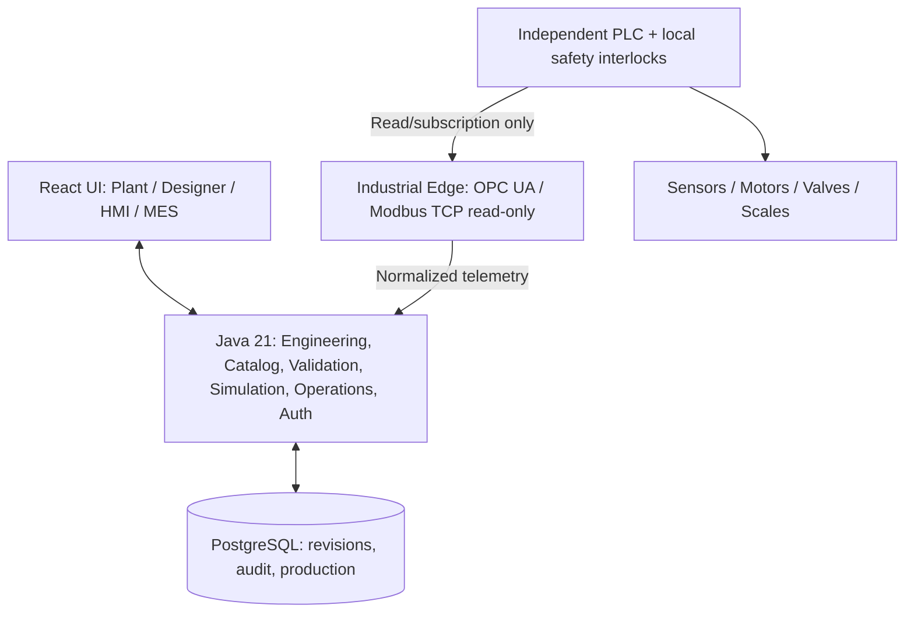
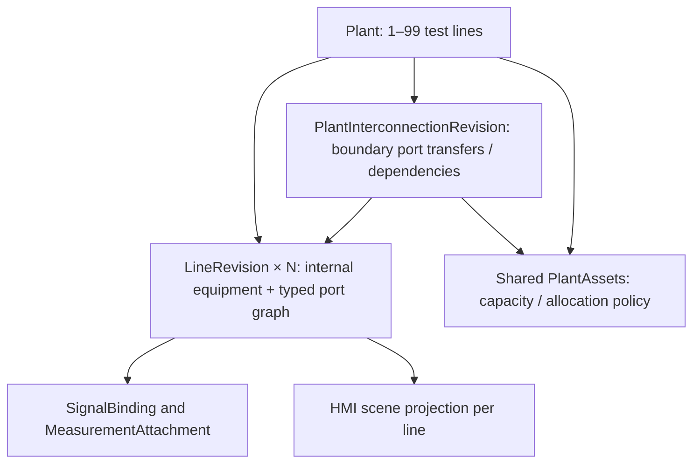

# ZAVOD INDUSTRIALOS — ЕДИНОЕ КАНОНИЧЕСКОЕ МАСТЕР-ТЗ

**Версия документа:** 0.2 (Consolidated Draft)  
**Дата baseline:** 13 ноября 2026  
**Статус:** DRAFT / требуется техническое, OT-инженерное и продуктовое ревью; не свидетельствует о реализации функций или промышленной сертификации.  
**Единственный нормативный файл требований:** `docs/ZAVOD-MASTER-SPEC.md`.  
**Репозиторий:** https://github.com/alimbetov/zavod  
**Порядок разработки:** Scenario Design → RED-тесты → Test Review → GREEN → Regression → Independent Review → PR → Merge.

> Этот документ объединяет прежние требования, модель, архитектуру, решения, безопасность, тесты, дорожную карту и исследования оборудования. Старые файлы удалены из рабочей ветки (сохранены в Git history). При конфликте формулировок приоритет имеют **решения раздела 0** и последующие согласованные изменения через PR/DEC. Нельзя заводить параллельные master/spec/roadmap файлы.

## 0. Согласованная продуктовая и техническая политика

| Вопрос | Решение / единая трактовка |
|---|---|
| Название | Zavod IndustrialOS |
| Тип продукта | Универсальный инженерный конструктор производства; в перспективе SCADA + MES + Industrial IoT |
| Первая реальная ценность | Инженер создаёт цифровую модель разных линий, проверяет соединения, тестирует виртуально и получает черновую HMI |
| Иерархия | Organization → Site → Plant → Line → LineRevision; общие PlantAsset и Controller существуют на уровне площадки/сайта |
| Число линий | В первой поставке 1–10 **активных** линий на площадке; DRAFT площадки без линий допустим. Лимит — конфигурируемая бизнес-политика, не физический предел БД. 100 линий — возможная будущая *нагрузочная цель*, не обещание |
| Тип производства | `Line.profileKey`: BATCH / CONTINUOUS / DISCRETE / UTILITY; один Plant может содержать разные процессы. `Plant.plantType` не определяет единственный тип всех линий |
| Общий физический ресурс | Один `PlantAsset`, ссылки от нескольких линий; проверка занятости/влияния при согласованной активации `PlantActivationSet` |
| Пилотные демонстрации | Бетонная BATCH + насосная CONTINUOUS; затем розлив/фасовка DISCRETE как третий профиль |
| Конструктор | **React + TypeScript + React Flow (@xyflow/react)**. Vaadin Flow в MVP **не используется** |
| Backend и домен | Java 21 + Spring Boot (модульный монолит), JPA/PostgreSQL позднее; критическая валидация выполняется на сервере, UI может показывать локальные подсказки |
| Интеграция | Отдельный site-local Industrial Edge, сначала OPC UA и Modbus TCP **строго read-only** |
| Контроль оборудования | PLC, safety PLC и защитные цепи остаются автономны; Java/Web/Cloud не отвечают за safety interlocks, E-stop, deterministic control |
| Рецептура | `RecipeRevision` относится к производственной процедуре/MES; `Mixer` объявляет capability (TIMED/RECIPE_CAPABLE/CONTINUOUS), но не хранит рецепты в шаблоне |
| Лицензии зависимостей | Только бесплатный для предполагаемого коммерческого использования OSS; **Apache-2.0 предпочтительно**, допускаются совместимые разрешительные MIT/BSD/ISC при сохранении уведомлений. Платные Pro-расширения не являются обязательной частью продукта |
| Лицензия собственного кода | Вопрос владельца проекта `DEC-16`; использование Apache-2.0 как собственной лицензии требует отдельного явного оформления `LICENSE`, не предполагается автоматически |
| Node.js | Только frontend toolchain (сборка/тесты), не производственный Backend и не PLC runtime |
| Разработка | Отдельные ветки и Draft PR, без автоматического merge; `main` менять только после review |

**Лицензии подтверждённых компонентов:** React и React Flow лицензированы по **MIT**, а не Apache-2.0; они допускают коммерческое применение при выполнении условий лицензии. Не записывать неверную лицензию в SBOM. Официальные первоисточники: https://github.com/react/react/blob/main/LICENSE и https://github.com/xyflow/xyflow/blob/main/README.md. Условия каждого пакета (включая транзитивные зависимости) проверяются при релизе; сохраняем LICENSE/NOTICE, SBOM и не допускаем неожиданные платные требования.

**Граница обязательств:** «функция в ТЗ» ≠ «функция реализована» ≠ «функция квалифицирована на заводе». Любое утверждение PASS требует логов и commit SHA.

## 1. Конечный сценарий и ценность продукта

**Главный пользовательский путь (North Star):**
1. Инженер создаёт предприятие/площадку и выбирает от 1 до 10 активных линий.
2. Для каждой линии выбирает профиль (например, бетонный Batch и насосный Continuous) либо пустой проект.
3. Из версионированного каталога помещает физические станки, композитные модули и общие ресурсы площадки.
4. Соединяет типизированные порты — материальные потоки, поток отдельных изделий, utilities, сигналы (не смешивать физику с привязкой PLC).
5. Настраивает параметры оборудования и проверяет схему; невалидный черновик сохраняется, но не публикуется и не исполняется.
6. Запускает изолированную сценарную симуляцию с виртуальными сигналами, без real PLC.
7. Получает черновую SCADA/HMI-мнемосхему, автоматически построенную из утверждённой инженерной модели; редактирует представление независимо от физической схемы.
8. Позднее подключает PLC read-only и получает измерения, состояния, alarm/historian с качеством и временем.
9. Позднее MES фиксирует задание, версию рецепта или процедуры, фактический выпуск и производственные отклонения.
10. Проект сохраняется/закрывается/открывается без потери связи оборудования, портов, line revision и shared assets.

**Конкурентное отличие:** простой инженерный No-Code Builder и retrofit существующих китайских и других OEM-линий с независимой автоматикой; не попытка сразу конкурировать количеством драйверов с зрелыми универсальными SCADA. Ценность должна быть доказана пилотом и интервью, а не объявлена автоматически.

### Модули продукта

| Модуль | Потребитель | Результат |
|---|---|---|
| **Zavod Designer** | Инженер | Технологическая топология, проверка, конфигурация и утверждённая ревизия |
| **Zavod SCADA** | Оператор | Мнемосхема, сигналы с provenance/quality, тревоги, тренды и historian |
| **Zavod MES** | Технолог/начальник смены | Заказы, версии рецептов, партии/операции, фактический расход и отчёты |
| **Zavod Edge** | Инженер интеграции | Нормализация read-only PLC данных, quality, локальный буфер |
| **Zavod Analytics (позже)** | Руководитель | Сводная статистика нескольких площадок; без зависимости локальной автоматики от облака |

### Уровни детализации

Физическая машина может быть *Station/Skid/Composite Unit* с вложенными двигателями, датчиками и приводами, но на общей схеме представляться одним узлом. Вложенная структура не должна создавать физические дубликаты.

**Измеримый первый результат:** инженер создаёт две линии (Batch Concrete и Continuous Pump) и один shared asset, проходит Validate → Simulate → Save → Reopen. Затем проверяем десять линий и отказ активации одиннадцатой. Производственная система без реального PLC на первом этапе.

---

## 2. Продуктовые требования и роли

### 1. Цель и позиционирование

Создать расширяемую платформу конфигурирования производственных линий и мониторинга, которая позволяет инженеру описать производственное оборудование, порты, материальные связи, сигналы и технологические ограничения независимо от производителя PLC. Первый полный демонстрационный профиль — бетонный завод; архитектура обязана одновременно поддерживать несколько разнотипных линий на одной площадке. Первая доступная для демонстрации вертикаль — бетонный завод (aggregate/cement/water/admixture → mixer → discharge). В перспективе — комбикорм, элеватор, насосная станция, водоподготовка, асфальт (по отдельным технологическим профилям).

Продукт состоит из логически независимых возможностей:
1. **Engineering Design**: визуальная схема, каталог оборудования, валидация, ревизии.
2. **Simulation**: детерминированная безопасная симуляция линии с виртуальными сигналами, а затем модель замеса.
3. **Edge Integration**: адаптеры к промышленным протоколам и нормализация сигналов, сначала только чтение.
4. **Manufacturing Operations**: рецепты, партии, задания, фактические данные, отчёты (после R1).
5. **Multi-site Visibility**: централизованная аналитика без зависимости локального процесса от облака (после R2).

### 2. Пользователи и полномочия

| Роль | Задачи | Не допускается |
|---|---|---|
| SYSTEM_ADMIN | пользователи, площадки, политики доступа | обход локальной системы безопасности |
| ENGINEER | каталог, линии, порты, инженерные версии, тесты | живые команды без commissioning |
| TECHNOLOGIST | рецепты и допустимые диапазоны после ввода модуля | изменение PLC interlocks |
| OPERATOR | обзор текущей линии, подтверждённые задания в будущем | изменение активной инженерной схемы |
| SUPERVISOR | отчёты, утверждение публикации, расследования | отключение safety interlocks |
| AUDITOR | история, журнал, выгрузки | модификация данных |
| SERVICE_ENGINEER | диагностика только при предоставленном доступе | неограниченный remote write |

В R0 автономный браузерный прототип не имеет реальной аутентификации: роли определяют целевой контракт R1, а не нынешние права доступа.

### 3. Бизнес-сценарии

- **UC-01** Инженер создаёт площадку, линию и черновик схемы.
- **UC-02** Из каталога размещает силос, бункеры, весы, конвейер, водомер/дозатор, бак добавок, смеситель, выгрузку.
- **UC-03** Соединяет явно выбранные входные/выходные порты с направлением и типом материала.
- **UC-04** Получает понятный список ошибок: занятый порт, несовместимая среда, обрыв, цикл, неподключённый обязательный вход, диапазоны параметров.
- **UC-05** Отменяет действие, сохраняет черновик, экспортирует/импортирует версионированную схему без потерь.
- **UC-06** Запускает только симуляцию валидированной схемы, наблюдает лог событий и воспроизводимый результат.
- **UC-07** В R1 отправляет проект схемы на инженерный review, публикует неизменяемую ревизию.
- **UC-08** В R2 подключает OPC UA/Modbus источник в read-only, связывает теги с оборудованием, видит качество и возраст данных.
- **UC-09** В будущем создаёт рецепт, задание и производственную партию с регистрацией фактических показателей.
- **UC-10** При потере связи локальная система и PLC продолжают действовать в безопасном независимом контуре.

---

## 3. Функциональные требования (FR)

### 1A. Универсальный Multi-Line / Multi-Industry Builder (новое P0 для R0.3)

**Новый продуктовый инвариант:** одна площадка Plant может иметь **1–10 активных линий разных типов**; DRAFT-площадка может иметь 0 линий, но не публикуется без хотя бы одной. Лимит 10 — первая продуктовая политика, а не ограничение базы данных, протокола или аппаратуры. Добавление 11-й активной линии должно быть отклонено на backend и в UI без удаления черновиков.

Технологический профиль `profileKey` принадлежит **Line**, а не единственному `Plant.plantType`. Пример одной площадки: бетонная BATCH, насосная CONTINUOUS, упаковочная DISCRETE. Для каждого профиля используются собственные требования, catalogue/validators, HMI и MES extensions; бетонные рецепты не обязательны на насосной линии.

Общие силосы, насосы, компрессоры и источники ресурсов являются `PlantAsset` с единым ID; линии содержат ссылки и интерфейсы, а не копии одного физического оборудования. Межлинейные конфликты и совместимость активных ревизий проверяются в `PlantActivationSet` до активации. Один PLC может обслуживать несколько линий, и одна линия может получать сигналы нескольких PLC.

**Новые требования:**

| ID | Приоритет | Требование | Приёмка |
|---|---|---|---|
| FR-ML-001 | P0 | Создание Plant с 1–10 активными линиями разных профилей | SC-ML-001…005 |
| FR-ML-002 | P0 | Независимый жизненный цикл LineRevision и общая согласованная PlantActivationSet | SC-ML-014, 016, 017 |
| FR-ML-003 | P0 | Общие PlantAsset с уникальной физической идентичностью и ресурсными ссылками | SC-ML-008, 009, 018 |
| FR-ML-004 | P1 | Сайт-уровневая N:M связь Controller ↔ Line через SignalBinding | SC-ML-006, 007 |
| FR-ML-005 | P0 | Версионированный каталог и минимум два полных профиля R0.3: BATCH concrete и CONTINUOUS pump | SC-ML-005, 011 |
| FR-ML-006 | P1 | Автоматическое создание HMI preview из утверждённой модели без PLC writes | SC-ML-010, 012, 013 |
| FR-ML-007 | P1 | Раздельные операторские экраны, сигналы, статусы и производственные метрики на каждую линию | SC-ML-012, 016, 019 |
| FR-ML-008 | P0 | Повторная проверка сохранения/восстановления и целостности связей между линиями | SC-ML-008, 015, 017 |

Полный дизайн, поля, границы подсистем и двадцать новых сценариев: Universal Industrial Builder R0.3 (раздел настоящего мастер-ТЗ). Этот документ дополняет **единое** мастер-ТЗ, не создаёт вторую нормативную версию.

### 4. Обязательные функциональные требования

#### 4.1 Конструктор и инженерная модель (R0.2 / P0)

| ID | Требование | Приёмочное свидетельство |
|---|---|---|
| FR-DES-001 | Создание/переименование/дублирование линий и редакций | UI + unit/e2e |
| FR-DES-002 | Drag & drop оборудования, zoom, pan, snap-to-grid, selection, delete | e2e |
| FR-DES-003 | Детерминированные уникальные стабильные UUID объектов, портов, соединений | unit |
| FR-DES-004 | Порты имеют собственные ID, направление, класс соединения, тип продукта, кратность и обязательность | unit |
| FR-DES-005 | Вода и химическая добавка подключаются к независимым входам смесителя | regression |
| FR-DES-006 | Поддержка ограничений числа связей: min/max для каждого порта и явные многовходовые устройства | property/unit |
| FR-DES-007 | Разделение «material-flow» графа и «signal/control» графа; визуальные координаты отдельно | schema/unit |
| FR-DES-008 | Валидация направлений, типов, единиц, повторяющихся ID, кратностей, обязательных портов, циклов и незавершённых путей | RED suite |
| FR-DES-009 | Запрет симуляции при blocking errors, сообщения об ошибках у конкретного узла/порта | e2e |
| FR-DES-010 | Undo/Redo с корректным восстановлением геометрии, портов и связей | unit/e2e |
| FR-DES-011 | Явные действия «Сохранить», «Экспорт JSON», «Импорт JSON»; резервное восстановление повреждённых черновиков | e2e |
| FR-DES-012 | Поддержка версий документа, миграция совместимых форматов и отказ на неподдерживаемых версиях без порчи данных | contract |
| FR-DES-013 | Подсветка выделенного оборудования, портов и причины несовместимости | e2e |
| FR-DES-014 | Базовая библиотека: silo, aggregate-bin, scale, conveyor, screw, water-tank, water-doser, additive-tank, additive-doser, mixer, discharge, valve | catalog tests |
| FR-DES-015 | Перенос схемы в новое окружение не должен изменять технологическую семантику | round-trip |

#### 4.2 Симулятор (R0.2 / P0)

| ID | Требование |
|---|---|
| FR-SIM-001 | Выполнение только в виртуальном пространстве без драйверов PLC |
| FR-SIM-002 | Воспроизводимое состояние с seed/time-scale и журналом шагов |
| FR-SIM-003 | Нельзя запустить при блокирующей ошибке целостности графа |
| FR-SIM-004 | Модели состояний IDLE, READY, RUNNING, COMPLETED, FAILED, STOPPED |
| FR-SIM-005 | Ошибки: переполнение, пустой источник, сломанный датчик, timeout (эмуляция) |
| FR-SIM-006 | Строгое разделение демонстрационной топологической анимации и физически осмысленного Digital Twin; первая не называется полноценной технологической симуляцией |

#### 4.3 Серверное проектирование (R1 / P1)

| ID | Требование |
|---|---|
| FR-SRV-001 | Tenant/Organization → Site → Plant → Line(profileKey) → LineRevision + PlantAsset/PlantActivationSet; изоляция прав |
| FR-SRV-002 | REST API, OpenAPI, серверная проверка DTO, RBAC |
| FR-SRV-003 | Черновики с optimistic locking / ETag; разрешение конфликтов параллельного редактирования |
| FR-SRV-004 | Неизменяемые опубликованные ревизии; approval, rollback через новую редакцию, а не переписывание истории |
| FR-SRV-005 | История изменений: who/when/what/reason; append-only audit |
| FR-SRV-006 | PostgreSQL и контролируемые миграции (Liquibase или Flyway — открытое решение DEC-06) |
| FR-SRV-007 | Проверка схемы на Backend; frontend не является единственным источником правил |

#### 4.4 Интеграция оборудования (R2 / P1)

| ID | Требование |
|---|---|
| FR-PLC-001 | Конфигурация устройства, endpoint, протокола, тега, типа и единицы измерения |
| FR-PLC-002 | OPC UA client read-only через адаптер; доверие сертификатам, политика шифрования |
| FR-PLC-003 | Modbus TCP reader с документированной register map, endianness, scale, timeout |
| FR-PLC-004 | Качество сигнала GOOD/BAD/UNCERTAIN, timestamp измерения и получения, staleness |
| FR-PLC-005 | Offline-first edge: локальная запись событий, retry/reconnect с backoff, ограниченная очередь |
| FR-PLC-006 | Simulator adapter полностью заменяет физический PLC в CI и тестовых стендах |
| FR-PLC-007 | Любые операции write/command по умолчанию запрещены и НЕ входят в R2 read-only |
| FR-PLC-008 | Потеря Backend/Cloud/Web не является причиной изменения безопасного состояния оборудования |

#### 4.5 Производственный учёт (R3 / P2)

Отдельные сущности RecipeDefinition/RecipeRevision, ProductionOrder, BatchRun, Weighment, MaterialLot, Consumption, Alarm и Shift. Для рецептов требуются версия, допуски, единицы и точная трассировка фактической дозировки. Принятие производственных команд и связь с PLC реализуются только после независимой оценки риска, FAT/SAT и допуска инженерной организации.

---

## 4. Универсальная библиотека и периферия

**Правило конфигурации:** `EquipmentType` с `key + version`, декларациями `Capability`, `Mode`, `PortDefinition`, `ParameterDefinition`, `SignalDefinition`, `hmiTemplateKey`; `EquipmentInstance` — размещённый экземпляр; `PlantAsset` — единый физический ресурс. Никаких классов `MixerWithRecipe` и `MixerWithoutRecipe` как отдельных фундаментальных сущностей.

- Типы смешивания: порционный Batch Mixer, Continuous Mixer, Inline/Static Mixer, Tank Agitator. `RecipeRevision` находится в MES, режим TIMED/RECIPE_CAPABLE/CONTINUOUS_SETPOINT — capability оборудования.
- Порты: `MATERIAL` (порошки/жидкости/гранулы), `ITEM_FLOW` (бутылки/короба/поддоны), `UTILITY` (вода, энергия, воздух), `INSTRUMENTATION/SIGNAL` (измерения), `CONTROL` (только будущие разрешённые действия; не равен физическому приводу).
- Порты имеют id/portKey, direction, medium/item type, min/max links, unit/capacity, optional required; порт `waterIn` и `admixtureIn` независимы.
- Датчик давления моделируется как измерительный компонент, а не по умолчанию трубопровод с входом/выходом воды. Проточный прибор может отдельно объявлять реальные технологические порты.
- Дублированные/занятые/несовместимые соединения, циклы без разрешённого recirculation-профиля, незаполненные обязательные входы блокируют публикацию/симуляцию.
- Переводы RU/KK/EN — через display keys; keys и единицы не зависят от языка.
- Для первых отраслевых профилей используем версионированные декларативные шаблоны, а не динамически загружаемый исполняемый код.

### Повторно используемая периферия

| Класс | Примеры | Телеметрия / параметры |
|---|---|---|
| Хранение | Силос, бункер, бак, накопитель | Объём/уровень/температура |
| Подача | Вакуумный загрузчик, шнек, вибропитатель | Расход, скорость, авария |
| Транспорт | Лента, роликовый/шнековый конвейер, элеватор, насос | Работа, производительность |
| Привод и пневматика | Двигатель, VFD, серво, цилиндр, клапан | Ток, частота, положение |
| Измерение | Весовой терминал, датчик уровня/давления, расходомер, фотоэлектрический датчик | Значение, единица, quality |
| Обработка | Смеситель, дробильная машина, экструдер, пресс, сушилка, фильтр | Операции, состояния, уставки |
| Упаковка | Фасовщик, наполнитель, укупорка, этикетировщик, маркиратор | Количество, цикл, отбраковка |
| Контроль качества | Чеквейер, металлодетектор, машинное зрение | Good/reject, причина |
| Общие utilities | Компрессор, аспирация, чиллер, гидростанция, водоснабжение | Давление, мощность, расход |
| Связь | PLC, local HMI, remote I/O, gateway | Firmware, протокол, связь, stale |

### Отраслевые шаблоны (предложения, а не готовая поддержка)

| Template key | Технологическая линия | Путь | Ввод |
|---|---|---|---|
| `batch.concrete.v1` | Бетон / строительные смеси | Бункер/силос → дозатор → миксер → выгрузка | Первый |
| `continuous.pump.v1` | Насос / водоподготовка | Ёмкость → насос → фильтр/клапан → измерения | Первый |
| `discrete.bottling.v1` | Розлив | Подача тары → наполнитель → укупорка → этикетка → контроль | Затем |
| `discrete.bagging.v1` | Весовая фасовка | Бункер → дозатор → упаковка → контроль веса | Затем |
| `batch.feed-pellet.v1` | Комбикорм | Дробилка → дозирование → миксер → грануляция → охладитель | P1 |
| `discrete.block-press.v1` | Блоки/кирпич/плитка | Смешивание → вибропресс → поддоны → выдержка | P1 |
| `continuous.plastic-recycling.v1` | Переработка пластика | Дробление → мойка → сушка → экструзия → гранулирование | P1 |
| `continuous.grain-processing.v1` | Зерно и крупы | Очистка → сепарация → обработка → сортировка → упаковка | P1 |
| `discrete.conveyor-sort.v1` | Конвейер/сортировка | Подача → обнаружение → сортировка → отвод | P1 |
| `discrete.bakery.v1` | Выпечка | Замес → деление → расстойка → печь → упаковка | P2 |

Профиль может содержать гибридные операции; `ProcessKind` является основной классификацией, а не запретом внутреннего сочетания Batch и Discrete. Предложение 10 шаблонов **не означает** обязанность иметь 10 линий одновременно.

Результаты ознакомления с китайскими поставщиками — **кандидаты рынка**, не подтверждённый рейтинг спроса/интероперабельности. Изучать прежде всего модель+прошивку OEM, доступные теги и протокол, интерфейсы HMI, схемы питания и actual I/O. Китайские PLC/HMI брендов Inovance, Xinje, Haiwell — кандидаты для будущего лабораторного read-only теста, не заявленная совместимость.

Источники примеров: https://www.inovance.com/product?typeId=1 ; https://www.xinje.com/web/solutionInfo/index?id=34 ; https://www.haiwell.com/about/haiwell-cn.html ; https://www.chanferpack.com/zh/equipment/ ; https://zcjxc.com.cn/new/2263.html ; https://www.klongchina.cn/products/ ; https://www.yizumi.com/en/news/product/IMM/guide-how-to-choose-a-pet-preform-injection-molding-machine.

### Интеграционные варианты оборудования

`SIMULATED` (без реального PLC); `READ_ONLY_CONNECTED` (контроллер/шлюз, измерения с quality); `MANUAL_REPORTING` (внесение результата для нецифрового станка с явной маркировкой). Никакой автоматической подмены ручного значения фактической телеметрией.

---

## 5. Единая инженерная и доменная модель

### 1. Bounded Contexts

- **Engineering**: EquipmentTemplate, EquipmentInstance, PortTemplate, EquipmentPort, MaterialConnection, Line, LineRevision, ValidationFinding.
- **Automation Mapping**: Device, DeviceEndpoint, ProtocolDriver, SignalDefinition, SignalBinding, SignalObservation.
- **Simulation**: SimulationScenario, SimulationRun, VirtualPlantState, SimulationEvent.
- **Manufacturing** (будущее): Material, MaterialLot, RecipeRevision, ProductionOrder, BatchRun, Weighment, Consumption, Alarm.
- **Identity/Organization** (R1): Tenant, Site, Plant, User, Role, Approval, AuditEvent.

Не путать EquipmentTemplate (тип из каталога) и EquipmentInstance (физическая установка на конкретной линии). Типизацией физических портов нельзя подменять PLC-адреса.

### 2. Основная модель

| Сущность | Ключевые поля | Инварианты |
|---|---|---|
| Tenant | id, name, status | данные площадок изолированы |
| Site | id, tenantId, timezone | site принадлежит одному tenant |
| Plant | id, siteId, maxActiveLines, status | технологически нейтрален; первая редакция ограничивает до 10 активных линий |
| Line | id, plantId, name, profileKey, activeRevisionId | профиль процесса определяет валидаторы конкретной линии; активная ревизия опубликована |
| LineRevision | id, lineId, revisionNo, status, schemaVersion, contentHash, createdBy, approvedBy | опубликованная версия неизменяема |
| EquipmentTemplate | templateKey, templateVersion, class, capabilities, defaultPorts, parameterSchema | template version фиксируется в ревизии |
| EquipmentInstance | id, templateKey/version, name, parameters, visualPosition, plantAssetRef? | equipmentId уникален в revision; физический общий актив не дублируется |
| EquipmentPort | id, equipmentId, portKey, direction, connectionKind, media, minLinks, maxLinks, required | порт принадлежит одному оборудованию |
| MaterialConnection | id, sourceEquipmentId/PortId, targetEquipmentId/PortId, medium, properties | соблюдены направления, совместимость, лимиты |
| SignalDefinition | id, deviceId, address, protocolDataType, unit, accessMode | адрес не заменяет семантический signalKey |
| SignalBinding | id, revisionId, equipmentId, signalKey, signalDefinitionId, conversion | bind to target property, immutable by revision |
| ValidationFinding | code, severity, entityRef, messageKey, details | blocking flag объективен и проверяем |
| SimulationRun | id, revisionHash, seed, state, startedAt, finishedAt | воспроизводим, без связи с PLC |
| AuditEvent | id, actor, action, entity, beforeHash, afterHash, timestamp | append-only (R1) |

### 3. Виды графов — нельзя смешивать

1. **Process/material flow graph**: физически перемещаемая среда, направление, порты, агрегаты.
2. **Instrumentation/signal graph**: датчики и команды, теги, device endpoints, semantics.
3. **Layout graph**: координаты и размеры блоков, маршруты визуальных рёбер; не определяют реальную длину труб/ленты.
4. **Procedure graph** (R3): последовательность фаз/операций; отдельно от физической связности.

Изменение визуальной позиции не меняет технологическую валидность; изменение типа или кратности порта — меняет.

### 4. Модель портов

Каждый тип оборудования содержит объявленные порты с:
- portKey и displayName; direction: IN/OUT/BIDIRECTIONAL (для material P0 используются только IN/OUT).
- connectionKind: MATERIAL/UTILITY/SIGNAL/CONTROL (на первом этапе материальные связи проверяются отдельно).
- medium: CEMENT, AGGREGATE, WATER, ADMIXTURE, CONCRETE, OTHER; возможность профилей и иерархии сред.
- minConnections/maxConnections: числовые ограничения, 0..N; required определяется minConnections > 0.
- capacity/flowRate и единицу измерения (после R0.2); allowableRange и допустимые агрегатные свойства — отдельные ограничения.
- порты идентифицируются по equipmentInstanceId + portKey, а не только общему слову liquid.

**Принципиальный пример:** Mixer имеет независимые порты cementIn, aggregatesIn, waterIn, admixtureIn (опциональность химической добавки определяется профилем) и concreteOut. Вода и добавка — разные технологические среды; два потока не занимают один порт.

### 5. Инварианты соединений

- source и target существуют в одной LineRevision и не совпадают по ID.
- OUT → IN; разрешённые классы соединения; medium совместим с обоими портами.
- Для P0 не допускаются параллельные дубликаты (sourcePortId,targetPortId), кроме явно моделируемой раздельной физической линии.
- min/maxConnections для каждого порта соблюдаются при статусе READY; допустима временная неполнота DRAFT.
- Самосвязи и циклы материалопотока запрещены по умолчанию; процессы с recirculation включаются только отдельным типом оборудования/правилом профиля.
- Если компонент питается от нескольких источников, нужен явно поддерживаемый multi-in port или соответствующее устройство; никаких скрытых fan-in.
- Unknown equipment type, schemaVersion или единица измерения при импорте — fail-closed, без подмены.
- Проверка готовности к запуску отдельно от проверки, можно ли сохранить черновик.

### 6. Состояния и ревизии

LineRevision: DRAFT → IN_REVIEW → APPROVED → PUBLISHED → SUPERSEDED; при отклонении из IN_REVIEW → DRAFT, запрет редактирования APPROVED/PUBLISHED. Rollback создаёт новую редакцию на основе предыдущей, а не переписывает опубликованную.

SimulationRun: CREATED → VALIDATING → READY → RUNNING → COMPLETED / FAILED / STOPPED. Старт из статуса READY, только при отсутствии блокирующих ошибок. Реальное оборудование ни при каком статусе SimulationRun не затрагивается.

### 7. Рецептурная модель (поздний этап)

RecipeRevision: productCode, targetOutput, ingredientLines(materialId, quantity, unit, tolerance), mixingTime, qualityConstraints. Decimal arithmetic, фиксирование версии на BatchRun. Нельзя «горячо» менять рецепт выполняемого замеса. Фактические масса/время/качество записываются как отдельные измерения с источником и временем.

### 8. Конкретный путь данных для бетонной линии

AggregateBin → AggregateScale → Conveyor → Mixer.  
CementSilo → CementScale → Mixer.  
WaterTank → WaterDoser → Mixer.  
AdmixtureTank → AdmixtureDoser → Mixer.  
Mixer → Discharge.

Наличие отдельного AdmixtureDoser и точный состав обязательных линий для MVP уточнить в DEC-02. Количество физических портов не должно кодироваться как «один общий liquid».

### 9. Контракт сериализации

Будущий серверный документ LineDefinition schemaVersion=3 **не считать совместимым с JSON v2 прототипа R0.1 до реализации мигратора**. Содержит identity, revision metadata, catalogVersion, equipment[], ports[], materialConnections[], layout, optional signalBindings[]; timestamps ISO 8601 UTC. Перед импортом: parse → version check → schema validate → domain validate → preview → transactional save. Сохранение неизвестных полей: только явно разрешённая extension-область. Никакого silent fallback на демосхему при повреждении пользовательского файла.

### 10. Расширение: 1–10 разнотипных линий и общие ресурсы (R0.3)

**Нормативная корректировка прежнего предположения:** `Plant.plantType` удаляется как единственный обязательный тип производства. `Line.profileKey` выбирается независимо для каждой линии: `batch.concrete.v1`, `continuous.pump.v1`, `discrete.packaging.v1` и т.д. Завод может иметь несколько разнотипных линий, в том числе совместно работающих.

**Plant resource context:**
- `PlantAsset(id, plantId, assetCode, equipmentTypeRef, technicalProperties, activeVersion)` — единый физический объект общего пользования.
- `ResourceAllocation(id, plantAssetId, lineId, allocationKind, capacityConstraint)` — ссылка от линии, а не дублирование агрегата; пересечение эксклюзивных ресурсов — блокирующая ошибка активации.
- `PlantActivationSet(id, plantId, lineRevisionRefs, sharedAssetVersionRefs, state)` — атомарно проверяемая комбинация активных конфигураций. Действующая линия не перезаписывается; изменение общего ресурса требует impact analysis на зависимые линии.
- `Controller` привязан к `Site`; независимые `SignalBinding` связывают сигналы одного/нескольких PLC с оборудованием одной/нескольких линий (N:M).
- `HmiScene` — воспроизводимая проекция утверждённой топологии и каталожных HMI шаблонов; presentation override с независимыми IDs.

**Модельные правила:**
1. `Plant` с 0 линий может быть DRAFT, но не PUBLISHED/ACTIVE; требуется 1–10 активных линий в первой продуктовой редакции.
2. Лимит `maxActiveLines=10` — конфигурируемая продуктовая политика, и валидация на backend обязательна; не фиксировать лимит размером массивов/таблиц.
3. `LineRevision` нельзя активировать в обход `PlantActivationSet`, если она зависит от общего ресурса или другой линии.
4. Межлинейная физическая связь описывается через PlantAsset/интерфейс ресурса; ребро `MaterialConnection` внутри линии не должно напрямую ссылаться на чужую LineRevision.
5. Профильная MES-семантика не навязывается другим процессам: `RecipeRevision` требуется только для batch профилей, если это определено validator.
6. Отдельные ошибки `LINE_LIMIT_EXCEEDED`, `RESOURCE_CONFLICT`, `INCOMPATIBLE_ACTIVE_REVISIONS`, `CROSS_PLANT_REFERENCE` возвращают идентификаторы затронутых объектов.

См. [Universal Industrial Builder R0.3](universal-industrial-builder-R0-3.md) — сценарий инженера, подробный контракт и staged rollout.

---

## 6. Технологическая архитектура и политика без оверинжиниринга

**Первый runtime:** React/Vite frontend + чистое Java 21 domain ядро; после квалификации UI — один Spring Boot MVC modular-monolith + PostgreSQL. Отдельный локальный Edge вводится только на этапе read-only PLC.

**Java остаётся единым источником серверной доменной валидации**, TypeScript — интерактивный графический слой. Не плодить отдельные несовместимые определения правил: версия JSON Schema/DTO, fixtures и contract tests должны согласовываться с Java. Для воспроизводимости фиксировать версии JDK/Node/package-lock и покрывать production build.

**Не вводить в MVP:** микросервисы, Kafka, Redis, Kubernetes, multi-tenant billing, динамическую произвольную JVM/PLC plugin-систему, ML и «универсальный Digital Twin». TimescaleDB, MQTT Sparkplug B, централизованная аналитика — после телеметрических замеров и требований пилота.

**Вопрос Vaadin Flow:** для форм/справочников возможен, но не используется в первой версии. React Flow выбран именно для графа узлов/портов/рёбер/zoom/pan; второй UI-стек без измеримой выгоды исключён.

### Границы доменных модулей

- **engineering** — Plant, ProductionLine, LineRevision, PlantActivationSet, physical topology and approval.
- **catalog** — EquipmentType, version, capabilities, port schema, LineProfile.
- **shared-resources** — shared PlantAsset, resource interfaces, impact analysis.
- **simulation** — виртуальный state machine и журнал событий; никаких драйверов PLC.
- **automation** — Controller, SignalDefinition/Binding/Observation, identity/quality.
- **scada** — HMI projections, alarming, historian (R2).
- **operations / batch** — orders, production executions, recipes and traceability (R3).
- **identity / audit** — site scoped RBAC, audit and configuration approval (R1).
- **edge** — отдельно развёртываемый адаптер OPC UA/Modbus read-only (R2).

### Протокольный контракт

`SignalObservation(siteId, deviceId, signalKey, value, unit, sourceTimestamp, receivedAt, quality, sequence, provenance)`; `quality ∈ {GOOD, UNCERTAIN, BAD, STALE}` с явно описанной семантикой STALE как derived display status. Сырые адреса PLC никогда не становятся стабильными инженерными идентификаторами оборудования. Один PLC может обслуживать несколько линий, и линия может читать несколько PLC (N:M через binding).

### Версионирование и хранение

- `LineDefinition schemaVersion=3` — **целевая**, пока несовместимость с прежним автономным JSON v1/v2 должна разрешаться явным мигратором с golden fixtures.
- `DRAFT → IN_REVIEW → APPROVED → PUBLISHED → SUPERSEDED`; публикация immutable; rollback как новая revision.
- `PlantActivationSet` связывает совместимые активные ревизии линий и общих ресурсов, проверяет конфликты перед активацией.
- JSONB snapshot + реляционные ключевые индексы (после R1); optimistic locking/ETag, transaction audit.
- UTC события; TZ как атрибут Site; decimal и явная unit conversion для массы/объёма.
- R0 localStorage — временный черновик с recovery, не промышленный архив.

### 1. Слои системы

~~~text
[Engineering Web UI — React + TypeScript, React Flow]
        | HTTPS / REST (R1) / WebSocket read model (R2)
[Plant Management Backend — Java 21 + Spring Boot]
        | PostgreSQL (versioned configs, audit, recipes, operations)
        | internal auth + policy / outbox if required
[Industrial Edge Gateway — отдельный сервис на plant LAN]
        | OPC UA client READ-ONLY (R2) / Modbus TCP reader (R2)
        | bounded buffering, normalized telemetry, health
[PLC & local HMI / Safety PLC — отдельные trust/safety boundaries]
        | fieldbus / local IO (PROFINET, EtherNet/IP, Modbus, etc.)
[Sensors, scales, valves, motors, mixer, emergency circuits]

[Optional Site → Central analytics] only outbound authenticated,
never necessary for local equipment safety or machine operation.
~~~

Архитектура поддерживает один site on-premise первым; multi-tenant и fleet management — целевая модель, не техническое оправдание для преждевременного усложнения R0.

### 2. Граница ответственности

| Уровень | Выполняет | Не выполняет |
|---|---|---|
| React Editor | чертёж, настройки, ошибки, симуляция | циклическое управление PLC |
| Spring Boot | версии схем, учёт, права, API, audit | interlocks, real-time control |
| Edge Gateway | чтение тегов, нормализация, качество, очередь | safety-critical logic |
| PLC | последовательности и взаимодействие с I/O в локальном контуре | зависимость от облака |
| Safety circuits | аварийный останов / защитные отключения | управление через веб-запрос |

При остановке Backend/Cloud/Browser PLC и защитные контуры должны сохранять безопасную независимую работоспособность согласно проекту OEM и site-specific HAZOP/risk assessment.

### 3. Технологический стек (выбор для реализации)

- Frontend: React, TypeScript, Vite, React Flow; тесты Vitest + React Testing Library + Playwright.
- Backend: Java 21, Spring Boot MVC, Bean Validation, Spring Security, Spring Data JPA, PostgreSQL; Testcontainers.
- Миграции БД: контролируемые, инструмент определяется DEC-06.
- Edge: отдельный Java процесс/контейнер на Industrial PC, plugin-like protocol adapter SPI; Eclipse Milo как кандидат OPC UA.
- Telemetry: в R2 локальный PostgreSQL для начала; TimescaleDB/MQTT Sparkplug B — только при доказанной необходимости и после baseline нагрузки.
- Integration: OPC UA с серверными сертификатами и allowlist; Modbus TCP только в изолированной OT-сети и строго READ-ONLY.
- Observability: structured logs, Micrometer/Prometheus (по необходимости), correlation IDs, health/readiness.
- Deployment: локальная площадка может работать без Интернета; внешняя аналитика факультативна.

### 4. Предлагаемые границы модулей

frontend/line-designer — canvas, palette, inspector, validation panel, history.  
shared/line-schema — versioned JSON schema, types, migration fixtures.  
backend/engineering — lines, revisions, catalog, approvals, audit.  
backend/production — orders, recipes, batches (позже).  
edge/adapter-core — SignalObservation, adapter lifecycle, subscriptions, quality.  
edge/adapter-opcua; edge/adapter-modbus; edge/adapter-simulator — отдельные реализации.  
testing/fixtures — valid/invalid line graphs, simulated devices.

В R0 допускается монолит фронтенда с изолированным domain; дробление на микросервисы до фактической необходимости запрещено архитектурным решением.

### 5. API-контракт (целевые примеры, R1)

| Метод | Endpoint | Семантика |
|---|---|---|
| GET | /api/v1/sites/{siteId}/plants | доступные установки |
| POST | /api/v1/plants/{plantId}/lines | создание Line |
| GET | /api/v1/lines/{lineId}/revisions | список редакций |
| POST | /api/v1/lines/{lineId}/revisions | новый DRAFT |
| PUT | /api/v1/revisions/{revId} | запись при If-Match, optimistic lock |
| POST | /api/v1/revisions/{revId}/validate | общий server-side validator |
| POST | /api/v1/revisions/{revId}/submit | перевод в review |
| POST | /api/v1/revisions/{revId}/approve | утверждение по роли |
| GET | /api/v1/catalog/equipment | библиотека шаблонов |
| GET | /api/v1/revisions/{revId}/audit | записи изменений |

Ошибки — Problem Details, стабильный errorCode, binding к entity/port, никакого leak endpoint credentials.

### 6. Edge contract (R2)

SignalObservation = {siteId, deviceId, signalKey, value, unit, sourceTimestamp, receivedAt, quality, sequence, provenance}. В R2 доступен только outbound read. Gateway соблюдает bounded queue, reconnect с backoff/jitter, refresh certificate lifecycle, distinct connected/disconnected/stale. Отсутствие данных нельзя интерпретировать как ноль. Write endpoints отсутствуют.

### 7. Данные и целостность

- Конфигурация линии хранится как versioned JSONB snapshot + реляционная индексация основных сущностей (детали по профилированию).
- Иммутабельные опубликованные версии, транзакционный audit, optimistic locking.
- Клиентское localStorage R0 — лишь черновик, не архив и не single source of truth после R1.
- Резервное копирование/восстановление должно быть протестировано прежде производственного применения.
- Время UTC, local TZ как атрибут Site, числа для массы/объёма в decimal с явной unit conversion.

### 8. Переходы и архитектурные ограничения

R0.2: никаких реальных PLC драйверов и Backend.  
R1: серверное хранение/права/ревизии, но нет PLC-control.  
R2: реальная телеметрия только read-only, site network isolation.  
R3: технологический учёт, а машинные команды — отдельный safety-gated workstream и без обещания готовности на этапе проектирования.

Стандарты для проектирования границ: ISA-88, ISA-95, ISA/IEC 62443 и NIST SP 800-82 Rev.3; соответствие стандартам требует отдельного аудита.

---

## 7. Интерфейс и пользовательские рабочие области

### 5. UX, языки и единицы

- Desktop-first инженерный редактор; операторский экран должен отличаться от экрана редактирования.
- Левое меню — каталог с поиском; центр — схема; справа — свойства; снизу — ошибки и события.
- Русский интерфейс в пилоте, архитектура переводов ru/kk/en. Все пользовательские сообщения через ключи i18n.
- Единицы хранятся канонически: kg, m3, L, s, °C и др. Дисплейная единица отдельно от расчётной; запрещено складывать несовместимые физические величины.
- Статусы и тревоги кодируются не только цветом; доступность с клавиатуры и понятные подписи.
- При импорте файл валидируется до замены текущего проекта; нужна возможность предварительного просмотра.

### 7. Designer UX / workflow

**Plant overview:** list 1–10 lines, type icon, engineering status, runtime quality, draft/active revision and last event. Add Line button displays templates + empty line. Disable *Activate* above limit; allow preserving an extra inactive draft until scope decision.

**Line Designer:** left equipment palette scoped by profile, center graph, right typed property/port editor, bottom validation findings. Support multi-select, undo/redo, copy/paste, saving invalid drafts, import preview, stable IDs and cross-line assets as reference nodes.

**HMI Preview:** auto-generate readonly visualization from approved engineering revision and equipment HMI templates. Distinguish a synthetic/virtual signal from physical signal by visible provenance and interface banner. Edit visual overrides separately; do not conflate canvas geometry and plant topology.

**Simulation:** virtual sensor model with seed, bounded step count and recorded events, no production PLC adapters in build/dependencies. Simulate each line independently first; later a plant-level simulation can reason about shared resources.

**Operations:** a generic execution records line, revision, operator, time, production quantity and status, with profile-specific payloads. Batch, discrete and continuous extensions may use different performance metrics.

### 10. Product acceptance demonstration (target outcome)

Demo plant «Pilot-Z» has:
- Line A: concrete BATCH, silos/scales/mixer, virtual batch records.
- Line B: pump CONTINUOUS, tank/pump/flow/pressure sensors.
- One shared utility asset referenced by both.
- Both lines visible on Plant Overview, independently editable and simulated.
- HMI scenes generated from approved engineering revision with virtual signal quality badges.
- Save → close → reopen → same schema/links/IDs, no lost references.
- Separate test creates ten valid lines; adding an eleventh active line fails with explainable error.
- No connection to physical PLC, no safety or commissioning claims.

**Definition of Done:** artifacts exist in repo, RED→GREEN tests and browser journey evidence, no undocumented cross-line state, independent engineering/security review for future OT connectivity.

---

## 8. SCADA, MES и производственная прослеживаемость

### Различие трёх продуктовых модулей

| Модуль | Вопрос клиента | Конечный артефакт |
|---|---|---|
| Zavod Designer | Из каких компонентов и соединений состоит линия? | Утверждённая ревизия инженерной модели |
| Zavod SCADA | Что происходит с оборудованием сейчас и какие есть тревоги? | Live HMI, сигналы с качеством/временем, historian, журнал alarms |
| Zavod MES | Что было заказано, сколько произведено и из чего? | Заказ, версия рецепта, batch record, расход/отклонения/отчёт смены |

Технологически это **три модуля на одном инженерном registry**, а не три отдельные несвязанные программы.

### Два принципиальных процесса

#### Engineering Change Control
`DRAFT → REVIEW → APPROVED → ACTIVE → SUPERSEDED/ARCHIVED`

Запрет активации без проверки обязательных соединений, прав, миграций и тестовой валидации. Действующая ревизия и ревизия, использованная при партии, неизменяемы.

#### Batch Traceability
`ProductionOrder → ApprovedRecipeVersion → PLC Batch Events → ActualMeasurements → BatchRecord → MaterialReconciliation`

При обрывах связи учитываем качество данных и неполные партии явно, а не додумываем их статусы в MES. Номинальные и фактические дозы хранятся отдельно.

### Метрики успеха для первого пилота

- Время подключения от списка сигналов до первого HMI.
- Доля партий с полным и непротиворечивым batch record.
- Сходимость отчётов Zavod с проверенными журналами и калиброванными весами.
- Время ручного заполнения отчётности за смену «до/после».
- Время обнаружения потери/устаревания сигнала.
- Ноль неразрешённых записей в PLC и подтверждённая автономность control loop.

Численные SLO/ROI определяются после пилота, не объявляются достигнутыми.

### 7. Что НЕ входит в R0

Прямая выдача команд в PLC, аварийный останов, safety PLC, SIL/PL сертификация, real-time motion/drive control, удалённое управление через облако, полноценные P&ID/электрические CAD, автоматическая генерация PLC ladder/program, бухгалтерия, ERP, прогнозирующий ML и сертифицированный Digital Twin. Эти направления потребуют отдельного ТЗ и инженерной приёмки.

---

## 9. OT-безопасность и кибербезопасность

### 1. Fundamental safety boundary

IndustrialOS R0/R1/R2 проектируется как инженерный редактор, безопасный симулятор, конфигурационный сервис и шлюз **read-only телеметрии**. Нельзя описывать его как промышленный safety controller или replacement PLC/HMI. Безопасное циклическое управление, interlocks, E-stop, пусковые цепи, permissive checks, защита электродвигателей, контроль уровня/давления/температуры и все safety-critical функции выполняются локально независимым, квалифицированным контроллером и физическими защитными устройствами согласно проекту объекта.

Потеря Java Backend, браузера, Ethernet, облака или gateway не должна отключать, обходить либо деградировать локальные защитные блокировки. Источником истины для состояния оборудования является PLC/local system; UI отображает измерения с качеством и возрастом данных.

### 2. Классификация режимов

| Режим | Взаимодействие с реальным PLC | Разрешение |
|---|---|---|
| DESIGN | отсутствует | R0 |
| SIMULATION | отсутствует, только виртуальные устройства | R0 |
| SHADOW_READ_ONLY | OPC UA/Modbus чтение, no writes, no method invocation | R2, после допуска на стенд |
| COMMISSIONED_MONITORING | промышленная сеть, наблюдение в эксплуатации, no writes | после SAT monitoring |
| COMMAND_CAPABLE (будущий) | ограниченные allowlisted команды через независимый PLC-контур | отдельное ТЗ/HAZOP/FAT/SAT и approval |
| SAFETY_LOGIC | недопустима в Java/Web/Cloud | никогда |

Запрет записи должен обеспечиваться не только выключенной UI-кнопкой: права учётной записи PLC, сетевые ACL, read-only adapter SPI, отсутствие write API и интеграционные негативные тесты.

### 3. Threat model и границы доверия

Актуальные угрозы: подмена конфигурации линии, компрометация сервисной учётной записи, проникновение из IT в OT, небезопасный удалённый доступ, replay/duplicate telemetry, timestamp spoofing, loss of communication, неверный register mapping, нарушение полноты журнала, ошибочная интерпретация BAD quality как реального значения, отказ датчика, устаревшие сертификаты.

Минимальные зоны:
- OT Field: датчики, приводы, физические E-stop.
- OT Control: PLC/local HMI/safety controller.
- Industrial DMZ / Edge: шлюз, ограниченный однонаправленный логический поток телеметрии; реальную сетевую односторонность не заявлять без соответствующих средств.
- Plant IT: management backend и engineering browser.
- Optional enterprise/cloud: только через контролируемый шлюз, никакого прямого доступа к PLC.

Классические firewalls/VLAN/ACL, разрешённые направления трафика, отдельные сервисные учётные записи, deny by default, VPN + MFA для авторизованного сервисного доступа. Никаких публичных OPC UA/Modbus endpoint.

### 4. Требования к OPC UA / Modbus

OPC UA:
- Защищённый канал, верификация сертификата и application identity, endpoint allowlist.
- Запрет insecure SecurityPolicy=None для реального deployment за исключением документированного изолированного лабораторного стенда.
- Только Subscription/Read в R2; write/method calls отсутствуют в коде или блокируются аппаратными/ACL ограничениями.
- Качество и sourceTimestamp обязательны; при BAD/UNCERTAIN явное отображение.

Modbus TCP:
- Не рассчитывать на встроенную аутентификацию классического Modbus TCP; изоляция подсети и сетевые ACL обязательны.
- Разрешать только read function codes на уровне адаптера и сети где возможно, отсутствие writes в интерфейсе; read-only binding credentials не всегда реализуемы конкретным PLC, поэтому усиливать сетевые и организационные меры.
- Endianness, подписанность, масштаб, регистр и unit выбираются на основании официальной карты производителя и тестируются с симулятором.

Никаких runtime-перепривязок тегов в production без ревизии, review и commissioning.

### 5. Secure development / operational requirements

- RBAC least privilege, утверждение публикации схемы отдельной ролью, аудит actor/time/oldHash/newHash.
- Сертификаты/секреты вне git, секреты в конфигурации с ограниченными правами, ротация и отзыв.
- TLS для интерфейсов IT; mTLS для соединений между доверенными сервисами по оценке рисков.
- SBOM, dependency/vulnerability scanning, подпись релизных артефактов по мере введения production.
- Параметры telemetry: GOOD/BAD/UNCERTAIN, stale age, device disconnect и lastSeen; старые данные не показывать как live.
- Rate limit, bounded queues, backpressure, retry jitter, circuit breaker по месту; в случае перегрузки деградирует UI/телеметрия, а не локальная безопасность.
- Логи не содержат паролей, секретов PLC, приватных ключей и raw access tokens.
- Отдельные backup/restore, incident response и patch window; любое обновление на объекте с rollback-plan.
- При расхождении часов фиксировать разницу, source/device timestamp и time received, не подделывать «текущее» измерение.

### 6. Условия для будущей возможности команд

До первого write должны быть оформлены и утверждены:
1. Технологическое описание конкретной установки и OEM-документация.
2. HAZOP / risk assessment + hazards and mitigations, согласованные ответственным инженером.
3. Command matrix: кто, когда, что, как подтверждает, допустимое состояние PLC, ограничения диапазона.
4. PLC-side validation/permissives/interlocks и независимый E-stop.
5. Локальная авторизация, запрет команд из публичного облака, временные разрешения и audit command/ack.
6. Safe failure states, потеря связи, duplicate command, replay, stale state, partial failure.
7. FAT на стенде, затем SAT на объекте, испытания восстановления, план обслуживания.
8. Юридическое/регуляторное соответствие применимое к конкретной стране и машине.
9. Письменная приёмка ответственным инженерным владельцем.

До выполнения всех пунктов — **NO-GO** на команды реальному оборудованию.

---

## 10. Нефункциональные требования и performance targets

### 6. Нефункциональные требования (кандидатные, подлежат нагрузочной квалификации)

| ID | Метрика / условие | Цель и проверка |
|---|---|---|
| NFR-01 | Редактор | 100 узлов / 150 связей: p95 действий интерфейса ≤ 300 мс на согласованном эталонном ноутбуке, Playwright tracing |
| NFR-02 | Восстановление | После принудительного закрытия браузера восстановление последнего подтверждённого черновика, тест crash recovery |
| NFR-03 | Целостность | 100% сохранения семантики при JSON round-trip на поддерживаемых версиях |
| NFR-04 | API | p95 ≤ 500 мс на чтение конфигурации при 20 конкурентных инженерах и согласованном тестовом окружении |
| NFR-05 | Edge | При разрыве связи никакой команды в PLC; диагностика DEGRADED и STALE, bounded buffers |
| NFR-06 | Безопасность | Чёткие роли, аудит, секреты вне исходников, TLS/mTLS по границам |
| NFR-07 | Наблюдаемость | Health, structured logs, metrics, trace/correlation IDs без чувствительных секретов |
| NFR-08 | Тестируемость | Повторяемые unit/contract/e2e/integration тесты; критерии Gate в отдельном документе |
| NFR-09 | Данные | UTC хранение событий; локальная TZ только в отображении; decimal для массы и объёма |
| NFR-10 | Развёртывание | Локальный plant edge способен работать при отсутствии подключения к Интернету |

Эти показатели — проектные SLO для стенда, не гарантии производственной безопасности или реального времени.

---

## 11. Приёмочные сценарии, CI и Test Review

### 1. Матрица сценариев R0.2 (обязательные)

| Scenario | Требование | Given / When / Then | Уровень |
|---|---|---|---|
| SC-LD-001 | FR-DES-001/002 | пустая линия → инженер добавляет Silo и Scale → два объекта с устойчивыми ID на canvas | E2E |
| SC-LD-002 | FR-DES-004/008 | Silo.OUT(CEMENT) → Scale.IN(CEMENT) → валидная связь | Unit |
| SC-LD-003 | FR-DES-008 | Water.OUT(WATER) → CementScale.IN(CEMENT) → BLOCKING incompatible-medium | Unit |
| SC-LD-004 | FR-DES-005 | Mixer.waterIn уже занят; подключаем AdditiveDoser к Mixer.admixtureIn → обе линии существуют независимо | Regression |
| SC-LD-005 | FR-DES-006/008 | порт maxLinks=1 занят → вторая попытка подключения отклонена без изменения графа | Unit |
| SC-LD-006 | FR-DES-008 | Два identical source/target port edges → обнаружен duplicate | Unit |
| SC-LD-007 | FR-DES-008 | MaterialFlow A→B→C→A → blocker unless explicitly declared recirculation profile | Unit |
| SC-LD-008 | FR-DES-008/009 | Mixer требует воду и цемент, но вода отсутствует → validation ERROR, симуляция не стартует | E2E |
| SC-LD-009 | FR-DES-008 | Два equipment instances имеют один ID → BLOCKING duplicate-id | Unit |
| SC-LD-010 | FR-DES-010 | удаление узла с 2 рёбрами и Undo → исходная структура и портовые ссылки восстановлены | E2E |
| SC-LD-011 | FR-DES-011 | повреждённый local draft → предложение восстановления, не молчаливое затирание демосхемой | E2E |
| SC-LD-012 | FR-DES-011/012 | импорт неверного JSON → текущий проект не изменился | E2E |
| SC-LD-013 | FR-DES-012/015 | валидная схема → export/import → одинаковая нормализованная семантика, несмотря на порядок JSON полей | Contract |
| SC-LD-014 | FR-DES-012 | unknown schema version → explicit error, без частичной загрузки | Contract |
| SC-LD-015 | FR-DES-012 | old prototype JSON v1/v2 → поддерживаемый мигратор или явный отказ без потерь; никакой silent conversion | Contract |
| SC-LD-016 | FR-DES-007 | только перемещение блока → доменные порты и соединения неизменны | Unit |
| SC-LD-017 | FR-SIM-001 | симуляция R0 активна → OPC UA/Modbus sockets и драйверы не используются | Security |
| SC-LD-018 | FR-SIM-002 | одинаковые версия/seed/параметры → идентичная последовательность simulation events | Unit |
| SC-LD-019 | FR-SIM-003 | blocking graph error → START disabled + domain start rejected | Unit/E2E |
| SC-LD-020 | FR-DES-013 | попытка недопустимой связи → подсветка обоих портов и конкретный код ошибки | E2E |
| SC-LD-021 | FR-DES-014 | все каталожные шаблоны имеют уникальные keys и валидную портовую декларацию | Unit |
| SC-LD-022 | NFR-01 | 100 узлов + 150 связей на эталонном стенде → p95 UI actions ≤ 300ms | Performance |

### 2. R1 — Backend и права

| Scenario | Given / When / Then |
|---|---|
| SC-BE-001 | ENGINEER создаёт DRAFT; опубликованный результат не изменяется |
| SC-BE-002 | параллельные изменения с одинаковым ETag → одна операция успешна, другая 409/412 |
| SC-BE-003 | пользователь Tenant A пытается открыть линию Tenant B → 403/404 без утечки |
| SC-BE-004 | DRAFT → IN_REVIEW → APPROVED → PUBLISHED только правильными ролями |
| SC-BE-005 | попытка модифицировать PUBLISHED → отказ; rollback создаёт новую версию |
| SC-BE-006 | API получает документ с портовым конфликтом → server-side rejection |
| SC-BE-007 | трансакция публикации падает → audit/activeRevision не расходятся |
| SC-BE-008 | повторная загрузка после сбоя → восстановленный snapshot hash совпадает |
| SC-BE-009 | Testcontainers PostgreSQL: constraints, optimistic locking, isolation, audit |

### 3. R2 — Read-only Edge

| Scenario | Given / When / Then |
|---|---|
| SC-EDGE-001 | OPC UA Simulator publishes tag; Gateway emits correct unit, timestamp, quality |
| SC-EDGE-002 | Device offline → no stale value rendered as GOOD/live |
| SC-EDGE-003 | Reconnect with retry/backoff → no uncontrolled reconnection storm |
| SC-EDGE-004 | Modbus words/endian/scale map tested on known fixtures |
| SC-EDGE-005 | Attempt write via Adapter SPI/API → no write implementation reachable |
| SC-EDGE-006 | loss of backend → bounded queue, no unbounded OOM, no PLC command |
| SC-EDGE-007 | invalid certificate/unknown OPC UA endpoint → connection refused |
| SC-EDGE-008 | duplicate/out-of-order observations → explicit sequence handling |
| SC-EDGE-009 | disconnect network, kill Edge, kill Browser → PLC simulation interlocks unaffected |

### 3A. R0.3 — Multi-Line / Multi-Industry Builder (новые RED-контракты)

Группа **SC-ML-001…020** детализирована в Universal Industrial Builder R0.3 (раздел настоящего мастер-ТЗ), §8. Это 20 **запланированных**, ещё не исполненных сценариев сверх базовых 40. Требуется отдельный Test Review.

| Критический тест | Ожидаемый результат |
|---|---|
| SC-ML-001/002 | 1 и 10 активных линий успешно проходят валидацию, в том числе смесь BATCH и CONTINUOUS |
| SC-ML-003/004 | 11-я активная линия заблокирована по первоначальной продуктовой политике; DRAFT не повреждён; пустой DRAFT сохраняется, но не активируется |
| SC-ML-005 | Рецепт обязателен только в профиле, который его требует, например BATCH; для насосной линии он не навязывается |
| SC-ML-006/007 | Один PLC допускает read-only-привязки от нескольких линий; линия — от нескольких PLC |
| SC-ML-008/009/018 | Общий PlantAsset не дублируется; конфликтующая заявка блокирует активацию; показано влияние изменения ресурса |
| SC-ML-010/011/013 | HMI layout и регенерация не изменяют материальные связи; шаблоны и overrides версионируются |
| SC-ML-012 | HMI различает VIRTUAL/REAL и GOOD/BAD/STALE, показывает источник и временную метку |
| SC-ML-014/016/017 | Несогласованные ревизии линий и общего оборудования не активируются |
| SC-ML-015 | Межплощадочный доступ к ресурсам/тегам отклонён сервером |
| SC-ML-019/020 | Производственные результаты ссылаются на нужные ревизии; read-only контур не отправляет физических команд |

**Масштабируемость:** `maxActiveLines=10` — значение политик для первой поставки, **не константа в доменной модели или схеме БД**. Отдельный будущий benchmark может проверять 20/50/100 линий на согласованном сервере и профиле телеметрии; это не обещание поддержки 100 линий в MVP.

### Дополнительные RED-сценарии R0.3 — SC-ML-001…020

| ID | Ожидаемый результат |
|---|---|
| SC-ML-001 | Plant с одной Batch линией → допустимая активация |
| SC-ML-002 | Plant с 10 разнотипными линиями → успешная проверка совместимых ревизий |
| SC-ML-003 | 11-я активная линия → доменная ошибка `LINE_LIMIT_EXCEEDED`, черновик не потерян |
| SC-ML-004 | Plant DRAFT без линий сохраняется, но не активируется |
| SC-ML-005 | Concrete Batch и Pump Continuous соседствуют; насос не требует бетонного рецепта |
| SC-ML-006 | Один Controller связан с сигналами двух линий, без копирования контроллера |
| SC-ML-007 | Одна линия читает два PLC, без неявных write-команд |
| SC-ML-008 | Две линии ссылаются на один физический PlantAsset |
| SC-ML-009 | Конфликт эксклюзивного ресурса → блокирующая ошибка `SHARED_RESOURCE_CONFLICT` |
| SC-ML-010 | Перемещение HMI-виджета не меняет инженерный граф/SignalBinding |
| SC-ML-011 | Новая версия EquipmentTemplate не меняет уже ACTIVE LineRevision |
| SC-ML-012 | HMI показывает VIRTUAL/BAD/STALE и timestamp/источник |
| SC-ML-013 | Повторная генерация HMI сохраняет идентичность согласованных overrides |
| SC-ML-014 | Неполный DRAFT допустим; RUN/PUBLISH с блокирующей ошибкой запрещён |
| SC-ML-015 | Cross-plant asset/tag ссылки отклоняются на сервере |
| SC-ML-016 | Изменение Line B не изменяет APPROVED Line A |
| SC-ML-017 | Несовместимые версии общего ресурса и линий не активируются |
| SC-ML-018 | Изменение shared asset приводит к межлинейному impact report |
| SC-ML-019 | BatchRecord ссылается на exact PlantActivationSet, LineRevision, RecipeRevision и provenance |
| SC-ML-020 | Отказ UI/Backend/Edge не меняет независимые PLC interlocks; никаких write |

### Дополнительные RED-сценарии периферии (кандидаты)

| ID | Ожидаемый результат |
|---|---|
| SC-PER-001 | ITEM_FLOW не соединяется с несовместимым MATERIAL портом |
| SC-PER-002 | Композитная упаковочная станция содержит вложенные sensor/drive, не дублирует PlantAsset |
| SC-PER-003 | Две линии ссылаются на один компрессор, сохраняя единый assetId |
| SC-PER-004 | PLC и ручные источники на одной линии имеют различимую provenance |
| SC-PER-005 | pcs/h и kg/h не смешиваются без явной и проверенной конверсии |
| SC-PER-006 | Timed Mixer может работать без RecipeRevision, если профиль не требует рецепта |
| SC-PER-007 | Датчик давления не подразумевает материальный flow-through |
| SC-PER-008 | Политика 10 активных линий и сохранение дополнительного DRAFT |
| SC-PER-009 | Автогенератор HMI не создаёт PLC write и не обозначает виртуальный сигнал как реальный |
| SC-PER-010 | JSON round-trip сохраняет каталожные версии, порты, ссылки на общий ресурс |

Новые сценарии **не исполнены**. Они дополняют первоначальные 40 (SC-LD-001…022, SC-BE-001…009, SC-EDGE-001…009) и 20 SC-ML — всего **70 запланированных сценарных контрактов**, а не 70 успешных тестов.

### 4. Test pyramid / обязательные CI checks

**R0.2:**
1. npm ci на фиксированном lockfile.
2. npm run typecheck / lint / format check.
3. unit + property-based tests валидаторов/миграции/портов.
4. production build.
5. Playwright smoke: создание схемы, неправильная связь, восстановление, импорт/экспорт, Undo.
6. JSON fixtures golden tests (valid, invalid, legacy).
7. SCA/dependency scanning; no known critical vulnerabilities без документированного исключения.
8. Проверка, что R0 не импортирует production PLC/edge drivers.

**R1:**
JUnit 5 + Spring Boot tests, Testcontainers PostgreSQL, Flyway/Liquibase migration test, REST security/ABAC, optimistic locking, audit integrity, backup/restore, contract tests и API docs check.

**R2:**
Protocol simulators and negative write tests, certificate rejection, malformed payloads, QoS/staleness, disconnect/restart/backpressure tests, penetration review.

### 5. Quality Gates и verdict

| Gate | Условие PASS |
|---|---|
| G0 Specification | все P0 требования имеют измеримый сценарий, владелец определён |
| G1 Test Review | независимый reviewer утверждает RED-контракт и test oracles |
| G2 Implementation | RED → GREEN, все требуемые тесты, линтер, типы и сборка зелёные |
| G3 Integration | импорт/экспорт, deterministic simulation, миграции и recovery проходят |
| G4 OT Safety (R2) | успешные негативные write-тесты, сетевые правила, режим read-only подтверждены |
| G5 Release | review без нерешённых P0/P1 дефектов, зафиксирован SHA и evidence |

Вердикты: PASS, FAIL, BLOCKED, NOT_RUN, NOT_APPLICABLE; слово PASS применять только к фактически выполненной проверке с логами, окружением и commit SHA. На R0.1 ранее упоминались 18 пройденных доменных тестов отдельного архива: **это историческая информация, не CI-результат репозитория Zavod**.

### 6. Evidence template

- Commit SHA / Branch / PR:
- Tool versions, OS, browser, DB/PLC simulator versions:
- Setup and fixtures:
- List of test IDs executed:
- Results PASS/FAIL/BLOCKED and logs:
- Architecture/security review:
- Known defects and severity:
- Recommendation GO / NO-GO:
- Sign-off by reviewer:

Нет автоматического merge при частичных PASS или BLOCKED. Любое изменение бизнес-инварианта требует обновить сценарий и RED-тест до реализации.

---

## 12. Roadmap и квалификация релизов

### Current baseline

- GitHub repo Zavod был пустым до создания документации 2026-11-13.
- В предыдущем обсуждении был подготовлен отдельный архив Line Designer R0.1 (React/TS), с 11 шаблонами и 18 доменными тестами. Он **не импортирован в Zavod**; любые утверждения о его работоспособности внутри данного repo требуют повторной проверки.
- Текущая задача PR: согласовать ТЗ, модель, safety-boundaries и тестовый план.

### R0.1-IMPORT — принять исходный прототип в репозиторий

Содержимое: импорт исходников отдельным feature PR, pin Node/npm versions, package-lock, build scripts, CI, тестовые evidence. Сопоставление JSON v1/v2, выявление и фиксация расхождений после ревью. Нельзя смешивать импорт с изменением доменной семантики, пока не получены baseline CI results.

Exit criteria: чистая сборка и все зафиксированные unit/e2e smoke, воспроизводимый запуск на macOS/Linux, отчёт о дефектах.

### R0.2 — Engineering Line Designer [P0]

Этапы:
1. Scenario Design с 22 SC-LD и инженером-рецензентом.
2. RED-тесты портов, обязательных входов, материала и безопасности симулятора.
3. Версионированный каталог оборудования: типов, параметров, портов и единиц.
4. Инженерная валидация графа; отдельная проверка READY.
5. UI: подключение к конкретным портам, ошибки, Undo/Redo, импорт preview/recovery.
6. Детерминированная симуляция и журнал шагов (не физическое управление).
7. CI + скриншотные E2E, документация миграций.

Exit criteria: Gate G0–G3, нет P0-блокеров; демонстрационная схема бетонного завода может независимо подключить цемент, инертные, воду и химическую добавку при соответствующем профиле.

### R1.0 — Java foundation & versioned engineering storage [P1]

- Spring Boot MVC + Java 21, PostgreSQL, управляемые миграции.
- Tenant/Site/Plant/Line/Revision, API, RBAC, append-only audit.
- Server-side validation, optimistic locking, approvals, immutable publication.
- Contract and Testcontainers integration tests.
- Frontend подключается к Backend вместо единственного localStorage, поддерживает offline draft/конфликты.
- Не содержит доступа к PLC.

Exit criteria: Gate G0–G3 + SC-BE-001…009, квалификация backup/restore.

### R2.0 — Simulator Gateway and OPC UA read-only [P1]

- Adapter SPI, OPC UA simulator, воспроизводимый test harness.
- Gateway read-only, quality/sourceTimestamp/staleness, сертификаты и discovery policy.
- Site-level deployment and network ACL, disconnect tests.
- Read-only подключение к первому реальному контроллеру **только после approval**.

Exit criteria: Gate G4, SC-EDGE-001…003/005…009, протокол испытаний без write.

### R2.1 — Modbus TCP read-only and multi-device inventory [P1]

- Register map, byte/word ordering, scaling, unit tests.
- Ошибки датчиков, диагностика с качеством и журнал событий.
- Нет команд в PLC; MQTT Sparkplug B в P2, только если обоснована необходимость.

Exit criteria: SC-EDGE-004, повторная security/OT проверка.

### R3.0 — Batch operations / concrete plant [P2]

- Catalog материалов, версионированные рецепты, заказы на производство, фактические замесы и сменные отчёты.
- ISA-88-подобное разделение recipe/equipment/procedure; ISA-95 уровни интеграции.
- Read-only reconciliation факта из PLC допустимо раньше, чем write.
- Write-capable контур управления — **другой workstream** с HAZOP/FAT/SAT и отдельным GO/NO-GO.

Exit criteria: трассируемость recipe revision → batch → измерения, неизменяемые записи, инженерная приёмка.

### R4+ — Multi-site analytics [P2 / не в текущем ТЗ MVP]

- Fleet dashboard, SLA и аналитика, атрибуция downtime.
- Опциональный MQTT Sparkplug B/TimeSeries storage.
- ML для прогнозов — только после накопления качественной телеметрии и измерения экономического эффекта.

### Sequencing and dependency rules

R0.1-IMPORT → R0.2 → R1.0 → R2.0 → R2.1 → R3.0 → R4+.  
Запрещены: direct PLC write до приёмки, публикация mutable revision, смешивание UI и технологической/safety логики, автоматический merge без evidence.

### Первая серия задач

- Issue A: аудит и импорт R0.1 + CI baseline.
- Issue B: Scenario Design + RED tests портов и графа.
- Issue C: domain/catalog schemaVersion 3 + import/migration policy.
- Issue D: React Flow порты, undo/redo и ошибки.
- Issue E: deterministic simulator с изолированным VirtualPLC.
- Issue F: независимое R0.2 qualification review.

Все номера Issue и PR назначаются GitHub после создания; документ не притворяется уже созданными задачами.

### Уточнение последовательности вертикальной реализации

1. **R0.1-IMPORT** — импорт автономного React R0.1; lockfile, typecheck, unit, build, Playwright; повторная квалификация baseline.
2. **R0.2** — Java equipment/port/line graph + корректные физические порты/обязательные входы, undo/redo, safe simulation, validator.
3. **R0.3A** — Plant 1–10 active lines, две разнотипные линии, shared PlantAsset без реализации управления общим ресурсом.
4. **R0.3B** — HMI preview из APPROVED revision, equipment declarative templates + layout overrides; третья упаковочная линия с ITEM_FLOW как proof of universality.
5. **R1** — Spring Boot/PostgreSQL, backend validation, auth, immutable revision, PlantActivationSet, audit.
6. **R2** — virtual OPC UA → read-only реальный пилот, quality, alarm, historian; Modbus TCP reader.
7. **R3** — MES recipe/order/batch для бетонного производства, generic execution для других линий, фактические сигналы с provenance.
8. **R4 command mode (отдельный GO)** — только site-qualified limited supervisory intents после hazard analysis, PLC-side permissives и FAT/SAT.
9. **R5 fleet** — multi-site, другие пакеты, телеметрическая аналитика после доказанной пользы.

**Не менять scope R0.2 на сотни каталожных типов.** Подтверждённые 15 Java типов и два профиля в Draft PR #2 — достаточная начальная база.

### Статус реализации на дату baseline

| Артефакт | Статус |
|---|---|
| GitHub PR #1 (документация) | Draft / review не завершён |
| GitHub PR #2 (`feat/r0-smart-equipment-library`) | Draft; Java 21, 15 типов, 2 профиля; `catalog-smoke` GitHub Actions PASS на `0df0bb23243aa5b1511d34b8aa93f2fe66da8c2f` |
| Старый React Line Designer R0.1 | Отдельный архив, **не импортирован** в этот репозиторий |
| Line Graph + multi-line + HMI generator | Только требования, не реализация |
| Backend Spring Boot/PostgreSQL | Не реализован |
| OPC UA/Modbus Edge | Не реализован |
| MES production execution | Не реализован |
| Real PLC commands | Не разрешены и не реализованы |

**Тестовое свидетельство:** 18 smoke checks — не 18 независимых E2E/интеграционных тестов. Любое заявление о production readiness требует дополнительных gate evidence.

---

## 13. Решения, реестр DEC и проектные ограничения

| ID | Приоритет | Вопрос | Предлагаемое прагматичное решение | Блокирует |
|---|---|---|---|---|
| DEC-01 | P0 | Первая версия: бетонный завод или другой процесс? | Бетонный batch plant, одна демонстрационная линия | R0.2 scope |
| DEC-02 | P0 | Минимальный набор узлов и обязательность добавки? | Cement, aggregate, water, mixer, discharge обязательны; admixture опциональна по рецептуре, отдельный физический порт всегда существует | Catalog/validator |
| DEC-03 | P0 | Рециркуляция и циклы? | Запрет по умолчанию, разрешение только профилем типа оборудования и отдельным тестом | Graph validator |
| DEC-04 | P0 | Каноническая версия LineDefinition и v1/v2 миграция? | Определить schemaVersion=3; миграции через fixtures, reject unsupported | R0.2 import |
| DEC-05 | P0 | Кто утверждает инженерную схему? | ENGINEER составляет; SUPERVISOR/назначенный engineering reviewer утверждает, запрет self-approval для production | R1 RBAC |
| DEC-06 | P1 | Инструмент миграций Spring Boot БД? | Flyway или Liquibase; один выбранный инструмент, без ddl-auto=update в прод | R1 |
| DEC-07 | P1 | Первый PLC и протокол тестового стенда? | OPC UA simulator сначала; затем один реальный model/vendor под read-only, device mapping после инвентаризации | R2 |
| DEC-08 | P1 | Регион и безопасность при внедрении? | Пилот в Казахстане, оценка требований владельца объекта и местных норм до SAT | Live site |
| DEC-09 | P1 | Offline режим и частота синхронизации? | локальный edge автономный; cloud необязателен; данные передавать по политике site | R2 |
| DEC-10 | P1 | Параметры давления, температур, плотности, дозировки? | type-specific Quantity с unit + range, catalog profile per industry | R0.2/R3 |
| DEC-11 | P2 | MQTT Sparkplug B и time series storage? | не вводить до необходимости multi-site потоков и нагрузочных измерений | R4 |
| DEC-12 | P1 | Лицензирование и multi-tenant SaaS? | архитектурная изоляция Site/Tenant предусмотрена, SaaS billing не в R0/R1 | коммерческий релиз |
| DEC-13 | P1 | Требования к SCADA/P&ID и символам ISO? | R0 только functional process layout, не сертифицированный P&ID | UX |
| DEC-14 | P1 | Требуется ли browser/desktop app? | Browser-first на локальном industrial PC, desktop packaging только после UAT | Deployment |
| DEC-15 | P0 | Критерии допуска команд в оборудование? | Команды запрещены до отдельного ТЗ, независимой оценки риска, FAT/SAT и одобрения инженера | любой PLC write |

### Процесс принятия решений

1. Для каждого DEC сохранить решение, 2 альтернативы, последствия и тестовый оракул.
2. Проверить согласованность с R0-master-spec, domain-model, OT-safety.
3. Утвердить на PR с owner и датой; закрытие DEC обновляет документы и тесты в одном PR.
4. Если DEC меняет опасность или границу PLC — отдельное safety review, обычного code review недостаточно.

### Главная неопределённость пилота

Пока не определены конкретный производитель PLC, модель контроллера, схемы подключения, I/O карта, протокол, допустимость удалённого подключения и инженер, отвечающий за реальный завод. Поэтому обещать управление настоящей установкой или совместимость с любым PLC нельзя.

### Дополнительные проектные решения

| ID | Статус | Правило |
|---|---|---|
| DEC-ML-01 | Proposed | `maxActiveLines=10` — политический лимит выпуска, не техническая константа модели |
| DEC-ML-02 | Proposed | Общая машина — один PlantAsset с несколькими ссылками |
| DEC-ML-03 | Proposed | Site Controller и Line связаны через SignalBinding N:M |
| DEC-ML-04 | Proposed | Line PUBLISHED отдельно от согласованного PlantActivationSet ACTIVE |
| DEC-ML-05 | Proposed | В R0.3 только виртуальные сигналы; будущие реальные — read-only |
| DEC-ML-06 | Proposed | Вначале два инженерно качественных отраслевых профиля, остальные поэтапно |
| DEC-16 | Open | Лицензирование **собственного** исходного кода Zavod: Apache-2.0 либо другой вариант, решение владельца и отдельный LICENSE |
| DEC-17 | Proposed | Frontend React + React Flow, **не Vaadin Flow**; допустимы бесплатные Apache-2.0/MIT/BSD/ISC зависимости после license audit |
| DEC-18 | Proposed | Второй контрольный отраслевой профиль — Continuous Pump; третий — фасовка/розлив для ITEM_FLOW |

### Рассмотренные альтернативы

| Альтернатива | Почему не выбрана как первая |
|---|---|
| Сразу заменить PLC + HMI | риск безопасности, отсутствует проверенная инженерная компетенция и доступ к стенду |
| Только дашборд телеметрии | не формирует универсальную доменную модель линии |
| Сразу микросервисы / Kafka | избыточная стоимость и эксплуатационная нагрузка на старте |
| Привязка к одному Siemens/ОВЕН | лишает обещанной мультивендорности |
| Только frontend без серверных ревизий | недостаточна прослеживаемость для multi-user engineering |

### Последствия

Плюсы: переносимость каталога, независимое тестирование без оборудования, контролируемая стоимость и безопасность. Минусы: потребуется реальная работа с картами регистров/сертификатами и инженерная экспертиза, будущий commissioning может потребовать OEM-specific адаптеров.

### Признаки пересмотра

Первые реальные объекты используют недоступные по сети протоколы; промышленный инженер отклоняет портовую модель; не достигаются SLO интерфейса; другой стандарт безопасности обязателен по конкретной юрисдикции. Тогда новое ADR с trade-off и migration plan.

---

## 14. Трассировка требований

### 8. Трассировка и согласование

Для каждого FR обязательна связь Scenario ID → Requirement ID → Test ID → PR → CI run → Review verdict. Любое изменение производственной семантики требует изменения версии схемы и тестовых оракулов. Документ считается утверждённым только после закрытия P0-решений в реестре DEC (раздел настоящего мастер-ТЗ) и независимого ревью.

**Обязательная матрица:** `FR-xxx → SC-xxx → TEST-xxx → PR → CI evidence (SHA) → verdict → reviewer`. Идентификаторы из исторических документов сохраняются. Не переименовывать SC-LD, SC-BE, SC-EDGE, SC-ML без миграционной таблицы.

---

## 15. Принятые ограничения, альтернативы и контроль изменений

**Отклонённые решения для текущего этапа:** Cloud-only SCADA; прямой web-to-PLC; замена safety PLC; микросервисы/Kafka в R0; несколько взаимоисключающих доменных моделей в React и Java; исключительно бетонный тип Plant; один общий liquid-порт смесителя; Vaadin Flow как обязательный конструктор.

**Причины:** повышенные эксплуатационные риски OT, дублирование предметной логики, усложнение UX и сопровождения, стоимость инфраструктуры без подтверждённой ценности. Риск безопасности для будущих PLC-команд рассматривается отдельно.

**Открытые блокеры:** конкретный OEM/PLC + firmware и разрешённая read-only интеграция, реальные материалы и технологические допуски, ответственный PLC инженер/владелец производства, формат и утверждение рецептов, security review, отраслевые особенности страны/площадки, результаты пилотных интервью и E2E.

**Принятие изменения ТЗ:** issue/DEC → сценарии → PR diff в **этом файле** → review → согласованное изменение тестов → merge. При пересмотре OT границ обязательно отдельное safety review. Документ нормативный внутри проекта после утверждения, но **не заменяет применимые местные нормы, технологический проект, FAT/SAT, HAZOP, SIL/PL assessment и OEM документацию**.

## 16. Нормативные ориентиры и исследования

- ISA-95 / IEC 62264: https://www.isa.org/standards-and-publications/isa-standards/isa-95-standard
- ISA-88 / IEC 61512: https://www.isa.org/standards-and-publications/isa-standards/isa-88-standards
- ISA/IEC 62443: https://www.isa.org/standards-and-publications/isa-standards/isa-iec-62443-series-of-standards
- NIST SP 800-82 Rev.3 FINAL: https://csrc.nist.gov/pubs/sp/800/82/r3/final
- OPC UA reference: https://reference.opcfoundation.org/
- Modbus: https://www.modbus.org/modbus-specifications
- Eclipse Sparkplug B: https://sparkplug.eclipse.org/specification/
- License React (MIT): https://github.com/react/react/blob/main/LICENSE
- License React Flow (MIT): https://github.com/xyflow/xyflow/blob/main/README.md
- Региональные промышленные нормы/допуски/инструкции конкретного объекта должны быть получены и проверены до пилота.

**Исторический provenance:** консолидация 11 прежних файлов из ветки `docs/r0-industrialos-master-spec` коммит `3ecba55aa1e10fce79f58b16ed8e7c44b62ce957`. Прежние `docs/requirements`, `docs/architecture`, `docs/security`, `docs/testing`, `docs/roadmap`, `docs/decisions`, `docs/strategy` сохранены в Git history, но текущий нормативный файл один.

---

## 17. R0.4 — эксперимент Plant Scenario Lab: 1–99 взаимосвязанных линий

**Статус:** проектная архитектура + синтетический лабораторный эксперимент; **не** утверждение о промышленной готовности, пропускной способности или совместимости PLC. Исходники: `src/main/java/kz/zavod/lab/`, тесты `src/test/java/kz/zavod/lab/`. Веточный CI должен быть подтверждён до ревью.

### 17.1 Цель эксперимента и политика масштабирования

Проверить технологическую универсальность при **1, 10, 50, 99 одновременно описанных линиях**, уникальном структурном наборе оборудования, межлинейных передачах, зависимостях и общих ресурсах. Проверка 99 — только **нагрузочный профиль модели**, а не жёсткий предел в API, БД или самой доменной модели.

**MVP** остаётся `maxActiveLines=10` на площадку; политика `maxActiveLines` является конфигурационным и проверяемым бизнес-правилом. Режим тестового стенда выставляет 99 и не требует новой архитектуры. Наличие 99 модельных линий не гарантирует выдерживание 99 PLC/потоков телеметрии/операторов — это другие виды нагрузочного тестирования.

**Структурная уникальность линии в эксперименте** определена как fingerprint, построенный из типа процесса, списка типов оборудования, технологического графа связей и измерительных привязок **без lineId/nodeId**. Уникальные человеческие названия не считаются доказательством уникальных паттернов. В рабочем продукте одинаковые паттерны разрешены: требование уникальности относится только к генератору тестовых случаев.

### 17.2 Правильная иерархия графов

1. **LineGraph:** собственные EquipmentInstance, версионированные EquipmentType, физические ports, internal directed connections, port cardinality/medium validator. Линия публикует контракты `LineBoundaryPort` и имеет независимую `LineRevision`.
2. **InterLineGraph:** связи только через явно названные граничные порты. `MaterialTransfer` проверяет направление, класс среды, совместимость и лимиты fan-in/fan-out; **позже** должен иметь binding к физическому входу/выходу и количественный баланс. `ProcessDependency` задаёт предусловия выполнения и отдельно от физического перемещения продукции.
3. **SharedResourceGraph:** `PlantAsset` с единой физической идентичностью, заявки `ResourceDemand`, ограничения доступной мощности; локальный симулятор — справедливое моделирование ожидания, **не PLC-переключатель**.
4. **InstrumentationGraph:** сенсор/измерение прикрепляется к объекту `MeasurementAttachment`; нельзя моделировать датчик давления как обязательный материальный проточный узел. `SignalBinding` и физические PLC-адреса — следующая ступень.
5. **Presentation/HMI Graph:** независимая проекция с layout, zoom, группировкой и отображением состояний; **не** определяет реальные технологические связи.

**Не делать один гигантский React Flow canvas на 99 линий.** Разделить `Plant Overview` (сводка 99 линий, зависимости, общие ресурсы) и `Line Designer` (открытая одна линия и её локальный граф), загружать и валидировать изменившиеся части инкрементально; показывать Impact Analysis по связанным линиям.

### 17.3 Состояния, ревизии и активация

- `PlantRevision` фиксирует набор line revisions, shared asset revisions и `InterLineRevision` — совместимость проверяется атомарно до `PlantActivationSet`.
- Изменение одной линии или общего ресурса порождает `ImpactReport(affectedLineIds, interfaces, reasons)`, без неявной модификации других `APPROVED/ACTIVE` версий.
- Временная симуляция/эмуляция привязана к immutable revision set + seed + clock model; никогда не изменяет опубликованную производственную конфигурацию.
- Ошибки `DUPLICATE_LINE`, `UNKNOWN_NODE`, `UNKNOWN_PORT`, `INCOMPATIBLE_STREAM`, `REQUIRED_PORT_MISSING`, `PORT_CAPACITY_EXCEEDED`, `MATERIAL_CYCLE`, `INCOMPATIBLE_TRANSFER`, `TRANSFER_FANOUT_UNSUPPORTED`, `INTERLINE_DEPENDENCY_CYCLE`, `RESOURCE_DEMAND_EXCEEDS_CAPACITY`, `LINE_LIMIT_EXCEEDED` должны возвращаться со стабильными code + entity reference.

### 17.4 Три слоя виртуального исполнения

- **Structural emulation (R0.4):** генератор валидных инженерных схем (Batch бетон, Continuous насосная, Discrete упаковка) с вариативными цепочками оборудования, межлинейными transfer/dependency и shared assets.
- **Logical scheduling simulation (R0.4):** дискретные условные такты, release-after-upstream, буфер виртуальных единиц доступности, fairness при распределении resource slots, счётчики WAITING_UPSTREAM/WAITING_RESOURCE/PRODUCED. Вывод не выражается в тоннах или м³.
- **Process-aware simulation (позже):** материальный баланс и единицы, фактические циклы, накопительные буферы, времена обработки, расход сырья, аварии, состояние PLC-симулятора. Не объявлять реализованным по результату первых двух слоёв.

В первой версии feedback-петли и технологическая рециркуляция **запрещены до отдельного профиля/анализатора**; ограничения текущей модели fan-in/fan-out = 1, нет контролируемого распределения материального потока. Для новых режимов потребуется модель разветвителей/смесителей/буферов и проверки сохранения массы.

### 17.5 Новые требования R0.4

| ID | Приоритет | Требование | Приёмка |
|---|---|---|---|
| FR-LAB-001 | P0 | Генерация 1/10/50/99 строк LineGraph с различными корректными equipment patterns | SC-LAB-001, 002 |
| FR-LAB-002 | P0 | typed internal ports, stable graph validation, line lifecycle independence | SC-LAB-003, 006 |
| FR-LAB-003 | P0 | Typed boundary transfer и отдельная precedence dependency | SC-LAB-004, 007 |
| FR-LAB-004 | P0 | Shared asset capacity и детерминированное ожидание ресурса | SC-LAB-005, 010 |
| FR-LAB-005 | P0 | Sensors через instrumentation attachment, не material flow | SC-LAB-008 |
| FR-LAB-006 | P0 | Разделение `maxActiveLines` policy и графической/доменной масштабируемости | SC-LAB-009 |
| FR-LAB-007 | P1 | Согласованная PlantActivationSet ревизия и impact analysis межлинейных изменений | SC-LAB-011 (пока PLANNED) |
| FR-LAB-008 | P1 | JSON schema/import/export всех ссылок и golden fixture 99 lines | SC-LAB-012 (пока PLANNED) |
| FR-LAB-009 | P1 | Инкрементальная серверная проверка и UX lazy rendering отдельной линии | SC-LAB-013 (пока PLANNED) |
| FR-LAB-010 | P1 | Количественная модель throughput, buffers, resource allocation, time and units | SC-LAB-014 (пока PLANNED) |

### 17.6 SC-LAB — критерии испытаний

| ID | Проверяемое ожидаемое поведение | Статус |
|---|---|---|
| SC-LAB-001 | 1/10/50/99 линий создаются и проходят проверку структуры | Локально PASS |
| SC-LAB-002 | Все 99 структурных сигнатур уникальны | Локально PASS |
| SC-LAB-003 | Нарушения портов/обязательных связей/циклов отклоняются | Локально PASS |
| SC-LAB-004 | 64 transfer и 14 dependency в профиле 99; ошибочная среда отклоняется | Локально PASS |
| SC-LAB-005 | Общие ресурсы вызывают ожидание при насыщении | Локально PASS |
| SC-LAB-006 | Межлинейная ссылка на чужой локальный node запрещена | Локально PASS |
| SC-LAB-007 | Недопустимые межлинейные циклы / fanout отклоняются | Локально PASS |
| SC-LAB-008 | Датчик давления — instrumentation attachment | Локально PASS |
| SC-LAB-009 | Политика на 10 блокирует 99, но тестовая политика 99 допускает | Локально PASS |
| SC-LAB-010 | Два запуска одного виртуального сценария дают одинаковые итоги | Локально PASS |
| SC-LAB-011 | Атомарная публикация связанной PlantActivationSet + impact analysis | PLANNED |
| SC-LAB-012 | JSON export/import/restore 99 линий с сохранением связей | PLANNED |
| SC-LAB-013 | React UI открывает отдельно выбранную линию из 99 без подвисания | PLANNED |
| SC-LAB-014 | Material balance / equipment cycle times / constrained intermediate buffers | PLANNED |
| SC-LAB-015 | Разрыв связи / перезапуск Edge не влияет на независимую PLC safety | PLANNED (только после R2 стенда) |

**Локальная реализация:** Java 21, 52 assertion checks на ветке; 0 реальных PLC вызовов. До CI на head и независимого review не переносить статусы в production-quality PASS.

### 17.7 Воспроизводимые синтетические результаты

Выполнение `bash scripts/test-plant-scenario-lab.sh`, на отдельной Java 21 лаборатории (**240 условных тиков**).

| Линии | Nodes | Internal edges | Transfers | Dependencies | Virtual units per 240 ticks |
|---:|---:|---:|---:|---:|---:|
| 1 | 8 | 7 | 0 | 0 | 240 |
| 10 | 70 | 57 | 5 | 1 | 1 440 |
| 50 | 407 | 340 | 31 | 7 | 1 680 |
| 99 | 853 | 721 | 64 | 14 | 1 680 |

Стабилизация throughput при >=50 линиях вызвана **искусственно заданной ёмкостью** двух общих ресурсов (`compressed-air=3`, `electrical-supply=4` slots/tick). Это тест ограничения, а не прогноз реального выпуска. Времена исполнения зависят от JVM, прогрева, железа и нагрузки; они **не служат production SLA**.

**Технические долги перед настоящим фундаментом:** line boundary привязать к физическим ports и media balance; version-aware EquipmentType registry вместо строк; ввести реальные временные/количественные единицы и ограниченные буферы; хранить ревизии + migrations; испытать incremental impact, concurrency и Playwright 99-line overview. Нельзя использовать лабораторный код для управления заводом.

---

## 18. R0.5 — Physical Process OS / Zavod Blueprint

**Design decision (Draft):** Zavod develops as a Physical Process OS. The authoritative, versioned engineering artifact is the **Zavod Blueprint**; SCADA/HMI, simulation and MES are derived views and runtimes. The general process unit can be a LINE, CIRCUIT, ZONE or STATION. Equipment, typed physical ports, instrumentation, material/item transfers, explicit dependencies and shared resources are distinct concepts. This expands the earlier Line model without invalidating existing FR/SC identifiers.

### 18.1 Scale and boundaries

- The 10-active-line MVP limit remains a configurable product policy, not a database array limit. Scenarios 1/10/50/99 exercise synthetic structure and do not imply 99 PLCs or qualified live throughput.
- Plant/Blueprint snapshots include independently described ProcessUnits and typed inter-unit boundary contracts. A physical asset has one identity even if shared by many units.
- ProcessUnit CIRCUIT is the foundation for hydroponics/recirculation. Real recirculation is not yet fully qualified: explicit flow-loop rules, buffers, measurements and failure modes remain mandatory future work. Process dependency cycles remain blocked.
- Revisions are append-only: changes create a new snapshot. Impact analysis finds downstream connections and peers sharing constrained assets; it does not execute or authorize physical operations.
- An incomplete DRAFT may be saved and reopened. Unknown catalogue templates, mismatched ports and unbound boundaries block PUBLISH until reviewed and repaired.

### 18.2 Java/JPA engineering slice

- Java 21 pure domain: ProcessBlueprint, EquipmentRef (key/version), ProcessUnit, Boundary, Transfer, Dependency, SharedAsset, BlueprintValidator, BlueprintCatalogAudit and BlueprintImpactAnalyzer.
- LabBlueprintAdapter migrates existing synthetic R0.4 fixtures. R0.4 boundary interfaces are unbound, so the migrated data is DRAFT only.
- One Spring Boot MVC modular-monolith with PostgreSQL/JPA append-only BlueprintRevisionEntity snapshots; schema marker blueprint.v1 and SHA-256 corruption check.
- Revision writes require expectedPreviousRevision and a unique DB constraint on (blueprint_id, revision_no); old snapshots remain readable. No REST write API or physical control API in this stage.
- Database connection parameters are environment supplied. No Liquibase/Flyway in R0.5.

### 18.3 Requested development configuration

~~~properties
spring.jpa.hibernate.ddl-auto=update
spring.jpa.open-in-view=false
spring.jpa.properties.hibernate.jdbc.lob.non_contextual_creation=true
spring.jpa.show-sql=false
spring.jpa.properties.hibernate.format_sql=false
spring.datasource.hikari.maximum-pool-size=5
spring.datasource.hikari.minimum-idle=1
spring.datasource.hikari.idle-timeout=30000
spring.datasource.hikari.connection-timeout=30000
~~~

**Production gate:** schema auto-update is **development only**. The production profile uses validate and requires a separately reviewed schema deployment/backup plan. Pool size 5 is a local starting point, not a validated 99-line telemetry configuration.

### 18.4 New acceptance scenarios

| ID | Required result | Qualification |
|---|---|---|
| SC-BP-001 | Generate 1/10/50/99 units with distinct structural equipment patterns | JDK21 core smoke |
| SC-BP-002 | Save and reload 99 units, all equipment, 64 transfers, 14 dependencies and shared assets | PostgreSQL Testcontainers |
| SC-BP-003 | Change one unit, save revision 2, reload revision 1 unchanged | PostgreSQL Testcontainers |
| SC-BP-004 | Impact report finds dependent and shared-resource peers | Core and integration |
| SC-BP-005 | maxActiveUnits=10 policy warns/blocks 99, while test policy 99 accepts | Core smoke |
| SC-BP-006 | Unknown template/unbound boundary reported; DRAFT preserved but not published | Core and integration |
| SC-BP-007 | Shared capacity contention detected, not mistaken for real production throughput | Core and integration |
| SC-BP-008 | Interunit dependency cycles blocked; hydroponic recirculation requires separate engineering safety review | Core smoke / future |
| SC-BP-009 | Stale revision write fails and PostgreSQL unique constraint preserves history | Integration |
| SC-BP-010 | Actual HMI, MES and PLC read-only projection tests | PLANNED; excluded from this PR |

**CI gate:** Java 21 javac smoke, then Maven/JUnit/Testcontainers PostgreSQL on the exact PR HEAD. No success claim until CI completes. Real OEM/PLC connectivity, process physics, quantified buffers, nested units, production approval, security/RBAC and performance benchmarking are later workstreams. Never represent this laboratory as a certified SCADA or industrial safety controller.
