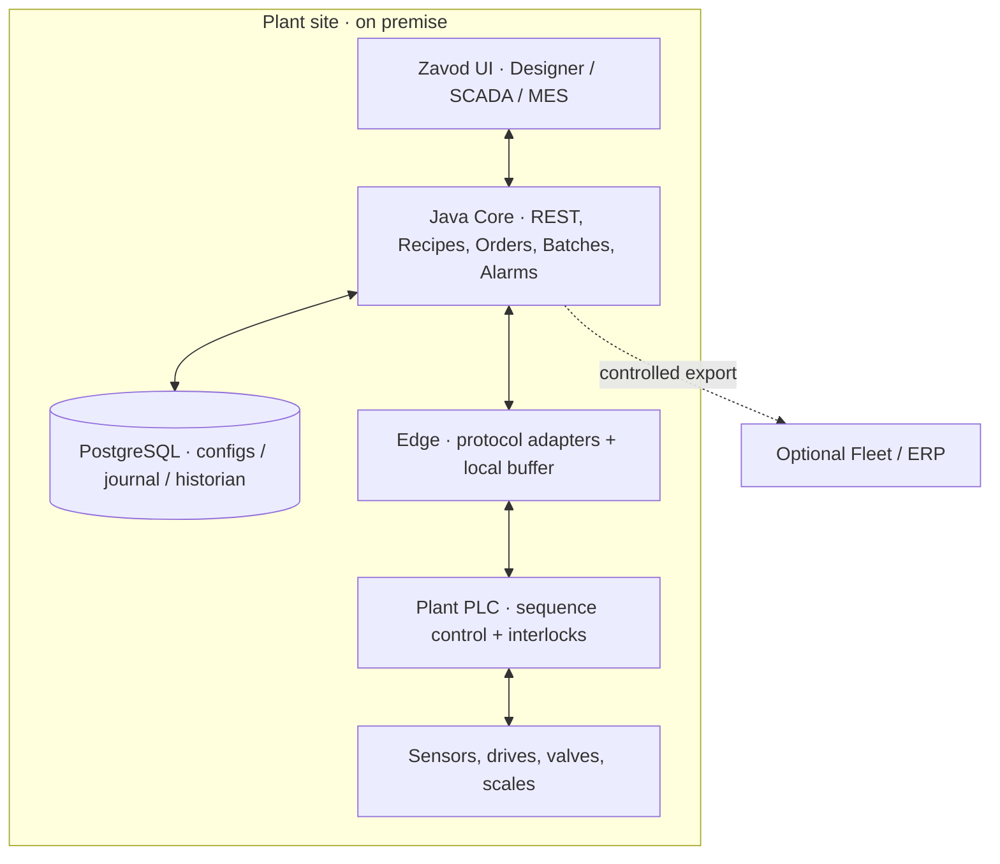

# Zavod IndustrialOS — Architecture Decision Record ADR-001

**Title:** On-prem-first modular-monolith core and safety-bounded industrial edge  
**Status:** PROPOSED  
**Date:** 2026-11-13

## Context

Zavod is intended for heterogeneous existing PLC installations. A generalized SaaS-only control plane, direct browser-to-PLC communication, and hard real-time control in Java create unacceptable dependencies between IT availability and safe industrial operations.

## Decision

1. **Safety-critical control** belongs to the installed, independently engineered PLC and its safety circuits. Zavod never overrides certified machine protections or PLC permissives.
2. **Site-local runtime:** equipment connectivity, operator HMI availability, alarms and essential manufacturing journaling reside at the plant. Remote fleet analytics is optional.
3. **Separate deployable Edge** with protocol adapters; start OPC UA and Modbus TCP. Edge defaults to read-only and has no arbitrary tag write API.
4. **Java modular monolith** for engineering and manufacturing workloads. Split into service deployments only after demonstrable isolation/scaling needs.
5. **Single source of truth for engineering configuration:** immutable LineRevision and explicit approval/activation workflow. SCADA screens are *views* of engineering model, not the model itself.
6. **Provenance on all telemetry:** signal ID, source timestamp, gateway timestamp, quality, unit, sequence, schema/config revision.
7. **Commands as business intents:** authorized, short-lived, idempotent, allowlisted, acknowledgable and audited. Enable only through a separately approved release after site-specific safety review.
8. **No implicit privilege from administrative role:** IT administrator is not automatically a control operator.
9. **Resilient offline operation:** local queue and replay; central network loss must not alter PLC safety behavior.
10. **No standards certification claims** until objectively demonstrated by accredited/qualified assessment where applicable.

## Logical view

The diagram represents **logical supervision** only; the system architecture, networking, and safety interlocks must be independently reviewed for each pilot. No Cloud-to-PLC command link.

## Consequences

**Advantages:** retrofit compatibility; separation of concerns; lower initial operational complexity; local survivability; better auditability; easier test-first development.

**Costs:** requires engineering and PLC expertise, device-specific testing, state reconciliation, rigorous operating procedures, site acceptance and hardened deployment; distributed state and historian require disciplined retention and buffering.

## Rejected alternatives

- **Microservices from R0:** extra operations and distributed failure paths without demonstrated scaling need.
- **Cloud-only SCADA:** introduces outage dependence and unacceptable OT connectivity complexity.
- **Front-end writes raw PLC tag addresses:** bypasses centralized permissions, interlock accountability and audit semantics.
- **Generic JSON graph as sole plant model:** confuses visualization, material paths, equipment identity and control IO mappings.
- **Custom PLC runtime replacing on-site safety control:** outside initial competence/qualification and product scope.

## Security baseline

Apply zones/conduits, asset inventory, remote-access procedures, identity and device-certificate lifecycle, secure backups, vulnerability response, least privilege and logging in accordance with local risk assessment. Reference ISA/IEC 62443 and NIST SP 800-82 Rev.3; conformance remains unverified until independently assessed.

## Review gates

- Product/PLC engineering approve responsibilities before deploying any read-only pilot.
- Integrations qualified with simulator and actual target PLC firmware.
- Limited supervisory control requires separate hazard analysis, interlock review and documented FAT/SAT.
