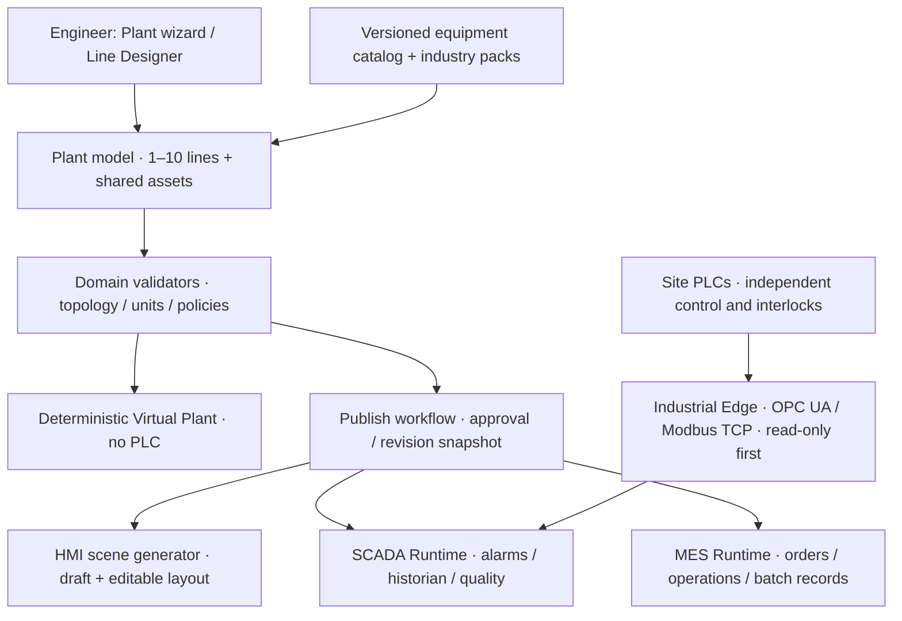
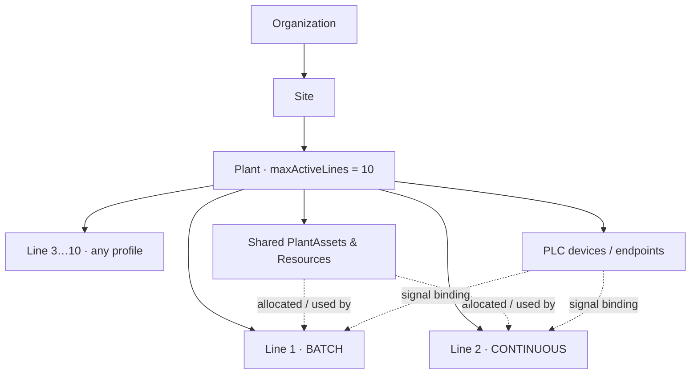

# Zavod IndustrialOS — Universal Industrial Builder: целевой дизайн R0.3

**Status:** DRAFT / Design proposal, 2026-11-13  
**Relation:** дополнение к [единому мастер-ТЗ](../requirements/R0-master-spec.md); основной контракт требований живёт в мастер-ТЗ.  
**Goal:** инженер без программирования создаёт площадку с **1–10 активными производственными линиями разных технологических типов**, формирует семантически корректную схему, тестирует её без PLC, затем в будущих релизах привязывает read-only сигналы и получает HMI. Никакой генерации safety PLC-программ.

## 1. Product outcome: один сквозной сценарий

**Результат, который должен получить пользователь:**

1. Создать организацию и площадку (Plant): «Завод №1».
2. Выбрать 1–10 линий; линии могут быть разных классов: BATCH / CONTINUOUS / DISCRETE / UTILITY.
3. Для каждой линии выбрать отраслевой шаблон или пустую конфигурацию.
4. Разместить Equipment из библиотеки и соединить **физические порты**; указать параметры в единицах измерения.
5. При необходимости подключить общий ресурс (силос, компрессор, водоснабжение) через PlantAsset/PlantResource и его интерфейсы.
6. Увидеть диагностические ошибки и исправить их. Сохранить DRAFT, даже если он неполный; запрещать PUBLISH/START, если есть блокирующие ошибки.
7. Запустить **виртуальную** сценарную симуляцию без подключения PLC.
8. Получить автоматически сгенерированную черновую HMI-мнемосхему из **утверждённой инженерной модели** с операторскими компонентами по каталожным типам; потом отредактировать оформление, не меняя физические соединения.
9. В будущем: привязать семантические сигналы к одному/нескольким PLC в режиме read-only; визуально показать timestamp, quality и stale-status.
10. В будущем: учитывать задания/операции с учётом профиля линии (batch recipes только для BATCH, throughput/counters для DISCRETE, trends/flows для CONTINUOUS).

Наличие автогенерации HMI не означает готового для производства экрана: требуется инженерное ревью, проверка тегов, операторских действий и alarm-политик.

## 2. Архитектурное правило: модель — первична, экраны — проекции



**Схема, физика, сигналы и интерфейс — четыре разных контракта**:
- **Engineering topology:** оборудование, порты, связи, ограничения и ресурсы.
- **Automation mapping:** контроллеры, теги, семантические SignalDefinition, SignalBinding, quality, scaling.
- **HMI presentation:** виджеты, расположение, сигнальные привязки, i18n, правила отображения; не источник истины физической топологии.
- **Operations:** процедура, рецепт, производственный заказ, запуск партии, результат; профильные расширения для разных типов линий.

## 3. Иерархия и владение объектами



| Entity | Primary fields | Decision / invariant |
|---|---|---|
| Plant | id, siteId, name, status, maxActiveLines | максимум 10 **активных** линий для первой редакции; 0 допустимо при создании DRAFT площадки, PUBLISH требует 1–10 |
| ProductionLine | id, plantId, name, profileKey, lifecycle | **profileKey у Line**, не plantType у Plant; независимые состояния и ревизии |
| LineRevision | id, lineId, revisionNo, catalogVersion, graph, validationStatus | immutable после APPROVED; ACTIVE ссылка только на утверждённую и совместимую ревизию |
| PlantRevision / PlantActivationSet | plantId, activatedLineRevisionIds, sharedAssetBindingVersion | согласованное активное сочетание конфигураций линий и общих ресурсов |
| EquipmentType | key, version, capabilities, ports, signalSchema, hmiTemplateKey | общие базовые типы, поддержка отраслевых расширений без пользовательского исполняемого кода |
| EquipmentInstance | id, equipmentType/version, lineId?, plantAssetId? | физический аппарат уникален как актив; графическая копия/line reference — не дублирование физического PLC-устройства |
| PlantAsset | id, plantId, equipmentType, assetCode | общий силос/насос/компрессор/линия подачи с собственной идентичностью |
| ResourceAllocation | id, assetId, lineId, mode, capacityConstraints | несколько линий могут ссылаться на ресурс; конфликтные требования требуют политики, в R0 только валидация и маркировка |
| Connection | sourceEquipmentPortRef, targetEquipmentPortRef, medium, capacity, unit | обычные внутриллинейные соединения в LineRevision; межлинейные/общие связи — через PlantAsset interfaces |
| Controller | id, siteId, protocol, endpoint, firmware, readOnly | **N:M:** линия может читать несколько PLC; один PLC может обслуживать несколько линий |
| SignalDefinition | signalKey, type, unit, qualityPolicy | семантический сигнал не равен vendor-specific Modbus register/OPC NodeId |
| SignalBinding | lineRevisionId / plantAssetVersion, signalKey, controllerTagId | переносимость редактора; version-bound mapping |
| HmiScene | id, sourceRevisionIds, generationVersion, layoutOverrides | регенерация не должна стирать подтверждённые UI override; операторская публикация — отдельный gate |

**Предел 10 — продуктовая политика первой версии**, не физический предел БД или максимальное число PLC. Backend и UI обязаны отвергать активацию 11-й линии предсказуемой ошибкой, не удаляя черновик; в будущих лицензиях лимит можно параметризовать через проверенную политику.

**Lifecycle линии:** DRAFT → IN_REVIEW → APPROVED → ACTIVE → SUPERSEDED / ARCHIVED. Действующая линия не редактируется напрямую.

## 4. Библиотека: единый Equipment Registry + технологические пакеты

**Core capabilities** (одинаковые во всех производствах):
- Equipment identity: name, assetTag, properties + units, states.
- Typed ports: material, electrical, instrument, pneumatic, hydraulic и т.д., direction and cardinality.
- Signal schema: RUNNING/STOPPED/FAULT, measurements with units, timestamp and quality; optional equipment-specific signals.
- HMI widget template: icons, statuses, alarm indicator, parameter panels.
- Domain validation contract and deterministic simulator stub.

**Industry profiles** (пакеты, не жёсткие классы `ConcretePlant`):
- `batch.concrete.v1`: силосы, весы, дозаторы, смесители, рецепты, партии.
- `batch.feed.v1`: загрузка компонентов, дозирование, дробление/смешивание, партии.
- `continuous.pump.v1`: насосы, клапаны, датчики давления/расхода, временные ряды.
- `discrete.packaging.v1`: конвейеры, счётчики изделий, упаковочные посты, производственные операции.
- `utility.common.v1`: общие услуги и ресурсы площадки.

В R0.3 сделать **два качественных пакета**, `batch.concrete.v1` и `continuous.pump.v1`; остальные — контракты/fixtures без обещания технологической готовности.

Профиль поставляет **версионированные декларативные** JSON Schemas, каталог оборудования, validators, HMI templates и fixtures; extensibility через кодируемый plugin SPI только после независимого review. Никаких произвольных пользовательских скриптов на PLC/Java в MVP.

## 5. Совместное оборудование и межлинейные зависимости

**Пример:** один общий силос цемента питает бетонные линии 1 и 2. Физический силос существует один раз в `PlantAsset`. Каждая линия ссылается на его выделенный интерфейс питания, а не копирует silos и теги. Даже если общая HMI показывает силос на двух экранах, assetId один.

Первый R0.3 реализует **модель и проверку конфликтов**; не реализует автоматическое управление общим устройством. В будущей MES ресурсная диспетчеризация вводит capacity, reservation, priority, interlocks и авторитетный PLC/status. Нельзя иметь два независимых программных `start` на один общий привод без отдельного инженерного решения.

## 6. Backend bounded contexts (modular monolith)

```
modules/
  identity/        # users, roles, plant-scope authorization
  engineering/     # plant, line, revisions, topology, approval
  catalog/         # template metadata and industry profiles
  simulation/      # deterministic virtual line, never physical commands
  automation/      # controllers, signals, mapping, quality
  scada/           # alarm/event/historian/HMI view projections
  operations/      # generic work orders, executions
  batch/           # batch-industry operations
  sharedresources/ # plant-wide assets and allocation policy
  audit/           # immutable operational/engineering audit
edge/              # separate Java deployable, no physical write in R2
web/               # React Designer / HMI / MES workspaces
```

Front-end should be separated by workspace (Plant Overview / Line Designer / Equipment Library / Signal Mapping / HMI Preview / SCADA Monitor / MES Operations). Do **not** create independent duplicate models in each workspace.

**Typical APIs (proposed, not implemented):**
- `POST /api/v1/plants`; `GET /api/v1/plants/{plantId}`
- `POST /api/v1/plants/{plantId}/lines`; `GET /api/v1/plants/{plantId}/lines`
- `PUT /api/v1/lines/{lineId}/draft` with ETag; `POST /api/v1/lines/{lineId}/validate`
- `POST /api/v1/lines/{lineId}/revisions/{revisionId}/submit-review`
- `POST /api/v1/plants/{plantId}/activation-sets/validate` then `.../activate` (separate approval)
- `POST /api/v1/simulations` with immutable revision snapshot, seed and scenario
- `GET /api/v1/plants/{plantId}/assets`; `GET /api/v1/catalog?profileKey=...`
- `POST /api/v1/hmi-scenes/preview`; `GET /api/v1/hmi-scenes/{sceneId}`
- `GET /api/v1/plants/{plantId}/status` (R2)
- `POST /api/v1/plants/{plantId}/signal-bindings/validate` (R2)

## 7. Designer UX / workflow

**Plant overview:** list 1–10 lines, type icon, engineering status, runtime quality, draft/active revision and last event. Add Line button displays templates + empty line. Disable *Activate* above limit; allow preserving an extra inactive draft until scope decision.

**Line Designer:** left equipment palette scoped by profile, center graph, right typed property/port editor, bottom validation findings. Support multi-select, undo/redo, copy/paste, saving invalid drafts, import preview, stable IDs and cross-line assets as reference nodes.

**HMI Preview:** auto-generate readonly visualization from approved engineering revision and equipment HMI templates. Distinguish a synthetic/virtual signal from physical signal by visible provenance and interface banner. Edit visual overrides separately; do not conflate canvas geometry and plant topology.

**Simulation:** virtual sensor model with seed, bounded step count and recorded events, no production PLC adapters in build/dependencies. Simulate each line independently first; later a plant-level simulation can reason about shared resources.

**Operations:** a generic execution records line, revision, operator, time, production quantity and status, with profile-specific payloads. Batch, discrete and continuous extensions may use different performance metrics.

## 8. Acceptance scenarios (NEW; use as RED contracts)

| ID | Scenario / oracle |
|---|---|
| SC-ML-001 | Create Plant with one BATCH line → publish valid PlantActivationSet |
| SC-ML-002 | Plant with 10 active lines of mixed profiles → validate and activate |
| SC-ML-003 | Attempt 11th active line → 409/domain error; active set remains unchanged |
| SC-ML-004 | Plant DRAFT with zero lines → save allowed, activation blocked |
| SC-ML-005 | Same plant contains concrete BATCH and pump CONTINUOUS; only concrete requires RecipeRevision |
| SC-ML-006 | One PLC endpoint serves tags from 2 lines without duplicate Controller entity |
| SC-ML-007 | A line consumes tags from 2 PLC endpoints without implicit machine write |
| SC-ML-008 | Two lines reference one shared PlantAsset; source assetId and telemetry are unique |
| SC-ML-009 | Two lines claim exclusive shared motor capability → activation blocked, code SHARED_RESOURCE_CONFLICT |
| SC-ML-010 | Drawing HMI object moved → no change to physical connections or signal binding semantics |
| SC-ML-011 | Equipment template upgrade cannot silently mutate existing ACTIVE revisions |
| SC-ML-012 | Generate HMI from approved line; flags display VIRTUAL/BAD/STALE and source timestamps correctly |
| SC-ML-013 | Repeat HMI generation and preserve reviewed layout override IDs deterministically |
| SC-ML-014 | Incomplete/invalid topology can be DRAFT but cannot start simulation or become ACTIVE |
| SC-ML-015 | Cross-plant asset/tag references rejected by backend access control |
| SC-ML-016 | Editing second line cannot change approved revision of first line |
| SC-ML-017 | Incompatible shared-asset revision against line revisions blocks PlantActivationSet |
| SC-ML-018 | Changing a shared resource requires cross-line impact report before activation |
| SC-ML-019 | Batch report references exact PlantActivationSet, LineRevision, RecipeRevision and measurement provenance |
| SC-ML-020 | Kill browser/backend/Edge during read-only simulation → physical PLC continues unaffected; no write attempt |

For all scenarios track Requirement ID → Test ID → execution SHA/CI → Review. Tests marked PLANNED until implemented and run.

## 9. Delivery, no premature multi-industry complexity

1. **R0.1 import qualification:** import standalone prototype to Zavod, pin lockfile, run typecheck/unit/build/Playwright, prove exact baseline.
2. **R0.2:** explicit ports, completeness validator, deterministic simulation, undo/redo and recovery from previous RED suite.
3. **R0.3A:** Plant 1–10 lines, `LineProfile`, mixed BATCH+CONTINUOUS, 10-line tests, shared PlantAsset references.
4. **R0.3B:** declarative equipment packs and catalog versioning, per-line HMI preview and stable layout generation.
5. **R1:** authoritative Java/PostgreSQL PlantActivationSet, revision publishing, audit/permissions and validated API.
6. **R2:** Simulator → OPC UA/Modbus read-only signals, quality, historian, alarms, certified-independent PLC safety remains external.
7. **R3:** Generic operations + concrete BATCH MES vertical; other MES industry packs after evidence from real pilots.

## 10. Product acceptance demonstration (target outcome)

Demo plant «Pilot-Z» has:
- Line A: concrete BATCH, silos/scales/mixer, virtual batch records.
- Line B: pump CONTINUOUS, tank/pump/flow/pressure sensors.
- One shared utility asset referenced by both.
- Both lines visible on Plant Overview, independently editable and simulated.
- HMI scenes generated from approved engineering revision with virtual signal quality badges.
- Save → close → reopen → same schema/links/IDs, no lost references.
- Separate test creates ten valid lines; adding an eleventh active line fails with explainable error.
- No connection to physical PLC, no safety or commissioning claims.

**Definition of Done:** artifacts exist in repo, RED→GREEN tests and browser journey evidence, no undocumented cross-line state, independent engineering/security review for future OT connectivity.

## 11. Decision points

- DEC-ML-01: `maxActiveLines=10` is first-release business policy; author a separate ADR before licencing variants.
- DEC-ML-02: shared equipment is a PlantAsset with references, not multiple independent copies.
- DEC-ML-03: controller topology is site-scoped N:M with lines, not `lineId` embedded in controller.
- DEC-ML-04: publishing a line is distinct from activating a compatible PlantActivationSet.
- DEC-ML-05: initial real read-only integration remains out of R0.3; no command-capable generator.
- DEC-ML-06: only two complete industry packs in R0.3; other profiles are design stubs until separately qualified.

## Reference framework

- ISA-95 enterprise-control integration, applies across discrete and continuous processes: https://www.isa.org/standards-and-publications/isa-standards/isa-95-standard
- ISA-88 batch/equipment separation: https://www.isa.org/standards-and-publications/isa-standards/isa-88-standards
- OPC UA semantic information models/companion specifications: https://opcfoundation.org/about/opc-technologies/opc-ua/ua-companion-specifications/
- NIST SP 800-82 Rev.3 industrial-control cyber guidance: https://csrc.nist.gov/pubs/sp/800/82/r3/final
